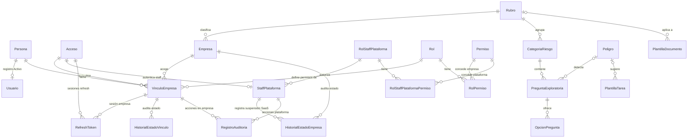
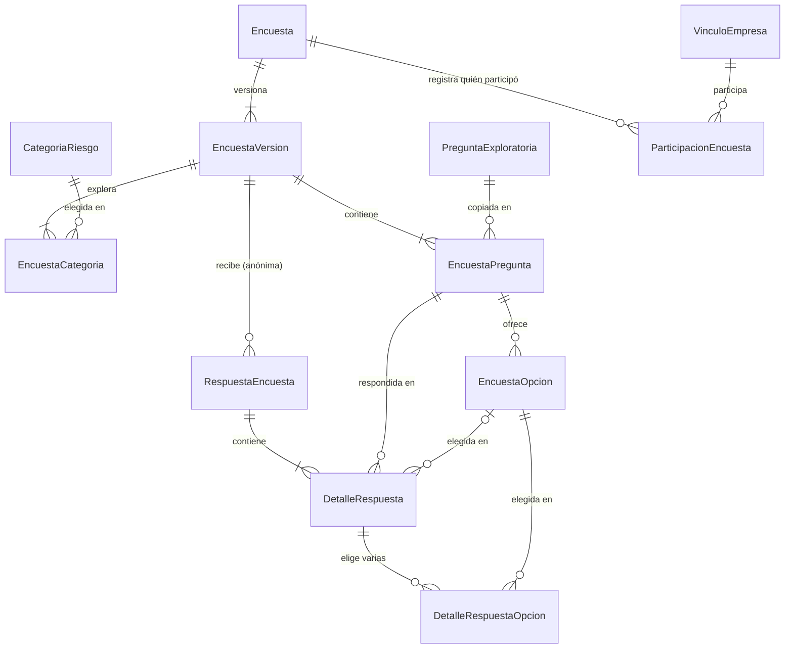
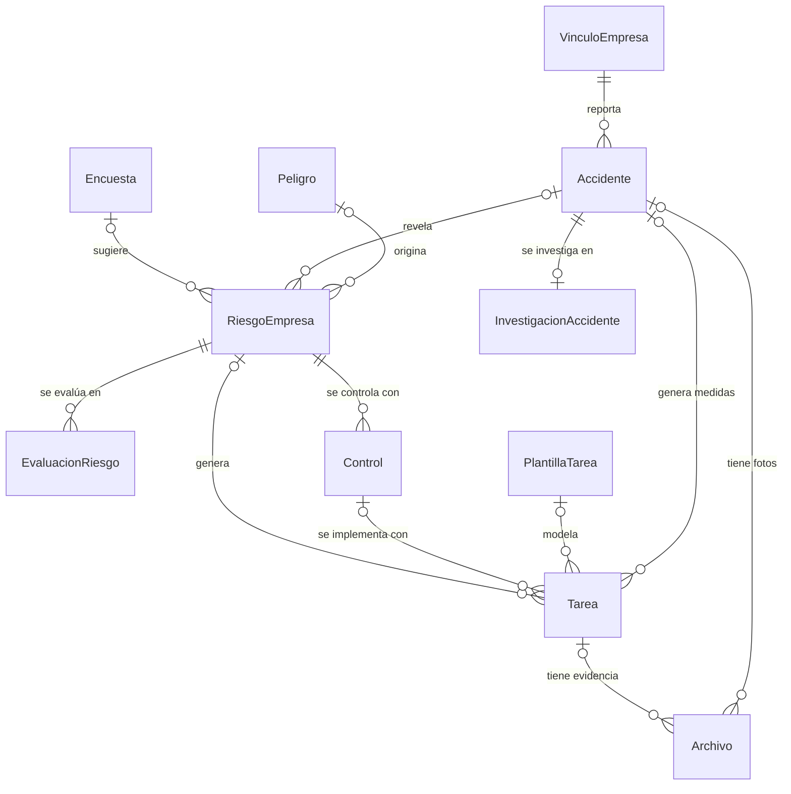
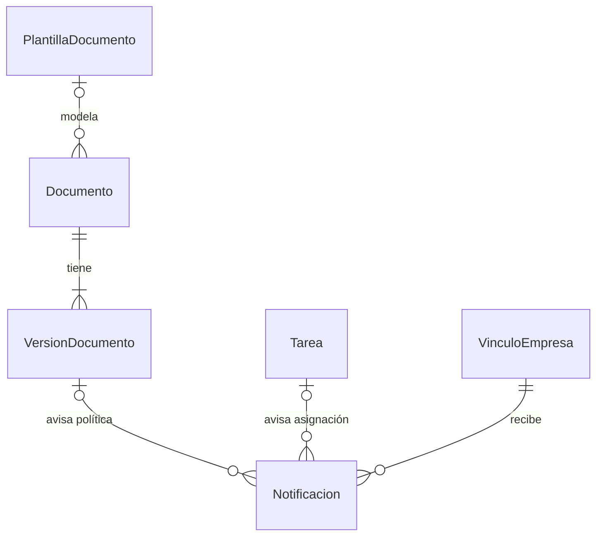

# Modelo de datos

**Para qué sirve:** define todas las tablas de Norvia, sus columnas, relaciones, restricciones e índices. Es la base del diagrama entidad-relación (ERD) que exige el curso y de la implementación con EF Core.

El modelo aplica las [decisiones](08-decisiones-bd.md) D1 a D28 y las [reglas de negocio](07-reglas-negocio.md). Parte de las [entidades candidatas](09-entidades.md) y agrega tablas que el diseño hizo necesarias: OpcionPregunta, EncuestaVersion, EncuestaOpcion, DetalleRespuestaOpcion, ParticipacionEncuesta, Persona, **Acceso**, `VinculoEmpresa`, `StaffPlataforma`, **RefreshToken**, historiales de estado y RBAC (`Permiso`, `RolPermiso`, `RolStaffPlataformaPermiso`).

Tiene **41 tablas**. Tras la reducción de alcance del 13-11-2026 no hay áreas, ni integración con Google, ni tablas de comisión, equipos, EPP, personas afectadas o informes; la lista de tablas retiradas está en [entidades](09-entidades.md#recortadas-13-11-2026).

### Nombres de persona (3FN)

Los nombres se guardan en cuatro columnas en `Persona`. **No** existe `NombreCompleto` en base de datos; la aplicación lo concatena al mostrar (RN-62).

## 1. Convenciones

### Nombres y tipos

- Tablas y columnas en español, con PascalCase, igual que las clases de C#: `RiesgoEmpresa`, `FechaLimite`.
- La llave foránea se llama como la tabla a la que apunta, más `Id`: `PeligroId` apunta a `Peligro`.
- Los tipos son los de PostgreSQL.

| Tipo | Uso |
|---|---|
| `uuid` | Llaves primarias. Un UUID es un identificador único generado al azar, que no revela cuántos registros existen |
| `smallint` | Llaves de catálogos pequeños (Rol, Rubro) y valores de 1 a 5 |
| `varchar(n)` | Texto corto con largo máximo |
| `text` | Texto largo |
| `date` | Fecha sin hora |
| `timestamptz` | Fecha y hora, guardada en UTC |
| `boolean` | Sí o no |
| `bytea` | Datos binarios, como credenciales cifradas |
| `jsonb` | Datos estructurados libres; solo se usa en la auditoría |

### Valores con opciones fijas

Los estados y tipos se guardan como texto en minúsculas, sin tildes, con una restricción `CHECK`. Una restricción `CHECK` es una condición que la base de datos verifica en cada fila; si no se cumple, rechaza el cambio.

Ejemplo: `Estado varchar(15) CHECK (Estado IN ('pendiente','en_progreso','completada','cancelada'))`.

En EF Core se mapean como `enum` de C# convertidos a texto.

### Claves en las tablas

| Marca | Significado |
|---|---|
| PK | Llave primaria |
| FK | Llave foránea |
| UQ | Valor único |
| NN | Obligatorio (`NOT NULL`) |

En los diccionarios, la columna **Nulo** dice "No" si el dato es obligatorio y "Sí" si es opcional.

### Fechas que fija el servidor

Las columnas que terminan en `En`, como `CreadoEn` o `RegistradoEn`, toman la hora del servidor (`DEFAULT now()`) y nunca la que envía el cliente.

## 2. Aislamiento entre empresas

| Tipo de tabla | Tiene `EmpresaId` | Tablas |
|---|---|---|
| Raíz | Es la empresa | Empresa |
| Global | No | Persona, Usuario, Acceso, RefreshToken, StaffPlataforma, RolStaffPlataforma, Rol, Permiso, RolPermiso, RolStaffPlataformaPermiso, Rubro, CategoriaRiesgo, PreguntaExploratoria, OpcionPregunta, Peligro, PlantillaTarea, PlantillaDocumento |
| De empresa | Sí, obligatorio | Las demás tablas operativas (incluye VinculoEmpresa y historiales) |

Reglas que cumplen todas las tablas de empresa:

1. **`EmpresaId` es obligatorio** y es FK hacia `Empresa`.
2. **Cada tabla tiene un valor único compuesto `(EmpresaId, Id)`**, además de su PK. Esto permite que otras tablas apunten a ella incluyendo la empresa.
3. **Las FK entre tablas de empresa son compuestas:** incluyen `EmpresaId`. Por ejemplo, `Tarea (EmpresaId, RiesgoEmpresaId) → RiesgoEmpresa (EmpresaId, Id)`. Así la base de datos rechaza que una tarea de la empresa A apunte a un riesgo de la empresa B (decisión D15, regla RN-07). En los diccionarios se marcan como "FK compuesta".
4. **Las personas con operación en la empresa se referencian a través de su vínculo.** Una columna como `ResponsableId` es FK compuesta hacia `VinculoEmpresa (EmpresaId, Id)`. Así solo se asigna a quien tiene vínculo en esa empresa.
5. **EF Core aplica un filtro global** (`HasQueryFilter`) en cada tabla de empresa, usando el **`EmpresaId` del JWT** (un vínculo = una empresa por sesión; sin selector).
6. **`EmpresaId` se asigna al guardar** desde el token autenticado, nunca desde lo que envía el cliente (RN-06).

Las referencias desde tablas de empresa hacia tablas globales son FK simples, por ejemplo `RiesgoEmpresa.PeligroId → Peligro.Id`.

## 3. Diagramas

Los diagramas están separados por tema para que sean legibles. Solo muestran relaciones; las columnas están en el diccionario. Las tablas de empresa referencian a quien actuó mediante **`VinculoEmpresa`** (FK compuesta). **`Usuario`** indica si la **persona** sigue habilitada en la plataforma (`Activo`); **`VinculoEmpresa.Estado`** indica si puede entrar a **esa** empresa. **`StaffPlataforma`** es el login del staff Norvia. Las FK a `Empresa` se omiten en los dibujos para no saturarlos.

Cardinalidades: `||` es exactamente uno, `o|` es cero o uno, `o{` es cero o muchos y `|{` es uno o muchos.

### 3.1 Acceso, empresa y catálogos

### 3.2 Encuestas dinámicas

`ParticipacionEncuesta` y `RespuestaEncuesta` **no** están relacionadas entre sí: así no se puede saber qué respondió cada persona (D27).

### 3.3 Riesgos, plan de trabajo y accidentes

### 3.4 Documentos y notificaciones

## 4. Diccionario de datos

### 4.1 Tablas globales

#### Persona

Identidad humana (D19, D21). Sin correo ni contraseña.

| Columna | Tipo | Nulo | Clave | Descripción y restricciones |
|---|---|---|---|---|
| Id | uuid | No | PK | |
| PrimerNombre | varchar(80) | No | | |
| SegundoNombre | varchar(80) | Sí | | |
| PrimerApellido | varchar(80) | No | | |
| SegundoApellido | varchar(80) | Sí | | |
| TipoDocumento | varchar(15) | Sí | | `dni`, `pasaporte`, `otro` |
| NumeroDocumento | varchar(50) | Sí | | |
| Telefono | varchar(30) | Sí | | |
| CreadoEn | timestamptz | No | | Lo fija el servidor |

**Restricciones:** UQ `(TipoDocumento, NumeroDocumento)` cuando ambos tienen valor.

#### Usuario

Registro global de la persona en Norvia (D21). **No** guarda correo ni contraseña; las credenciales están en **Acceso** y el permiso por empresa en `VinculoEmpresa`. Sirve para saber si la persona sigue **activa en la plataforma** antes de validar un vínculo.

| Columna | Tipo | Nulo | Clave | Descripción y restricciones |
|---|---|---|---|---|
| Id | uuid | No | PK | |
| PersonaId | uuid | No | FK → Persona, UQ | Una fila por persona que usa la app |
| Activo | boolean | No | | Por defecto `true`; `false` bloquea cualquier vínculo de esa persona |
| CreadoEn | timestamptz | No | | |

Quien solo existe como **Persona** **no** tiene fila `Usuario` hasta que se le da un vínculo o se registra explícitamente.

#### Acceso

Credenciales globales (D21, D25). Un correo, un hash de contraseña; varios **VinculoEmpresa** pueden compartir el mismo `AccesoId` si usan el mismo correo institucional.

| Columna | Tipo | Nulo | Clave | Descripción y restricciones |
|---|---|---|---|---|
| Id | uuid | No | PK | |
| Email | varchar(254) | No | UQ | Minúsculas; CHECK `Email = lower(Email)` |
| PasswordHash | varchar(255) | No | | |
| DebeCambiarPassword | boolean | No | | Por defecto `false` |
| Verificado | boolean | No | | Por defecto `false`; RN-67 |
| CreadoEn | timestamptz | No | | Lo fija el servidor |

#### RefreshToken

Persistencia de **refresh** únicamente (D25). El JWT de access **no** se guarda.

| Columna | Tipo | Nulo | Clave | Descripción y restricciones |
|---|---|---|---|---|
| Id | uuid | No | PK | |
| AccesoId | uuid | No | FK → Acceso | |
| VinculoEmpresaId | uuid | Sí | FK → VinculoEmpresa | Nulo en sesión solo plataforma |
| TokenHash | varchar(64) | No | UQ | Hash del refresh (p. ej. SHA-256 en hex) |
| TipoSesion | varchar(12) | No | | `empresa` o `plataforma` |
| ExpiraEn | timestamptz | No | | |
| CreadoEn | timestamptz | No | | Lo fija el servidor |

**Comportamiento (App):** refresh válido elimina la fila anterior y crea otra; logout elimina la fila (RN-66).

#### StaffPlataforma

Fila de **staff / soporte Norvia** (D21, D23). Credenciales en **Acceso**; relación 1:1 opcional `Acceso` ↔ `StaffPlataforma`. No es vínculo de empresa y **no** asigna `RolId` a terceros.

| Columna | Tipo | Nulo | Clave | Descripción y restricciones |
|---|---|---|---|---|
| Id | uuid | No | PK | |
| AccesoId | uuid | No | FK → Acceso, UQ | Un staff por **Acceso** |
| RolStaffPlataformaId | smallint | No | FK → RolStaffPlataforma | |
| Activo | boolean | No | | Por defecto `true` |
| CreadoEn | timestamptz | No | | |

#### RolStaffPlataforma

Permisos globales (catálogos, listar empresas, suspender tenant). Separado de **Rol** de empresa.

| Columna | Tipo | Nulo | Clave | Descripción y restricciones |
|---|---|---|---|---|
| Id | smallint | No | PK | |
| Codigo | varchar(30) | No | UQ | `admin_plataforma`, `soporte_plataforma` |
| Nombre | varchar(60) | No | | |

#### Rol

Rol **dentro de una empresa** (`VinculoEmpresa.RolId`). Quien gestiona vínculos y roles de su tenant es un vínculo con rol `admin_empresa`, no una cuenta de plataforma.

| Columna | Tipo | Nulo | Clave | Descripción y restricciones |
|---|---|---|---|---|
| Id | smallint | No | PK | |
| Codigo | varchar(30) | No | UQ | `admin_empresa`, `responsable_sst`, `colaborador`, `encuestado` (RN-74) |
| Nombre | varchar(60) | No | | Nombre visible |

#### Permiso

Catálogo de operaciones de la API (D20, D23, D24, HU-014). Una fila describe **qué endpoint** existe y **en qué tipo de sesión** aplica.

**Qué es `Alcance`:** clasifica el permiso, no la tabla de login.

| Valor de `Alcance` | Significado | Quién inicia sesión | Tabla de enlace rol–permiso |
|---|---|---|---|
| `empresa` | Operación dentro de un tenant (`EmpresaId` del token) | `VinculoEmpresa` | **RolPermiso** (`Rol` de empresa) |
| `plataforma` | Operación global (catálogos, listado de tenants, suspensión SaaS) sin datos SST de clientes | **`StaffPlataforma`** | **RolStaffPlataformaPermiso** |

El literal `plataforma` en **`Permiso.Alcance`** no renombra la tabla **`StaffPlataforma`** (cuenta del staff). Son capas distintas: **permiso** = qué ruta se puede llamar; **StaffPlataforma** = credencial del equipo Norvia.

| Columna | Tipo | Nulo | Clave | Descripción y restricciones |
|---|---|---|---|---|
| Id | smallint | No | PK | |
| Codigo | varchar(60) | No | UQ | Identificador estable |
| Nombre | varchar(120) | No | | |
| Alcance | varchar(10) | No | | `empresa` o `plataforma` (CHECK) — ver tabla anterior (D24) |
| MetodoHttp | varchar(10) | No | | `GET`, `POST`, `PUT`, `PATCH`, `DELETE` |
| RutaPatron | varchar(200) | No | | Ejemplo: `/api/riesgos/*` |
| Activo | boolean | No | | Por defecto `true` |

#### RolPermiso

Solo permisos con `Alcance = empresa` (RN-63).

| Columna | Tipo | Nulo | Clave | Descripción y restricciones |
|---|---|---|---|---|
| RolId | smallint | No | PK, FK → Rol | |
| PermisoId | smallint | No | PK, FK → Permiso | |

#### RolStaffPlataformaPermiso

Solo permisos con `Alcance = plataforma` (RN-63). La sesión proviene de **StaffPlataforma** (RN-64).

| Columna | Tipo | Nulo | Clave | Descripción y restricciones |
|---|---|---|---|---|
| RolStaffPlataformaId | smallint | No | PK, FK → RolStaffPlataforma | |
| PermisoId | smallint | No | PK, FK → Permiso | |

#### Rubro

| Columna | Tipo | Nulo | Clave | Descripción y restricciones |
|---|---|---|---|---|
| Id | smallint | No | PK | |
| Codigo | varchar(30) | No | UQ | `oficina`, `comercio`, `maquila_fabrica`, `construccion` |
| Nombre | varchar(80) | No | UQ | |
| Activo | boolean | No | | Por defecto `true` |

#### CategoriaRiesgo

Categorías de riesgo de cada rubro, como trabajo en alturas o alto voltaje.

| Columna | Tipo | Nulo | Clave | Descripción y restricciones |
|---|---|---|---|---|
| Id | uuid | No | PK | |
| RubroId | smallint | No | FK → Rubro | |
| Nombre | varchar(100) | No | | |
| Descripcion | text | Sí | | |
| Activa | boolean | No | | Por defecto `true` |

**Restricciones:** UQ `(RubroId, Nombre)`.

#### Peligro

| Columna | Tipo | Nulo | Clave | Descripción y restricciones |
|---|---|---|---|---|
| Id | uuid | No | PK | |
| Codigo | varchar(20) | No | UQ | |
| Nombre | varchar(150) | No | | |
| Descripcion | text | Sí | | |
| Clasificacion | varchar(15) | No | | `fisico`, `mecanico`, `electrico`, `quimico`, `biologico`, `ergonomico`, `psicosocial`, `locativo`, `otro` |
| Activo | boolean | No | | Por defecto `true` |

#### PreguntaExploratoria

Preguntas de cada categoría. El tipo define cómo se muestra y se valida en el formulario dinámico (D26, RN-68). Si la pregunta detecta un peligro, se indica cuál (D7).

| Columna | Tipo | Nulo | Clave | Descripción y restricciones |
|---|---|---|---|---|
| Id | uuid | No | PK | |
| CategoriaRiesgoId | uuid | No | FK → CategoriaRiesgo | |
| Texto | varchar(500) | No | | |
| TipoRespuesta | varchar(25) | No | | `respuesta_breve`, `seleccion_unica`, `seleccion_multiple` |
| Obligatoria | boolean | No | | Por defecto `true` (RN-69) |
| Orden | smallint | No | | Posición dentro de la categoría |
| PeligroId | uuid | Sí | FK → Peligro | Peligro que detecta, si aplica |
| Activa | boolean | No | | Por defecto `true` |

**Restricciones:**

- UQ `(CategoriaRiesgoId, Orden)`.
- CHECK: si `TipoRespuesta = 'respuesta_breve'`, `PeligroId` es nulo, porque una respuesta libre no puede indicar exposición.
- Las preguntas de selección deben tener opciones en OpcionPregunta; las de respuesta breve no. Lo valida la aplicación.

#### OpcionPregunta

Opciones de respuesta de las preguntas de selección. Está en una tabla aparte para cumplir la primera forma normal: una pregunta tiene varias opciones.

| Columna | Tipo | Nulo | Clave | Descripción y restricciones |
|---|---|---|---|---|
| Id | uuid | No | PK | |
| PreguntaExploratoriaId | uuid | No | FK → PreguntaExploratoria | |
| Texto | varchar(200) | No | | |
| Orden | smallint | No | | |
| IndicaExposicion | boolean | No | | Por defecto `false`. `true` si elegir esta opción sugiere el peligro de la pregunta |

**Restricciones:** UQ `(PreguntaExploratoriaId, Orden)`. Solo las preguntas de selección (`seleccion_unica`, `seleccion_multiple`) tienen opciones; lo valida la aplicación.

#### PlantillaTarea

Tareas modelo que se generan a partir de un peligro.

| Columna | Tipo | Nulo | Clave | Descripción y restricciones |
|---|---|---|---|---|
| Id | uuid | No | PK | |
| PeligroId | uuid | Sí | FK → Peligro | Peligro al que responde |
| TipoControl | varchar(15) | Sí | | Mismos valores que `Control.Tipo` |
| Titulo | varchar(200) | No | | |
| Descripcion | text | Sí | | |
| PrioridadSugerida | smallint | No | | CHECK entre 1 (alta) y 3 (baja) |
| RequiereEvidencia | boolean | No | | Por defecto `false` |
| Activa | boolean | No | | Por defecto `true` |

#### PlantillaDocumento

Políticas y procedimientos modelo.

| Columna | Tipo | Nulo | Clave | Descripción y restricciones |
|---|---|---|---|---|
| Id | uuid | No | PK | |
| Codigo | varchar(30) | No | UQ | |
| Titulo | varchar(200) | No | | |
| TipoDocumento | varchar(15) | No | | `politica`, `procedimiento` |
| RubroId | smallint | Sí | FK → Rubro | Nulo si aplica a todos los rubros |
| Contenido | text | No | | Texto con marcadores que se reemplazan por datos de la empresa, como `{{RazonSocial}}` |
| Activa | boolean | No | | Por defecto `true` |

### 4.2 Tabla raíz

#### Empresa

| Columna | Tipo | Nulo | Clave | Descripción y restricciones |
|---|---|---|---|---|
| Id | uuid | No | PK | |
| RazonSocial | varchar(200) | No | | |
| RTN | char(14) | No | UQ | CHECK: 14 dígitos (RN-01) |
| Direccion | varchar(300) | Sí | | Aparece en el encabezado de la matriz impresa |
| ActividadEconomica | varchar(150) | Sí | | |
| RubroId | smallint | Sí | FK → Rubro | Nulo hasta completar el perfil (RN-09) |
| TrabajadoresPermanentes | integer | Sí | | CHECK `>= 0` |
| FechaInicioOperaciones | date | Sí | | Dato informativo del perfil |
| Estado | varchar(12) | No | | `activa`, `suspendida`, `inactiva` (D22, RN-60) |
| CreadaEn | timestamptz | No | | Lo fija el servidor |

### 4.3 Tablas de empresa

En todas: `Id uuid` es la PK, `EmpresaId uuid` es obligatorio y es FK hacia `Empresa`, y existe UQ `(EmpresaId, Id)`. Las tablas con PK compuesta lo indican.

#### VinculoEmpresa

Relación persona–empresa con rol y referencia a **Acceso** (D1, D21). El correo institucional del login es `Acceso.Email`.

| Columna | Tipo | Nulo | Clave | Descripción y restricciones |
|---|---|---|---|---|
| Id | uuid | No | PK | |
| EmpresaId | uuid | No | FK → Empresa | |
| PersonaId | uuid | No | FK → Persona | |
| AccesoId | uuid | No | FK → Acceso | |
| RolId | smallint | No | FK → Rol | |
| Estado | varchar(12) | No | | `activo`, `suspendido`, `baja` — activo **en esta empresa** (distinto de `Usuario.Activo`) |
| CreadoEn | timestamptz | No | | |

**Restricciones:**

- UQ `(EmpresaId, PersonaId)`: una persona, un vínculo por empresa.
- UQ `(EmpresaId, AccesoId)`: un mismo **Acceso** solo puede tener un vínculo por empresa (RN-57).
- Destino de FK compuestas operativas (`ResponsableId`, etc.).
- Al menos un vínculo `activo` con rol admin por empresa (RN-08): lo valida la aplicación.

#### HistorialEstadoVinculo

Auditoría de cambios de estado del vínculo (D22, RN-59).

| Columna | Tipo | Nulo | Clave | Descripción y restricciones |
|---|---|---|---|---|
| Id | uuid | No | PK | |
| EmpresaId | uuid | No | FK → Empresa | |
| VinculoEmpresaId | uuid | No | FK compuesta → VinculoEmpresa | |
| EstadoAnterior | varchar(12) | Sí | | Nulo en el primer registro |
| EstadoNuevo | varchar(12) | No | | |
| MotivoCodigo | varchar(30) | No | | `decision_admin`, `baja_laboral`, `falta_pago_empresa`, `otro` |
| MotivoDetalle | text | Sí | | |
| RegistradoPorId | uuid | No | FK compuesta → VinculoEmpresa | |
| RegistradoEn | timestamptz | No | | |

#### HistorialEstadoEmpresa

Suspensión o reactivación del tenant (D22).

| Columna | Tipo | Nulo | Clave | Descripción y restricciones |
|---|---|---|---|---|
| Id | uuid | No | PK | |
| EmpresaId | uuid | No | FK → Empresa | |
| EstadoAnterior | varchar(12) | Sí | | |
| EstadoNuevo | varchar(12) | No | | |
| MotivoCodigo | varchar(30) | No | | `falta_pago_plataforma`, `reactivacion`, `otro` |
| MotivoDetalle | text | Sí | | |
| RegistradoPorId | uuid | Sí | FK → StaffPlataforma | Staff Norvia; nulo si es proceso automático |
| RegistradoEn | timestamptz | No | | |

#### RegistroAuditoria

Acciones importantes, para que la evidencia sea verificable.

| Columna | Tipo | Nulo | Clave | Descripción y restricciones |
|---|---|---|---|---|
| Id | uuid | No | PK | |
| EmpresaId | uuid | No | FK → Empresa | |
| VinculoEmpresaId | uuid | Sí | FK compuesta → VinculoEmpresa | Quien actuó en la empresa |
| StaffPlataformaId | uuid | Sí | FK → StaffPlataforma | Solo acciones del staff Norvia |
| Accion | varchar(50) | No | | Por ejemplo `acta_firmada` |
| Entidad | varchar(60) | No | | Tabla afectada |
| EntidadId | uuid | No | | Registro afectado; sin FK, porque puede apuntar a cualquier tabla |
| Fecha | timestamptz | No | | |
| Detalle | jsonb | Sí | | Datos adicionales de la acción |

**Restricciones:** la aplicación solo inserta; nunca actualiza ni borra.

#### Encuesta

Cada encuesta creada y respondida dentro de Norvia (D8). Su contenido está en sus versiones.

| Columna | Tipo | Nulo | Clave | Descripción y restricciones |
|---|---|---|---|---|
| Id | uuid | No | PK | |
| EmpresaId | uuid | No | FK → Empresa | |
| Titulo | varchar(200) | No | | |
| Estado | varchar(10) | No | | `borrador` (ninguna versión publicada aún), `publicada`, `cerrada` (RN-70) |
| CreadaPorId | uuid | No | FK compuesta → VinculoEmpresa | |
| CreadaEn | timestamptz | No | | |
| CerradaEn | timestamptz | Sí | | |

**Restricciones:** CHECK: `CerradaEn` tiene valor si y solo si `Estado = 'cerrada'`.

#### EncuestaVersion

Versión del cuestionario (D8, RN-12). Editar una encuesta publicada crea una versión nueva en borrador; solo la versión publicada se muestra a los encuestados.

| Columna | Tipo | Nulo | Clave | Descripción y restricciones |
|---|---|---|---|---|
| Id | uuid | No | PK | |
| EmpresaId | uuid | No | FK → Empresa | |
| EncuestaId | uuid | No | FK compuesta → Encuesta | |
| NumeroVersion | integer | No | | CHECK `>= 1` |
| Instrucciones | text | Sí | | Texto que ve el encuestado antes de responder |
| Estado | varchar(12) | No | | `borrador`, `publicada`, `reemplazada` |
| CreadaPorId | uuid | No | FK compuesta → VinculoEmpresa | |
| CreadaEn | timestamptz | No | | |
| PublicadaEn | timestamptz | Sí | | |

**Restricciones:**

- UQ `(EncuestaId, NumeroVersion)`.
- UQ parcial `(EncuestaId) WHERE Estado = 'publicada'`: una sola versión disponible para responder.
- UQ parcial `(EncuestaId) WHERE Estado = 'borrador'`: un solo borrador a la vez.
- CHECK: `PublicadaEn` tiene valor si `Estado` es `publicada` o `reemplazada`.
- Una versión publicada o reemplazada no cambia sus preguntas; lo valida la aplicación.

#### EncuestaCategoria

Categorías elegidas para cada versión de encuesta. Resuelve la relación muchos a muchos entre EncuestaVersion y CategoriaRiesgo.

| Columna | Tipo | Nulo | Clave | Descripción y restricciones |
|---|---|---|---|---|
| EncuestaVersionId | uuid | No | PK, FK compuesta → EncuestaVersion | |
| CategoriaRiesgoId | uuid | No | PK, FK → CategoriaRiesgo | |
| EmpresaId | uuid | No | FK → Empresa | |

**Restricciones:** PK `(EncuestaVersionId, CategoriaRiesgoId)`. La categoría debe pertenecer al rubro de la empresa (RN-11); lo valida la aplicación.

#### EncuestaPregunta

Copia de cada pregunta en una versión (RN-12), con su tipo, para que los cambios del catálogo o de la encuesta no alteren respuestas anteriores. El formulario dinámico se arma a partir de esta tabla y de EncuestaOpcion.

| Columna | Tipo | Nulo | Clave | Descripción y restricciones |
|---|---|---|---|---|
| Id | uuid | No | PK | |
| EmpresaId | uuid | No | FK → Empresa | |
| EncuestaVersionId | uuid | No | FK compuesta → EncuestaVersion | |
| PreguntaExploratoriaId | uuid | Sí | FK → PreguntaExploratoria | Pregunta de origen; nulo si la agregó el Responsable SST al editar |
| Texto | varchar(500) | No | | Copia del texto, editable mientras la versión está en borrador |
| TipoRespuesta | varchar(25) | No | | `respuesta_breve`, `seleccion_unica` o `seleccion_multiple` |
| Obligatoria | boolean | No | | |
| PeligroId | uuid | Sí | FK → Peligro | Copia del peligro asociado |
| Orden | smallint | No | | Posición en la versión |

**Restricciones:**

- UQ `(EncuestaVersionId, Orden)`.
- UQ `(EncuestaVersionId, Id)`, para que una respuesta verifique que la pregunta es de su versión.
- CHECK: si `TipoRespuesta = 'respuesta_breve'`, `PeligroId` es nulo.

#### EncuestaOpcion

Copia de las opciones de cada pregunta de selección.

| Columna | Tipo | Nulo | Clave | Descripción y restricciones |
|---|---|---|---|---|
| Id | uuid | No | PK | |
| EmpresaId | uuid | No | FK → Empresa | |
| EncuestaPreguntaId | uuid | No | FK compuesta → EncuestaPregunta | |
| Texto | varchar(200) | No | | |
| Orden | smallint | No | | |
| IndicaExposicion | boolean | No | | Copia del valor del catálogo |

**Restricciones:** UQ `(EncuestaPreguntaId, Orden)` y UQ `(EncuestaPreguntaId, Id)`; esta última permite verificar que la opción elegida pertenezca a su pregunta.

#### ParticipacionEncuesta

Registra **quién** ya respondió una encuesta, sin decir **qué** respondió (D27, RN-71, RN-72). Se inserta en la misma transacción que la respuesta, pero no tiene relación con ella.

| Columna | Tipo | Nulo | Clave | Descripción y restricciones |
|---|---|---|---|---|
| EncuestaId | uuid | No | PK, FK compuesta → Encuesta | |
| VinculoEmpresaId | uuid | No | PK, FK compuesta → VinculoEmpresa | Quien respondió |
| EmpresaId | uuid | No | FK → Empresa | |
| ParticipoEn | timestamptz | No | | Lo fija el servidor |

**Restricciones:** PK `(EncuestaId, VinculoEmpresaId)`: un vínculo responde una sola vez (RN-71). No hay columna hacia RespuestaEncuesta, a propósito.

#### RespuestaEncuesta

Cada respuesta recibida, **anónima** (D27, RN-72): no guarda el vínculo de quien respondió ni la hora. Guarda la versión que se contestó (RN-12).

| Columna | Tipo | Nulo | Clave | Descripción y restricciones |
|---|---|---|---|---|
| Id | uuid | No | PK | UUID aleatorio, que no permite ordenar las respuestas por llegada |
| EmpresaId | uuid | No | FK → Empresa | |
| EncuestaVersionId | uuid | No | FK compuesta → EncuestaVersion | Versión contestada; la encuesta se obtiene de ella |
| FechaRespuesta | date | No | | Solo la fecha, la fija el servidor. Sin hora, para que no se pueda cruzar con `ParticipacionEncuesta.ParticipoEn` |

**Restricciones:** UQ `(EncuestaVersionId, Id)`, destino de la FK de DetalleRespuesta.

#### DetalleRespuesta

Respuesta a cada pregunta. La columna que se llena depende del tipo de la pregunta (RN-68).

| Columna | Tipo | Nulo | Clave | Descripción y restricciones |
|---|---|---|---|---|
| RespuestaEncuestaId | uuid | No | PK, FK compuesta → RespuestaEncuesta | |
| EncuestaPreguntaId | uuid | No | PK, FK compuesta → EncuestaPregunta | |
| EmpresaId | uuid | No | FK → Empresa | |
| EncuestaOpcionId | uuid | Sí | | Opción elegida en `seleccion_unica` |
| TextoLibre | text | Sí | | Respuesta en `respuesta_breve` |

**Restricciones:**

- PK `(RespuestaEncuestaId, EncuestaPreguntaId)`.
- FK `(EncuestaPreguntaId, EncuestaOpcionId) → EncuestaOpcion (EncuestaPreguntaId, Id)`: la opción debe ser de esa pregunta.
- CHECK: como máximo una de `EncuestaOpcionId` o `TextoLibre` tiene valor. En `seleccion_multiple` las dos son nulas y las opciones van en DetalleRespuestaOpcion.
- Que la columna llena corresponda al tipo y que la pregunta sea de la misma versión que la respuesta lo valida la aplicación (RN-68).
- Una pregunta no obligatoria sin respuesta no genera fila.

#### DetalleRespuestaOpcion

Opciones elegidas en una pregunta `seleccion_multiple` (D26). Está aparte para cumplir la 1FN.

| Columna | Tipo | Nulo | Clave | Descripción y restricciones |
|---|---|---|---|---|
| RespuestaEncuestaId | uuid | No | PK | |
| EncuestaPreguntaId | uuid | No | PK | |
| EncuestaOpcionId | uuid | No | PK | |
| EmpresaId | uuid | No | FK → Empresa | |

**Restricciones:**

- PK `(RespuestaEncuestaId, EncuestaPreguntaId, EncuestaOpcionId)`.
- FK `(EmpresaId, RespuestaEncuestaId, EncuestaPreguntaId) → DetalleRespuesta`: la elección pertenece a una respuesta de esa pregunta.
- FK `(EncuestaPreguntaId, EncuestaOpcionId) → EncuestaOpcion (EncuestaPreguntaId, Id)`: la opción es de esa pregunta.
- Al menos una opción por pregunta respondida (RN-68): lo valida la aplicación.

#### RiesgoEmpresa

Riesgos de la empresa. Un riesgo empieza como sugerido por una encuesta, lo revela un accidente o lo crea el Responsable SST (D9). No hay áreas: el riesgo es de toda la empresa (D4).

| Columna | Tipo | Nulo | Clave | Descripción y restricciones |
|---|---|---|---|---|
| Id | uuid | No | PK | |
| EmpresaId | uuid | No | FK → Empresa | |
| PeligroId | uuid | Sí | FK → Peligro | Peligro del catálogo |
| DescripcionPeligro | varchar(300) | Sí | | Para peligros que no están en el catálogo |
| Actividad | varchar(200) | Sí | | Actividad o lugar relacionado, en texto libre |
| Estado | varchar(12) | No | | `sugerido`, `confirmado`, `descartado` (RN-18) |
| EncuestaId | uuid | Sí | FK compuesta → Encuesta | Encuesta que lo sugirió |
| AccidenteId | uuid | Sí | FK compuesta → Accidente | Evento que lo reveló (HU-051) |
| CreadoEn | timestamptz | No | | |
| RevisadoPorId | uuid | Sí | FK compuesta → VinculoEmpresa | Quien lo confirmó o descartó |
| RevisadoEn | timestamptz | Sí | | |

**Restricciones:**

- CHECK: `PeligroId` o `DescripcionPeligro` tiene valor.
- CHECK: como máximo una de `EncuestaId` o `AccidenteId` tiene valor.
- CHECK: si `Estado = 'sugerido'`, `EncuestaId` y `PeligroId` tienen valor.
- UQ parcial `(EncuestaId, PeligroId) WHERE EncuestaId IS NOT NULL`: calcular las sugerencias de nuevo no las duplica.

#### EvaluacionRiesgo

Cada evaluación de un riesgo. Una nueva no reemplaza a la anterior (RN-20, D10).

| Columna | Tipo | Nulo | Clave | Descripción y restricciones |
|---|---|---|---|---|
| Id | uuid | No | PK | |
| EmpresaId | uuid | No | FK → Empresa | |
| RiesgoEmpresaId | uuid | No | FK compuesta → RiesgoEmpresa | |
| Tipo | varchar(10) | No | | `inicial`, `residual` |
| Probabilidad | smallint | No | | CHECK entre 1 y 5 |
| Severidad | smallint | No | | CHECK entre 1 y 5 |
| EvaluadoPorId | uuid | No | FK compuesta → VinculoEmpresa | |
| EvaluadoEn | timestamptz | No | | |

El nivel (`Probabilidad × Severidad`) y su clasificación se calculan; no se guardan (RN-15, RN-16).

#### Control

| Columna | Tipo | Nulo | Clave | Descripción y restricciones |
|---|---|---|---|---|
| Id | uuid | No | PK | |
| EmpresaId | uuid | No | FK → Empresa | |
| RiesgoEmpresaId | uuid | No | FK compuesta → RiesgoEmpresa | |
| Tipo | varchar(15) | No | | `eliminacion`, `sustitucion`, `ingenieria`, `administrativo`, `epp` (RN-21) |
| Descripcion | text | No | | |
| Estado | varchar(12) | No | | `propuesto`, `implementado` |
| CreadoEn | timestamptz | No | | |

**Restricciones:** UQ `(RiesgoEmpresaId, Id)`, para que una tarea pueda verificar que su control es del mismo riesgo.

#### Tarea

Tareas de todos los módulos (D6). El origen se deduce de qué columna de origen tiene valor; si ninguna tiene valor, la tarea es manual.

| Columna | Tipo | Nulo | Clave | Descripción y restricciones |
|---|---|---|---|---|
| Id | uuid | No | PK | |
| EmpresaId | uuid | No | FK → Empresa | |
| Titulo | varchar(200) | No | | |
| Descripcion | text | Sí | | |
| Estado | varchar(12) | No | | `pendiente`, `en_progreso`, `completada`, `cancelada` |
| Prioridad | smallint | No | | CHECK entre 1 (alta) y 3 (baja) |
| ResponsableId | uuid | Sí | FK compuesta → VinculoEmpresa | |
| FechaLimite | date | Sí | | |
| RequiereEvidencia | boolean | No | | Por defecto `false` |
| PlantillaTareaId | uuid | Sí | FK → PlantillaTarea | |
| RiesgoEmpresaId | uuid | Sí | FK compuesta → RiesgoEmpresa | Origen: riesgo |
| ControlId | uuid | Sí | | Control que implementa |
| AccidenteId | uuid | Sí | FK compuesta → Accidente | Origen: medida correctiva de un accidente |
| CreadaPorId | uuid | No | FK compuesta → VinculoEmpresa | |
| CreadaEn | timestamptz | No | | |
| CompletadaEn | timestamptz | Sí | | |

**Restricciones:**

- CHECK: como máximo una de `RiesgoEmpresaId` o `AccidenteId` tiene valor (RN-23).
- FK `(RiesgoEmpresaId, ControlId) → Control (RiesgoEmpresaId, Id)`: el control debe ser del mismo riesgo. Si `ControlId` tiene valor, `RiesgoEmpresaId` también.
- CHECK: si `Estado` es `en_progreso` o `completada`, `ResponsableId` y `FechaLimite` tienen valor (RN-22).
- CHECK: `CompletadaEn` tiene valor si y solo si `Estado = 'completada'`.
- UQ parcial `(RiesgoEmpresaId, PlantillaTareaId) WHERE` ambas tienen valor: generar el plan dos veces no duplica tareas.
- Evidencia obligatoria (RN-25) y quién puede actualizar (RN-24): los valida la aplicación.

#### Archivo

Datos y enlace de cada archivo guardado en el almacenamiento externo (D14). El archivo en sí no está en la base de datos.

| Columna | Tipo | Nulo | Clave | Descripción y restricciones |
|---|---|---|---|---|
| Id | uuid | No | PK | |
| EmpresaId | uuid | No | FK → Empresa | |
| NombreOriginal | varchar(255) | No | | |
| TipoContenido | varchar(100) | No | | Por ejemplo `image/jpeg` o `application/pdf` |
| TamanoBytes | bigint | No | | CHECK `> 0`. El máximo se define en los requerimientos no funcionales |
| ClaveAlmacenamiento | varchar(500) | No | UQ | Ubicación en el almacenamiento externo |
| SubidoPorId | uuid | No | FK compuesta → VinculoEmpresa | |
| SubidoEn | timestamptz | No | | |
| TareaId | uuid | Sí | FK compuesta → Tarea | Evidencia de una tarea |
| AccidenteId | uuid | Sí | FK compuesta → Accidente | Foto de un accidente |

**Restricciones:** CHECK: como máximo una de las dos columnas de dueño tiene valor. La matriz en PDF se genera al pedirla y no se guarda.

#### Accidente

Accidentes, incidentes y enfermedades profesionales (RN-26). No registra personas afectadas ni días de incapacidad (D11).

| Columna | Tipo | Nulo | Clave | Descripción y restricciones |
|---|---|---|---|---|
| Id | uuid | No | PK | |
| EmpresaId | uuid | No | FK → Empresa | |
| Tipo | varchar(25) | No | | `accidente`, `incidente`, `enfermedad_profesional` |
| EstadoEnfermedad | varchar(15) | Sí | | `sospechosa`, `diagnosticada` |
| EsGrave | boolean | No | | Por defecto `false`. Sirve para las estadísticas |
| FechaHoraEvento | timestamptz | No | | La indica quien reporta (RN-31) |
| Lugar | varchar(200) | Sí | | Dónde ocurrió, en texto libre (no hay áreas) |
| Descripcion | text | No | | |
| ReportadoPorId | uuid | No | FK compuesta → VinculoEmpresa | |
| RegistradoEn | timestamptz | No | | Lo fija el servidor (RN-31) |
| Estado | varchar(16) | No | | `abierto`, `en_investigacion`, `cerrado` |
| CerradoEn | timestamptz | Sí | | |

**Restricciones:**

- CHECK: `EstadoEnfermedad` tiene valor si y solo si `Tipo = 'enfermedad_profesional'`.
- CHECK: `CerradoEn` tiene valor si y solo si `Estado = 'cerrado'`.
- Para cerrar debe existir investigación y al menos una medida (RN-28); lo valida la aplicación.

#### InvestigacionAccidente

| Columna | Tipo | Nulo | Clave | Descripción y restricciones |
|---|---|---|---|---|
| Id | uuid | No | PK | |
| EmpresaId | uuid | No | FK → Empresa | |
| AccidenteId | uuid | No | UQ, FK compuesta → Accidente | Una investigación por evento |
| CausasInmediatas | text | No | | |
| CausasBasicas | text | No | | Causas de fondo |
| Conclusiones | text | Sí | | |
| InvestigadaPorId | uuid | No | FK compuesta → VinculoEmpresa | |
| FechaInvestigacion | date | No | | |

Las medidas correctivas son tareas con `AccidenteId`.

#### Documento

| Columna | Tipo | Nulo | Clave | Descripción y restricciones |
|---|---|---|---|---|
| Id | uuid | No | PK | |
| EmpresaId | uuid | No | FK → Empresa | |
| PlantillaDocumentoId | uuid | Sí | FK → PlantillaDocumento | Plantilla de origen |
| Titulo | varchar(200) | No | | |
| TipoDocumento | varchar(15) | No | | `politica`, `procedimiento` |
| CreadoPorId | uuid | No | FK compuesta → VinculoEmpresa | |
| CreadoEn | timestamptz | No | | |

#### VersionDocumento

| Columna | Tipo | Nulo | Clave | Descripción y restricciones |
|---|---|---|---|---|
| Id | uuid | No | PK | |
| EmpresaId | uuid | No | FK → Empresa | |
| DocumentoId | uuid | No | FK compuesta → Documento | |
| NumeroVersion | integer | No | | CHECK `>= 1` |
| Contenido | text | No | | |
| Estado | varchar(11) | No | | `borrador`, `vigente`, `reemplazada` |
| CreadaPorId | uuid | No | FK compuesta → VinculoEmpresa | |
| CreadaEn | timestamptz | No | | |
| AprobadaPorId | uuid | Sí | FK compuesta → VinculoEmpresa | |
| AprobadaEn | timestamptz | Sí | | |

**Restricciones:**

- UQ `(DocumentoId, NumeroVersion)`.
- UQ parcial `(DocumentoId) WHERE Estado = 'vigente'`: una sola versión vigente (RN-51).
- UQ parcial `(DocumentoId) WHERE Estado = 'borrador'`: un solo borrador a la vez.
- CHECK: si `Estado` no es `borrador`, `AprobadaPorId` y `AprobadaEn` tienen valor.
- Un disparador impide modificar el contenido de una versión aprobada (RN-50).

#### Notificacion

Aviso a un operador con vínculo (D28). Se ve dentro de Norvia y se envía por correo. La misma fila es la bandeja de salida del correo.

| Columna | Tipo | Nulo | Clave | Descripción y restricciones |
|---|---|---|---|---|
| Id | uuid | No | PK | |
| EmpresaId | uuid | No | FK → Empresa | |
| DestinatarioId | uuid | No | FK compuesta → VinculoEmpresa | |
| Tipo | varchar(20) | No | | `politica_publicada`, `tarea_asignada` |
| Titulo | varchar(200) | No | | |
| Mensaje | text | No | | |
| VersionDocumentoId | uuid | Sí | FK compuesta → VersionDocumento | Origen: política publicada (RN-75) |
| TareaId | uuid | Sí | FK compuesta → Tarea | Origen: tarea asignada (RN-77) |
| CreadaEn | timestamptz | No | | Lo fija el servidor |
| LeidaEn | timestamptz | Sí | | Nulo mientras no se lee |
| CorreoEstado | varchar(10) | No | | `pendiente`, `enviado`, `fallido` (RN-78) |
| CorreoIntentos | smallint | No | | Por defecto 0. CHECK `>= 0` |
| CorreoEnviadoEn | timestamptz | Sí | | |
| CorreoUltimoError | text | Sí | | |

**Restricciones:**

- CHECK: si `Tipo = 'politica_publicada'`, `VersionDocumentoId` tiene valor y `TareaId` es nulo; si `Tipo = 'tarea_asignada'`, al revés.
- CHECK: `CorreoEnviadoEn` tiene valor si y solo si `CorreoEstado = 'enviado'`.
- UQ parcial `(VersionDocumentoId, DestinatarioId) WHERE VersionDocumentoId IS NOT NULL`: publicar no avisa dos veces a la misma persona.
- Solo el destinatario la ve y la marca como leída (RN-79); lo valida la aplicación.

## 5. Relaciones

| Relación | Cardinalidad | Cómo se implementa |
|---|---|---|
| Persona – Empresa | Muchos a muchos | Tabla intermedia VinculoEmpresa |
| EncuestaVersion – CategoriaRiesgo | Muchos a muchos | Tabla intermedia EncuestaCategoria |
| Encuesta – EncuestaVersion | Uno a muchos | FK y UQ parcial: una versión publicada y un borrador a la vez |
| Encuesta – VinculoEmpresa (participación) | Muchos a muchos | Tabla intermedia ParticipacionEncuesta |
| DetalleRespuesta – EncuestaOpcion (opción múltiple) | Muchos a muchos | Tabla intermedia DetalleRespuestaOpcion |
| Rubro – CategoriaRiesgo – PreguntaExploratoria – OpcionPregunta | Uno a muchos, en cadena | FK en la tabla hija |
| Accidente – InvestigacionAccidente | Uno a cero o uno | UQ en `AccidenteId` |
| RiesgoEmpresa – origen | Muchos a cero o uno | Dos FK opcionales (`EncuestaId`, `AccidenteId`) y CHECK de máximo una |
| Tarea – origen | Muchos a cero o uno | Dos FK opcionales (`RiesgoEmpresaId`, `AccidenteId`) y CHECK de máximo una |
| Archivo – dueño | Muchos a cero o uno | Dos FK opcionales y CHECK de máximo una |
| Notificacion – origen | Muchos a uno | Dos FK opcionales y CHECK según `Tipo` |

## 6. Eliminación y actualización

- **Ninguna tabla se borra en cascada.** Todas las FK usan `ON DELETE RESTRICT`: la base de datos rechaza borrar un registro que otros usan.
- **Los registros operativos no se borran:** se desactivan (`Activo`, `Activa`) o cambian de estado (`cancelada`, `descartado`, `cerrada`). Así se conserva la evidencia.
- **Los registros inmutables** (versiones aprobadas de documentos) están protegidos además por un disparador.
- **Las respuestas de encuesta no se editan ni se borran:** son anónimas, así que nadie puede demostrar que una es suya.
- **Las llaves primarias no cambian:** son UUID generados al crear el registro, por lo que no se necesita `ON UPDATE CASCADE`.

## 7. Índices

PostgreSQL crea índices automáticamente para las PK y los valores únicos, pero no para las FK.

1. **Cada FK lleva su índice,** empezando por `EmpresaId` cuando es compuesta.
2. **Índices de consultas frecuentes:**

| Tabla | Índice | Consulta que acelera |
|---|---|---|
| Tarea | `(EmpresaId, ResponsableId, Estado)` | Mis tareas |
| Tarea | `(EmpresaId, FechaLimite) WHERE Estado IN ('pendiente','en_progreso')` | Tareas vencidas y próximas |
| RiesgoEmpresa | `(EmpresaId, Estado)` | Matriz de la empresa |
| EvaluacionRiesgo | `(RiesgoEmpresaId, EvaluadoEn DESC)` | Última evaluación de cada riesgo |
| Accidente | `(EmpresaId, FechaHoraEvento)` | Estadísticas por periodo |
| Encuesta | `(EmpresaId, Estado)` | Encuestas abiertas para el encuestado |
| DetalleRespuesta | `(EncuestaPreguntaId, EncuestaOpcionId)` | Reporte anónimo y sugerencias |
| DetalleRespuestaOpcion | `(EncuestaPreguntaId, EncuestaOpcionId)` | Reporte anónimo de opción múltiple |
| Notificacion | `(EmpresaId, DestinatarioId, LeidaEn)` | Mis notificaciones sin leer |
| Notificacion | `(CorreoEstado) WHERE CorreoEstado IN ('pendiente','fallido')` | Reintentos de correo |
| RegistroAuditoria | `(EmpresaId, Fecha DESC)` y `(Entidad, EntidadId)` | Consulta de auditoría |

## 8. Normalización

### Primera forma normal (1FN)

Cada columna guarda un solo valor:

- Las opciones de una pregunta están en OpcionPregunta y EncuestaOpcion.
- Las opciones elegidas en una pregunta de opción múltiple están en DetalleRespuestaOpcion.
- Las categorías de una encuesta están en EncuestaCategoria.
- Las fotos y evidencias están en Archivo.

La única excepción es `RegistroAuditoria.Detalle`, que es `jsonb`: guarda información de contexto que no se consulta por campos ni se relaciona con otras tablas.

### Segunda forma normal (2FN)

Las tablas con PK compuesta (EncuestaCategoria, ParticipacionEncuesta, DetalleRespuesta, DetalleRespuestaOpcion, RolPermiso, RolStaffPlataformaPermiso) solo tienen atributos que dependen de toda la llave. Por ejemplo, `DetalleRespuesta.TextoLibre` depende de la respuesta y de la pregunta a la vez.

### Tercera forma normal (3FN)

No se guardan datos que se puedan obtener de otros:

| Dato | Cómo se obtiene |
|---|---|
| Nombre completo de Persona | Concatenación de las cuatro columnas de nombre (RN-62) |
| Nivel y clasificación del riesgo | `Probabilidad × Severidad` |
| Respuestas que respaldan una sugerencia | Conteo en DetalleRespuesta y DetalleRespuestaOpcion |
| Resultados del reporte anónimo | Conteos sobre DetalleRespuesta y DetalleRespuestaOpcion |
| Número de participantes de una encuesta | Conteo en ParticipacionEncuesta |
| Origen de una tarea | Columna de origen que tiene valor |
| Estadísticas de accidentes | Conteo de Accidente por `Tipo` y periodo |

### Duplicaciones intencionales

Estas columnas repiten un dato a propósito, sin romper la 3FN:

- **Copias de la encuesta** (`EncuestaPregunta.Texto`, tipo, `EncuestaOpcion.Texto`, `PeligroId`, `IndicaExposicion`): registran lo que mostró cada versión. No se pueden deducir del catálogo, porque este y la encuesta pueden cambiar (RN-12).
- **`Notificacion.Titulo` y `Mensaje`:** guardan el texto que se envió por correo, aunque el documento o la tarea cambien después.
- **`EmpresaId` en tablas hijas,** como DetalleRespuesta o ParticipacionEncuesta: técnicamente podría deducirse de la tabla padre. Se guarda porque el curso exige `EmpresaId` en las tablas transaccionales y porque el filtro global lo necesita en cada tabla. Las FK compuestas garantizan que siempre coincide con el padre, así que no puede quedar inconsistente.

## 9. Cómo se cumplen las reglas de negocio

**BD** indica que la base de datos lo garantiza aunque la aplicación falle. **App** indica que lo valida la aplicación, porque involucra varias tablas o condiciones que una restricción no puede expresar. Las reglas marcadas como fuera de alcance en [reglas de negocio](07-reglas-negocio.md) (RN-17, RN-29, RN-30, RN-32 a RN-48, RN-53 a RN-56 y RN-61) no se implementan.

| Regla | Dónde | Cómo |
|---|---|---|
| RN-01 | BD | UQ `Empresa.RTN` |
| RN-02, RN-03 | BD | VinculoEmpresa con UQ `(EmpresaId, PersonaId)` y `RolId` |
| RN-57 | BD y App | `Acceso.Email` / `PasswordHash`; login empresa con empresa cifrada; UQ `(EmpresaId, AccesoId)` en vínculo |
| RN-65 | BD | `Acceso.Email` UQ |
| RN-66 | App | Rotación y logout en **RefreshToken** |
| RN-67 | BD y App | `Acceso.Verificado` |
| RN-58, RN-59 | BD y App | `HistorialEstadoVinculo` y transacción con `Estado` |
| RN-60 | BD | `Empresa.Estado` |
| RN-62 | App | Sin `NombreCompleto` en Persona |
| RN-63 | BD y App | CHECK en `Permiso.Alcance`; semilla y FK solo combinan alcance correcto con `RolPermiso` o `RolStaffPlataformaPermiso` |
| RN-64 | App | Middleware de autorización filtra por tipo de sesión (vínculo vs staff) |
| RN-04 | BD | `EmpresaId` obligatorio |
| RN-05, RN-06 | App | Filtro global de EF Core y empresa tomada del token |
| RN-07 | BD | FK compuestas con `EmpresaId` |
| RN-08 | App | Validación al cambiar roles o suspender vínculos |
| RN-09 | BD | `Empresa.RubroId` es una sola columna |
| RN-10, RN-11 | App | Validación antes de generar la encuesta |
| RN-12 | BD y App | Copias por versión en EncuestaPregunta y EncuestaOpcion; RespuestaEncuesta guarda la versión contestada; solo se edita la versión en `borrador` |
| RN-13, RN-14 | App | Consulta determinista sobre DetalleRespuesta y DetalleRespuestaOpcion (`IndicaExposicion`) |
| RN-15, RN-16 | BD y App | CHECK de 1 a 5; nivel y clasificación calculados |
| RN-18 | BD | `RiesgoEmpresa.Estado` |
| RN-19 | App | Validación al evaluar |
| RN-20 | BD | Una fila por evaluación |
| RN-21 | BD | CHECK `Control.Tipo` |
| RN-22 | BD | CHECK en Tarea |
| RN-23 | BD | Columnas de origen con CHECK |
| RN-24, RN-25 | App | Permisos y conteo de evidencias |
| RN-26 | BD | CHECK `Tipo` y `EstadoEnfermedad` |
| RN-27 | App | Permiso de reporte |
| RN-28 | App | Validación al cerrar |
| RN-31 | BD | `RegistradoEn DEFAULT now()` |
| RN-49, RN-50, RN-51 | BD | Estados, UQ parciales y disparador |
| RN-52 | App | La matriz en PDF se genera desde las tablas |
| RN-68 | BD y App | CHECK de `TipoRespuesta`; validación de la respuesta según el tipo (FluentValidation y Zod) |
| RN-69 | App | Validación al enviar |
| RN-70 | BD y App | `Encuesta.Estado` y `EncuestaVersion.Estado` con UQ parcial; validación al responder |
| RN-71 | BD | PK `(EncuestaId, VinculoEmpresaId)` en ParticipacionEncuesta |
| RN-72 | BD | RespuestaEncuesta sin vínculo y con `FechaRespuesta date`; sin FK entre participación y respuesta |
| RN-73 | App | Conteo de respuestas antes de mostrar el reporte |
| RN-74 | BD y App | Rol `encuestado` con sus permisos en RolPermiso |
| RN-75 | BD y App | Notificacion por vínculo activo al aprobar la versión; UQ parcial por versión y destinatario |
| RN-76 | App | Sugerencias leídas de PlantillaTarea del peligro; solo se guarda el Control confirmado |
| RN-77 | App | Notificacion al asignar responsable |
| RN-78 | BD y App | `CorreoEstado`, `CorreoIntentos` y proceso de reintento |
| RN-79 | App | Filtro por `DestinatarioId` del token |

## 10. Informe anual

**Fuera de alcance (recorte 13-11-2026).** M10 se reduce a imprimir la matriz de riesgos en PDF, que se arma con RiesgoEmpresa, Peligro, EvaluacionRiesgo y Control. El informe anual, el semestral y sus tablas de origen ya no forman parte del modelo.
