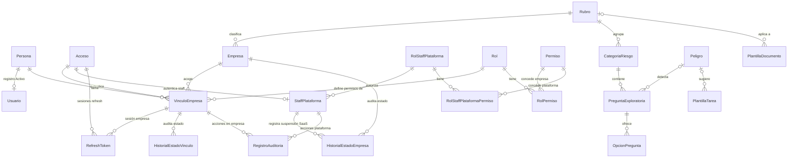
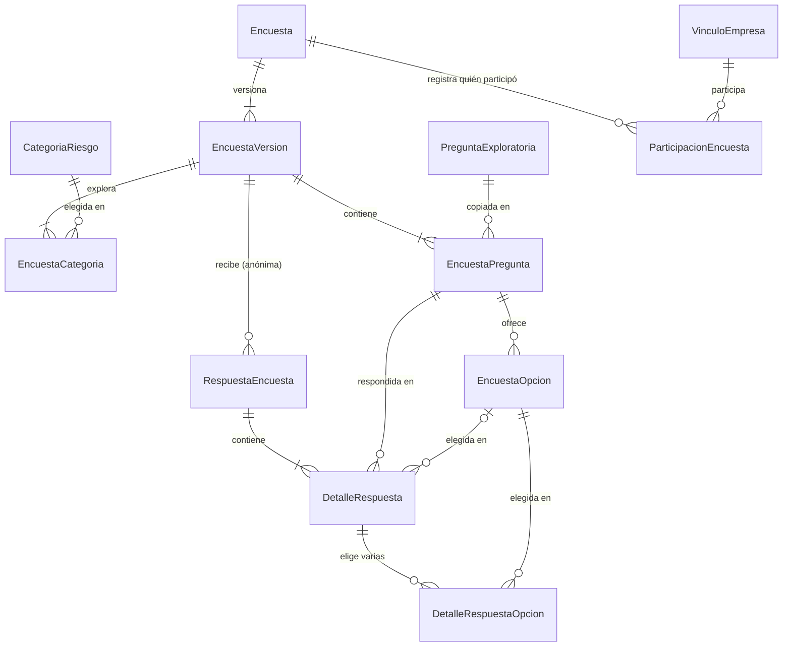
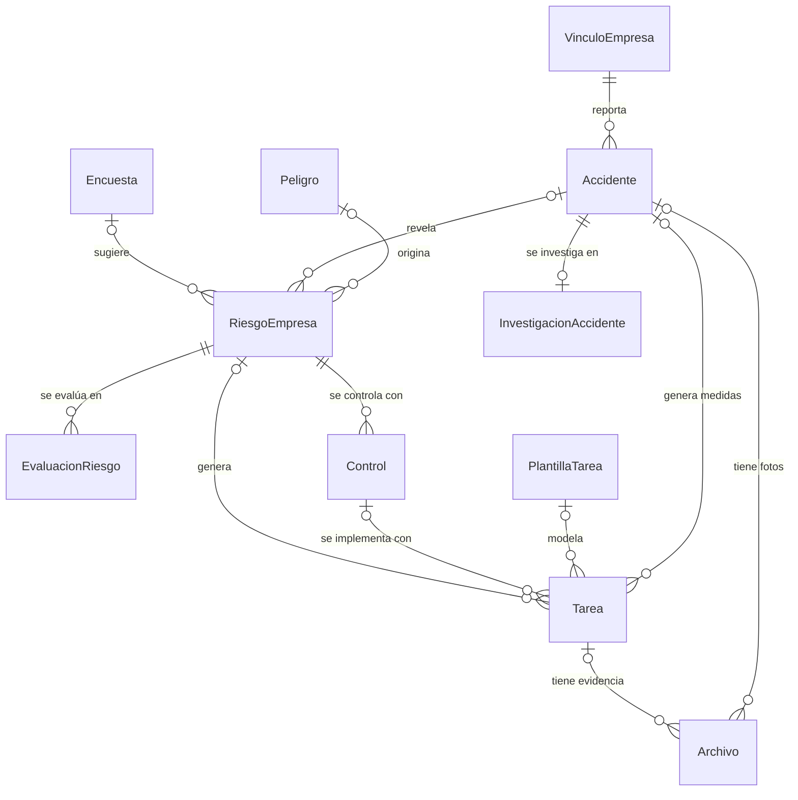
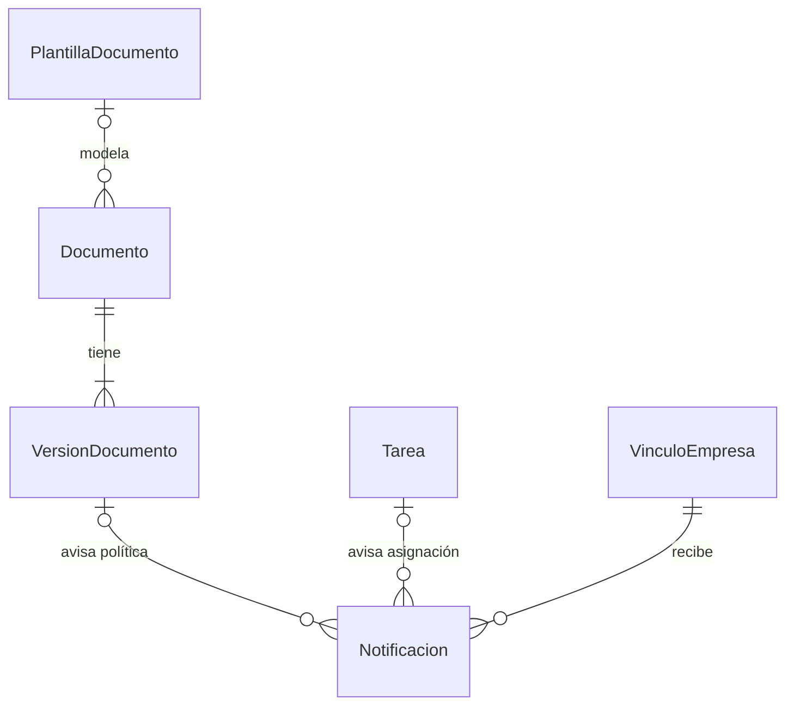
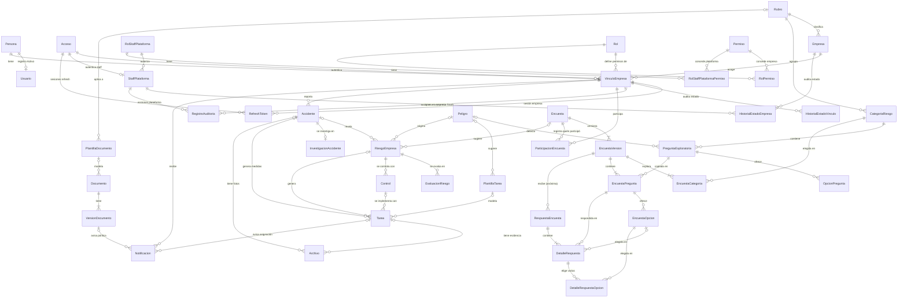
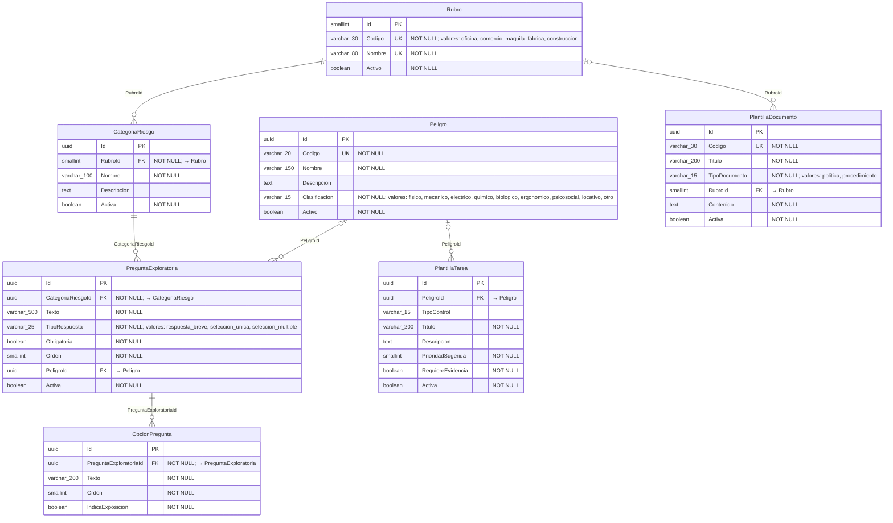

# Diagramas Exportables para Draw.io: Modelo ERD y Relacional

**Para qué sirve:** este documento proporciona las especificaciones completas en sintaxis **Mermaid** para generar e importar directamente en **draw.io** tanto el **Diagrama Entidad-Relación (Conceptual / Negocio)** como el **Diagrama Relacional (Físico para PostgreSQL)** de la plataforma **Norvia**, con cardinalidades y tipos de datos normalizados en tercera forma normal (3FN).

> [!TIP]
> **Archivo `.drawio` nativo:** todavía muestra el modelo anterior a la reducción de alcance del 13-11-2026 (53 tablas). Hay que reimportar en él los bloques de este archivo.
>
> **Archivo `.drawio` nativo disponible:** Si deseas abrir y editar directamente los diagramas vectoriales sin tener que importar los bloques Mermaid uno a uno, dispones del archivo nativo [Diagramas.drawio](Diagramas.drawio) ubicado en esta misma carpeta, el cual incluye las dos páginas ya maquetadas: **Entidad-Relación** y **Relacional**.

---

## Cómo importar estos diagramas en Draw.io

Draw.io admite código Mermaid de forma nativa:

1. Abre [draw.io](https://app.diagrams.net/) (en el navegador o en la aplicación de escritorio).
2. En el menú superior, ve a:
   $$\text{Organizar (Arrange)} \longrightarrow \text{Insertar (Insert)} \longrightarrow \text{Avanzado (Advanced)} \longrightarrow \text{Mermaid}$$
   *(O haz clic en el icono **`+`** de la barra de herramientas $\rightarrow$ **Avanzado** $\rightarrow$ **Mermaid**).*
3. Borra el código de ejemplo, **copia y pega** el bloque de código Mermaid del diagrama que deseas generar y presiona **Insertar**.
4. Draw.io generará automáticamente los nodos vectoriales, atributos, tablas y líneas conectoras con sus patas de gallo (*Crow's Foot*), los cuales puedes reorganizar, cambiar de color o exportar a PNG, SVG o PDF.

---

## Sobre la Cardinalidad en ambos diagramas

> [!NOTE]
> **¿Cómo se interpreta la cardinalidad en cada diagrama?**
> 
> - **En el Diagrama Entidad-Relación (Conceptual):** Representa las relaciones a nivel de negocio (semánticas). Admite cardinalidades **1 a 1 (1:1)**, **1 a Muchos (1:N)** y **Muchos a Muchos (N:M)** directamente. Por ejemplo, un `Rol` tiene muchos `Permiso` y un `Permiso` pertenece a muchos `Rol` (N:M directa).
> - **En el Diagrama Relacional (Físico PostgreSQL):** Representa la implementación física en tablas relacionales. **Todas las relaciones N:M se descomponen obligatoriamente en tablas asociativas/puente** (`RolPermiso`, `VinculoEmpresa`, `EncuestaCategoria`, `ParticipacionEncuesta`, `DetalleRespuestaOpcion`), por lo que todas las relaciones físicas son pares de **1:N**.
> 
> **Simbología de cardinalidad Crow's Foot utilizada:**
> - `||` : Exactamente uno (obligatorio, `NOT NULL`).
> - `o|` : Cero o uno (opcional, anulable `NULL`).
> - `}|` o `|{` : Uno o muchos (obligatorio).
> - `}o` o `o{` : Cero o muchos (opcional).

---

# PARTE 1: Diagramas Entidad-Relación (Conceptuales / Negocio)

Estos diagramas muestran las entidades y sus relaciones con verbos y cardinalidades. Son los mismos de la sección 3 de [modelo de datos](12-modelo-datos.md), que es la fuente de verdad. Modelo vigente: **41 tablas**, sin áreas, sin Google, sin comisión, sin equipos ni EPP, sin personas afectadas y sin informes (recorte del 13-11-2026).

## 1.1 Acceso, empresa y catálogos



---

## 1.2 Encuestas dinámicas



---

## 1.3 Riesgos, plan de trabajo y accidentes



---

## 1.4 Documentos y notificaciones



---

## 1.5 Diagrama ERD Conceptual Maestro Completo



---

# PARTE 2: Diagramas Relacionales (Físicos para PostgreSQL)

Estos diagramas se generan a partir del diccionario de datos de [modelo de datos](12-modelo-datos.md) §4 y muestran las **tablas con tipos de PostgreSQL**, columnas obligatorias (`NOT NULL`), claves primarias (`PK`), claves foráneas simples y compuestas (`FK`), unicidad (`UK`) y notación *Crow's Foot*. Las restricciones compuestas y los CHECK detallados están en el diccionario.

## 2.1 Dominio 1: Identidad, Multi-tenant, Acceso y RBAC (15 Tablas)

```mermaid
erDiagram
    Persona ||--o| Usuario : "PersonaId"
    Acceso ||--o{ RefreshToken : "AccesoId"
    VinculoEmpresa |o--o{ RefreshToken : "VinculoEmpresaId"
    Acceso ||--o| StaffPlataforma : "AccesoId"
    RolStaffPlataforma ||--o{ StaffPlataforma : "RolStaffPlataformaId"
    Rol ||--o{ RolPermiso : "RolId"
    Permiso ||--o{ RolPermiso : "PermisoId"
    RolStaffPlataforma ||--o{ RolStaffPlataformaPermiso : "RolStaffPlataformaId"
    Permiso ||--o{ RolStaffPlataformaPermiso : "PermisoId"
    Rubro |o--o{ Empresa : "RubroId"
    Empresa ||--o{ VinculoEmpresa : "EmpresaId"
    Persona ||--o{ VinculoEmpresa : "PersonaId"
    Acceso ||--o{ VinculoEmpresa : "AccesoId"
    Rol ||--o{ VinculoEmpresa : "RolId"
    Empresa ||--o{ HistorialEstadoVinculo : "EmpresaId"
    VinculoEmpresa ||--o{ HistorialEstadoVinculo : "EmpresaId + VinculoEmpresaId"
    VinculoEmpresa ||--o{ HistorialEstadoVinculo : "EmpresaId + RegistradoPorId"
    Empresa ||--o{ HistorialEstadoEmpresa : "EmpresaId"
    StaffPlataforma |o--o{ HistorialEstadoEmpresa : "RegistradoPorId"
    Empresa ||--o{ RegistroAuditoria : "EmpresaId"
    VinculoEmpresa |o--o{ RegistroAuditoria : "EmpresaId + VinculoEmpresaId"
    StaffPlataforma |o--o{ RegistroAuditoria : "StaffPlataformaId"

    Persona {
        uuid Id PK
        varchar_80 PrimerNombre "NOT NULL"
        varchar_80 SegundoNombre
        varchar_80 PrimerApellido "NOT NULL"
        varchar_80 SegundoApellido
        varchar_15 TipoDocumento "valores: dni, pasaporte, otro"
        varchar_50 NumeroDocumento
        varchar_30 Telefono
        timestamptz CreadoEn "NOT NULL"
    }

    Usuario {
        uuid Id PK
        uuid PersonaId FK, UK "NOT NULL; → Persona"
        boolean Activo "NOT NULL"
        timestamptz CreadoEn "NOT NULL"
    }

    Acceso {
        uuid Id PK
        varchar_254 Email UK "NOT NULL"
        varchar_255 PasswordHash "NOT NULL"
        boolean DebeCambiarPassword "NOT NULL"
        boolean Verificado "NOT NULL"
        timestamptz CreadoEn "NOT NULL"
    }

    RefreshToken {
        uuid Id PK
        uuid AccesoId FK "NOT NULL; → Acceso"
        uuid VinculoEmpresaId FK "→ VinculoEmpresa"
        varchar_64 TokenHash UK "NOT NULL"
        varchar_12 TipoSesion "NOT NULL; valores: empresa, plataforma"
        timestamptz ExpiraEn "NOT NULL"
        timestamptz CreadoEn "NOT NULL"
    }

    StaffPlataforma {
        uuid Id PK
        uuid AccesoId FK, UK "NOT NULL; → Acceso"
        smallint RolStaffPlataformaId FK "NOT NULL; → RolStaffPlataforma"
        boolean Activo "NOT NULL"
        timestamptz CreadoEn "NOT NULL"
    }

    RolStaffPlataforma {
        smallint Id PK
        varchar_30 Codigo UK "NOT NULL; valores: admin_plataforma, soporte_plataforma"
        varchar_60 Nombre "NOT NULL"
    }

    Rol {
        smallint Id PK
        varchar_30 Codigo UK "NOT NULL; valores: admin_empresa, responsable_sst, colaborador, encuestado"
        varchar_60 Nombre "NOT NULL"
    }

    Permiso {
        Significado Valor de `Alcance`
        Operación dentro de un tenant _`EmpresaId` del token `empresa`
        Operación global _catálogos_ listado de tenants_ suspensión SaaS_ sin datos SST de clientes `plataforma`
        smallint Id PK
        varchar_60 Codigo UK "NOT NULL"
        varchar_120 Nombre "NOT NULL"
        varchar_10 Alcance "NOT NULL; valores: empresa, plataforma"
        varchar_10 MetodoHttp "NOT NULL"
        varchar_200 RutaPatron "NOT NULL"
        boolean Activo "NOT NULL"
    }

    RolPermiso {
        smallint RolId PK, FK "→ Rol"
        smallint PermisoId PK, FK "→ Permiso"
    }

    RolStaffPlataformaPermiso {
        smallint RolStaffPlataformaId PK, FK "→ RolStaffPlataforma"
        smallint PermisoId PK, FK "→ Permiso"
    }

    Empresa {
        uuid Id PK
        varchar_200 RazonSocial "NOT NULL"
        char_14 RTN UK "NOT NULL"
        varchar_300 Direccion
        varchar_150 ActividadEconomica
        smallint RubroId FK "→ Rubro"
        integer TrabajadoresPermanentes
        date FechaInicioOperaciones
        varchar_12 Estado "NOT NULL; valores: activa, suspendida, inactiva"
        timestamptz CreadaEn "NOT NULL"
    }

    VinculoEmpresa {
        uuid Id PK
        uuid EmpresaId FK "NOT NULL; → Empresa"
        uuid PersonaId FK "NOT NULL; → Persona"
        uuid AccesoId FK "NOT NULL; → Acceso"
        smallint RolId FK "NOT NULL; → Rol"
        varchar_12 Estado "NOT NULL; valores: activo, suspendido, baja"
        timestamptz CreadoEn "NOT NULL"
    }

    HistorialEstadoVinculo {
        uuid Id PK
        uuid EmpresaId FK "NOT NULL; → Empresa"
        uuid VinculoEmpresaId FK "NOT NULL; FK comp → VinculoEmpresa"
        varchar_12 EstadoAnterior
        varchar_12 EstadoNuevo "NOT NULL"
        varchar_30 MotivoCodigo "NOT NULL; valores: decision_admin, baja_laboral, falta_pago_empresa, otro"
        text MotivoDetalle
        uuid RegistradoPorId FK "NOT NULL; FK comp → VinculoEmpresa"
        timestamptz RegistradoEn "NOT NULL"
    }

    HistorialEstadoEmpresa {
        uuid Id PK
        uuid EmpresaId FK "NOT NULL; → Empresa"
        varchar_12 EstadoAnterior
        varchar_12 EstadoNuevo "NOT NULL"
        varchar_30 MotivoCodigo "NOT NULL; valores: falta_pago_plataforma, reactivacion, otro"
        text MotivoDetalle
        uuid RegistradoPorId FK "→ StaffPlataforma"
        timestamptz RegistradoEn "NOT NULL"
    }

    RegistroAuditoria {
        uuid Id PK
        uuid EmpresaId FK "NOT NULL; → Empresa"
        uuid VinculoEmpresaId FK "FK comp → VinculoEmpresa"
        uuid StaffPlataformaId FK "→ StaffPlataforma"
        varchar_50 Accion "NOT NULL"
        varchar_60 Entidad "NOT NULL"
        uuid EntidadId "NOT NULL"
        timestamptz Fecha "NOT NULL"
        jsonb Detalle
    }
```

---

## 2.2 Dominio 2: Catálogos Globales de Seguridad y Salud (SST) (7 Tablas)



---

## 2.3 Dominio 3: Encuestas Dinámicas y Matriz de Riesgos (12 Tablas)

```mermaid
erDiagram
    Empresa ||--o{ Encuesta : "EmpresaId"
    VinculoEmpresa ||--o{ Encuesta : "EmpresaId + CreadaPorId"
    Empresa ||--o{ EncuestaVersion : "EmpresaId"
    Encuesta ||--o{ EncuestaVersion : "EmpresaId + EncuestaId"
    VinculoEmpresa ||--o{ EncuestaVersion : "EmpresaId + CreadaPorId"
    EncuestaVersion ||--o{ EncuestaCategoria : "EmpresaId + EncuestaVersionId"
    CategoriaRiesgo ||--o{ EncuestaCategoria : "CategoriaRiesgoId"
    Empresa ||--o{ EncuestaCategoria : "EmpresaId"
    Empresa ||--o{ EncuestaPregunta : "EmpresaId"
    EncuestaVersion ||--o{ EncuestaPregunta : "EmpresaId + EncuestaVersionId"
    PreguntaExploratoria |o--o{ EncuestaPregunta : "PreguntaExploratoriaId"
    Peligro |o--o{ EncuestaPregunta : "PeligroId"
    Empresa ||--o{ EncuestaOpcion : "EmpresaId"
    EncuestaPregunta ||--o{ EncuestaOpcion : "EmpresaId + EncuestaPreguntaId"
    Encuesta ||--o{ ParticipacionEncuesta : "EmpresaId + EncuestaId"
    VinculoEmpresa ||--o{ ParticipacionEncuesta : "EmpresaId + VinculoEmpresaId"
    Empresa ||--o{ ParticipacionEncuesta : "EmpresaId"
    Empresa ||--o{ RespuestaEncuesta : "EmpresaId"
    EncuestaVersion ||--o{ RespuestaEncuesta : "EmpresaId + EncuestaVersionId"
    RespuestaEncuesta ||--o{ DetalleRespuesta : "EmpresaId + RespuestaEncuestaId"
    EncuestaPregunta ||--o{ DetalleRespuesta : "EmpresaId + EncuestaPreguntaId"
    Empresa ||--o{ DetalleRespuesta : "EmpresaId"
    Empresa ||--o{ DetalleRespuestaOpcion : "EmpresaId"
    Empresa ||--o{ RiesgoEmpresa : "EmpresaId"
    Peligro |o--o{ RiesgoEmpresa : "PeligroId"
    Encuesta |o--o{ RiesgoEmpresa : "EmpresaId + EncuestaId"
    Accidente |o--o{ RiesgoEmpresa : "EmpresaId + AccidenteId"
    VinculoEmpresa |o--o{ RiesgoEmpresa : "EmpresaId + RevisadoPorId"
    Empresa ||--o{ EvaluacionRiesgo : "EmpresaId"
    RiesgoEmpresa ||--o{ EvaluacionRiesgo : "EmpresaId + RiesgoEmpresaId"
    VinculoEmpresa ||--o{ EvaluacionRiesgo : "EmpresaId + EvaluadoPorId"
    Empresa ||--o{ Control : "EmpresaId"
    RiesgoEmpresa ||--o{ Control : "EmpresaId + RiesgoEmpresaId"
    EncuestaOpcion |o--o{ DetalleRespuesta : "EncuestaPreguntaId + EncuestaOpcionId"
    DetalleRespuesta ||--o{ DetalleRespuestaOpcion : "EmpresaId + RespuestaEncuestaId + EncuestaPreguntaId"
    EncuestaOpcion ||--o{ DetalleRespuestaOpcion : "EncuestaPreguntaId + EncuestaOpcionId"

    Encuesta {
        uuid Id PK
        uuid EmpresaId FK "NOT NULL; → Empresa"
        varchar_200 Titulo "NOT NULL"
        varchar_10 Estado "NOT NULL; valores: borrador, publicada, cerrada"
        uuid CreadaPorId FK "NOT NULL; FK comp → VinculoEmpresa"
        timestamptz CreadaEn "NOT NULL"
        timestamptz CerradaEn
    }

    EncuestaVersion {
        uuid Id PK
        uuid EmpresaId FK "NOT NULL; → Empresa"
        uuid EncuestaId FK "NOT NULL; FK comp → Encuesta"
        integer NumeroVersion "NOT NULL"
        text Instrucciones
        varchar_12 Estado "NOT NULL; valores: borrador, publicada, reemplazada"
        uuid CreadaPorId FK "NOT NULL; FK comp → VinculoEmpresa"
        timestamptz CreadaEn "NOT NULL"
        timestamptz PublicadaEn
    }

    EncuestaCategoria {
        uuid EncuestaVersionId PK, FK "FK comp → EncuestaVersion"
        uuid CategoriaRiesgoId PK, FK "→ CategoriaRiesgo"
        uuid EmpresaId FK "NOT NULL; → Empresa"
    }

    EncuestaPregunta {
        uuid Id PK
        uuid EmpresaId FK "NOT NULL; → Empresa"
        uuid EncuestaVersionId FK "NOT NULL; FK comp → EncuestaVersion"
        uuid PreguntaExploratoriaId FK "→ PreguntaExploratoria"
        varchar_500 Texto "NOT NULL"
        varchar_25 TipoRespuesta "NOT NULL; valores: respuesta_breve, seleccion_unica, seleccion_multiple"
        boolean Obligatoria "NOT NULL"
        uuid PeligroId FK "→ Peligro"
        smallint Orden "NOT NULL"
    }

    EncuestaOpcion {
        uuid Id PK
        uuid EmpresaId FK "NOT NULL; → Empresa"
        uuid EncuestaPreguntaId FK "NOT NULL; FK comp → EncuestaPregunta"
        varchar_200 Texto "NOT NULL"
        smallint Orden "NOT NULL"
        boolean IndicaExposicion "NOT NULL"
    }

    ParticipacionEncuesta {
        uuid EncuestaId PK, FK "FK comp → Encuesta"
        uuid VinculoEmpresaId PK, FK "FK comp → VinculoEmpresa"
        uuid EmpresaId FK "NOT NULL; → Empresa"
        timestamptz ParticipoEn "NOT NULL"
    }

    RespuestaEncuesta {
        uuid Id PK
        uuid EmpresaId FK "NOT NULL; → Empresa"
        uuid EncuestaVersionId FK "NOT NULL; FK comp → EncuestaVersion"
        date FechaRespuesta "NOT NULL"
    }

    DetalleRespuesta {
        uuid RespuestaEncuestaId PK, FK "FK comp → RespuestaEncuesta"
        uuid EncuestaPreguntaId PK, FK "FK comp → EncuestaPregunta"
        uuid EmpresaId FK "NOT NULL; → Empresa"
        uuid EncuestaOpcionId
        text TextoLibre
    }

    DetalleRespuestaOpcion {
        uuid RespuestaEncuestaId PK
        uuid EncuestaPreguntaId PK
        uuid EncuestaOpcionId PK
        uuid EmpresaId FK "NOT NULL; → Empresa"
    }

    RiesgoEmpresa {
        uuid Id PK
        uuid EmpresaId FK "NOT NULL; → Empresa"
        uuid PeligroId FK "→ Peligro"
        varchar_300 DescripcionPeligro
        varchar_200 Actividad
        varchar_12 Estado "NOT NULL; valores: sugerido, confirmado, descartado"
        uuid EncuestaId FK "FK comp → Encuesta"
        uuid AccidenteId FK "FK comp → Accidente"
        timestamptz CreadoEn "NOT NULL"
        uuid RevisadoPorId FK "FK comp → VinculoEmpresa"
        timestamptz RevisadoEn
    }

    EvaluacionRiesgo {
        uuid Id PK
        uuid EmpresaId FK "NOT NULL; → Empresa"
        uuid RiesgoEmpresaId FK "NOT NULL; FK comp → RiesgoEmpresa"
        varchar_10 Tipo "NOT NULL; valores: inicial, residual"
        smallint Probabilidad "NOT NULL"
        smallint Severidad "NOT NULL"
        uuid EvaluadoPorId FK "NOT NULL; FK comp → VinculoEmpresa"
        timestamptz EvaluadoEn "NOT NULL"
    }

    Control {
        uuid Id PK
        uuid EmpresaId FK "NOT NULL; → Empresa"
        uuid RiesgoEmpresaId FK "NOT NULL; FK comp → RiesgoEmpresa"
        varchar_15 Tipo "NOT NULL; valores: eliminacion, sustitucion, ingenieria, administrativo, epp"
        text Descripcion "NOT NULL"
        varchar_12 Estado "NOT NULL; valores: propuesto, implementado"
        timestamptz CreadoEn "NOT NULL"
    }
```



---

## 2.4 Dominio 4: Plan de Trabajo, Accidentes, Documentos y Notificaciones (7 Tablas)

```mermaid
erDiagram
    Empresa ||--o{ Tarea : "EmpresaId"
    VinculoEmpresa |o--o{ Tarea : "EmpresaId + ResponsableId"
    PlantillaTarea |o--o{ Tarea : "PlantillaTareaId"
    RiesgoEmpresa |o--o{ Tarea : "EmpresaId + RiesgoEmpresaId"
    Accidente |o--o{ Tarea : "EmpresaId + AccidenteId"
    VinculoEmpresa ||--o{ Tarea : "EmpresaId + CreadaPorId"
    Empresa ||--o{ Archivo : "EmpresaId"
    VinculoEmpresa ||--o{ Archivo : "EmpresaId + SubidoPorId"
    Tarea |o--o{ Archivo : "EmpresaId + TareaId"
    Accidente |o--o{ Archivo : "EmpresaId + AccidenteId"
    Empresa ||--o{ Accidente : "EmpresaId"
    VinculoEmpresa ||--o{ Accidente : "EmpresaId + ReportadoPorId"
    Empresa ||--o{ InvestigacionAccidente : "EmpresaId"
    Accidente ||--o| InvestigacionAccidente : "EmpresaId + AccidenteId"
    VinculoEmpresa ||--o{ InvestigacionAccidente : "EmpresaId + InvestigadaPorId"
    Empresa ||--o{ Documento : "EmpresaId"
    PlantillaDocumento |o--o{ Documento : "PlantillaDocumentoId"
    VinculoEmpresa ||--o{ Documento : "EmpresaId + CreadoPorId"
    Empresa ||--o{ VersionDocumento : "EmpresaId"
    Documento ||--o{ VersionDocumento : "EmpresaId + DocumentoId"
    VinculoEmpresa ||--o{ VersionDocumento : "EmpresaId + CreadaPorId"
    VinculoEmpresa |o--o{ VersionDocumento : "EmpresaId + AprobadaPorId"
    Empresa ||--o{ Notificacion : "EmpresaId"
    VinculoEmpresa ||--o{ Notificacion : "EmpresaId + DestinatarioId"
    VersionDocumento |o--o{ Notificacion : "EmpresaId + VersionDocumentoId"
    Tarea |o--o{ Notificacion : "EmpresaId + TareaId"
    Control |o--o{ Tarea : "RiesgoEmpresaId + ControlId"

    Tarea {
        uuid Id PK
        uuid EmpresaId FK "NOT NULL; → Empresa"
        varchar_200 Titulo "NOT NULL"
        text Descripcion
        varchar_12 Estado "NOT NULL; valores: pendiente, en_progreso, completada, cancelada"
        smallint Prioridad "NOT NULL"
        uuid ResponsableId FK "FK comp → VinculoEmpresa"
        date FechaLimite
        boolean RequiereEvidencia "NOT NULL"
        uuid PlantillaTareaId FK "→ PlantillaTarea"
        uuid RiesgoEmpresaId FK "FK comp → RiesgoEmpresa"
        uuid ControlId
        uuid AccidenteId FK "FK comp → Accidente"
        uuid CreadaPorId FK "NOT NULL; FK comp → VinculoEmpresa"
        timestamptz CreadaEn "NOT NULL"
        timestamptz CompletadaEn
    }

    Archivo {
        uuid Id PK
        uuid EmpresaId FK "NOT NULL; → Empresa"
        varchar_255 NombreOriginal "NOT NULL"
        varchar_100 TipoContenido "NOT NULL"
        bigint TamanoBytes "NOT NULL"
        varchar_500 ClaveAlmacenamiento UK "NOT NULL"
        uuid SubidoPorId FK "NOT NULL; FK comp → VinculoEmpresa"
        timestamptz SubidoEn "NOT NULL"
        uuid TareaId FK "FK comp → Tarea"
        uuid AccidenteId FK "FK comp → Accidente"
    }

    Accidente {
        uuid Id PK
        uuid EmpresaId FK "NOT NULL; → Empresa"
        varchar_25 Tipo "NOT NULL; valores: accidente, incidente, enfermedad_profesional"
        varchar_15 EstadoEnfermedad "valores: sospechosa, diagnosticada"
        boolean EsGrave "NOT NULL"
        timestamptz FechaHoraEvento "NOT NULL"
        varchar_200 Lugar
        text Descripcion "NOT NULL"
        uuid ReportadoPorId FK "NOT NULL; FK comp → VinculoEmpresa"
        timestamptz RegistradoEn "NOT NULL"
        varchar_16 Estado "NOT NULL; valores: abierto, en_investigacion, cerrado"
        timestamptz CerradoEn
    }

    InvestigacionAccidente {
        uuid Id PK
        uuid EmpresaId FK "NOT NULL; → Empresa"
        uuid AccidenteId FK, UK "NOT NULL; FK comp → Accidente"
        text CausasInmediatas "NOT NULL"
        text CausasBasicas "NOT NULL"
        text Conclusiones
        uuid InvestigadaPorId FK "NOT NULL; FK comp → VinculoEmpresa"
        date FechaInvestigacion "NOT NULL"
    }

    Documento {
        uuid Id PK
        uuid EmpresaId FK "NOT NULL; → Empresa"
        uuid PlantillaDocumentoId FK "→ PlantillaDocumento"
        varchar_200 Titulo "NOT NULL"
        varchar_15 TipoDocumento "NOT NULL; valores: politica, procedimiento"
        uuid CreadoPorId FK "NOT NULL; FK comp → VinculoEmpresa"
        timestamptz CreadoEn "NOT NULL"
    }

    VersionDocumento {
        uuid Id PK
        uuid EmpresaId FK "NOT NULL; → Empresa"
        uuid DocumentoId FK "NOT NULL; FK comp → Documento"
        integer NumeroVersion "NOT NULL"
        text Contenido "NOT NULL"
        varchar_11 Estado "NOT NULL; valores: borrador, vigente, reemplazada"
        uuid CreadaPorId FK "NOT NULL; FK comp → VinculoEmpresa"
        timestamptz CreadaEn "NOT NULL"
        uuid AprobadaPorId FK "FK comp → VinculoEmpresa"
        timestamptz AprobadaEn
    }

    Notificacion {
        uuid Id PK
        uuid EmpresaId FK "NOT NULL; → Empresa"
        uuid DestinatarioId FK "NOT NULL; FK comp → VinculoEmpresa"
        varchar_20 Tipo "NOT NULL; valores: politica_publicada, tarea_asignada"
        varchar_200 Titulo "NOT NULL"
        text Mensaje "NOT NULL"
        uuid VersionDocumentoId FK "FK comp → VersionDocumento"
        uuid TareaId FK "FK comp → Tarea"
        timestamptz CreadaEn "NOT NULL"
        timestamptz LeidaEn
        varchar_10 CorreoEstado "NOT NULL; valores: pendiente, enviado, fallido"
        smallint CorreoIntentos "NOT NULL"
        timestamptz CorreoEnviadoEn
        text CorreoUltimoError
    }
```



---

## 2.5 Diagrama Relacional Físico Maestro Completo (41 Tablas)

*(Copia el bloque siguiente si deseas importar las 41 tablas de Norvia con todas sus relaciones foráneas en un solo lienzo de draw.io).*

```mermaid
erDiagram
    Persona ||--o| Usuario : "PersonaId"
    Acceso ||--o{ RefreshToken : "AccesoId"
    VinculoEmpresa |o--o{ RefreshToken : "VinculoEmpresaId"
    Acceso ||--o| StaffPlataforma : "AccesoId"
    RolStaffPlataforma ||--o{ StaffPlataforma : "RolStaffPlataformaId"
    Rol ||--o{ RolPermiso : "RolId"
    Permiso ||--o{ RolPermiso : "PermisoId"
    RolStaffPlataforma ||--o{ RolStaffPlataformaPermiso : "RolStaffPlataformaId"
    Permiso ||--o{ RolStaffPlataformaPermiso : "PermisoId"
    Rubro |o--o{ Empresa : "RubroId"
    Empresa ||--o{ VinculoEmpresa : "EmpresaId"
    Persona ||--o{ VinculoEmpresa : "PersonaId"
    Acceso ||--o{ VinculoEmpresa : "AccesoId"
    Rol ||--o{ VinculoEmpresa : "RolId"
    Empresa ||--o{ HistorialEstadoVinculo : "EmpresaId"
    VinculoEmpresa ||--o{ HistorialEstadoVinculo : "EmpresaId + VinculoEmpresaId"
    VinculoEmpresa ||--o{ HistorialEstadoVinculo : "EmpresaId + RegistradoPorId"
    Empresa ||--o{ HistorialEstadoEmpresa : "EmpresaId"
    StaffPlataforma |o--o{ HistorialEstadoEmpresa : "RegistradoPorId"
    Empresa ||--o{ RegistroAuditoria : "EmpresaId"
    VinculoEmpresa |o--o{ RegistroAuditoria : "EmpresaId + VinculoEmpresaId"
    StaffPlataforma |o--o{ RegistroAuditoria : "StaffPlataformaId"
    Rubro ||--o{ CategoriaRiesgo : "RubroId"
    CategoriaRiesgo ||--o{ PreguntaExploratoria : "CategoriaRiesgoId"
    Peligro |o--o{ PreguntaExploratoria : "PeligroId"
    PreguntaExploratoria ||--o{ OpcionPregunta : "PreguntaExploratoriaId"
    Peligro |o--o{ PlantillaTarea : "PeligroId"
    Rubro |o--o{ PlantillaDocumento : "RubroId"
    Empresa ||--o{ Encuesta : "EmpresaId"
    VinculoEmpresa ||--o{ Encuesta : "EmpresaId + CreadaPorId"
    Empresa ||--o{ EncuestaVersion : "EmpresaId"
    Encuesta ||--o{ EncuestaVersion : "EmpresaId + EncuestaId"
    VinculoEmpresa ||--o{ EncuestaVersion : "EmpresaId + CreadaPorId"
    EncuestaVersion ||--o{ EncuestaCategoria : "EmpresaId + EncuestaVersionId"
    CategoriaRiesgo ||--o{ EncuestaCategoria : "CategoriaRiesgoId"
    Empresa ||--o{ EncuestaCategoria : "EmpresaId"
    Empresa ||--o{ EncuestaPregunta : "EmpresaId"
    EncuestaVersion ||--o{ EncuestaPregunta : "EmpresaId + EncuestaVersionId"
    PreguntaExploratoria |o--o{ EncuestaPregunta : "PreguntaExploratoriaId"
    Peligro |o--o{ EncuestaPregunta : "PeligroId"
    Empresa ||--o{ EncuestaOpcion : "EmpresaId"
    EncuestaPregunta ||--o{ EncuestaOpcion : "EmpresaId + EncuestaPreguntaId"
    Encuesta ||--o{ ParticipacionEncuesta : "EmpresaId + EncuestaId"
    VinculoEmpresa ||--o{ ParticipacionEncuesta : "EmpresaId + VinculoEmpresaId"
    Empresa ||--o{ ParticipacionEncuesta : "EmpresaId"
    Empresa ||--o{ RespuestaEncuesta : "EmpresaId"
    EncuestaVersion ||--o{ RespuestaEncuesta : "EmpresaId + EncuestaVersionId"
    RespuestaEncuesta ||--o{ DetalleRespuesta : "EmpresaId + RespuestaEncuestaId"
    EncuestaPregunta ||--o{ DetalleRespuesta : "EmpresaId + EncuestaPreguntaId"
    Empresa ||--o{ DetalleRespuesta : "EmpresaId"
    Empresa ||--o{ DetalleRespuestaOpcion : "EmpresaId"
    Empresa ||--o{ RiesgoEmpresa : "EmpresaId"
    Peligro |o--o{ RiesgoEmpresa : "PeligroId"
    Encuesta |o--o{ RiesgoEmpresa : "EmpresaId + EncuestaId"
    Accidente |o--o{ RiesgoEmpresa : "EmpresaId + AccidenteId"
    VinculoEmpresa |o--o{ RiesgoEmpresa : "EmpresaId + RevisadoPorId"
    Empresa ||--o{ EvaluacionRiesgo : "EmpresaId"
    RiesgoEmpresa ||--o{ EvaluacionRiesgo : "EmpresaId + RiesgoEmpresaId"
    VinculoEmpresa ||--o{ EvaluacionRiesgo : "EmpresaId + EvaluadoPorId"
    Empresa ||--o{ Control : "EmpresaId"
    RiesgoEmpresa ||--o{ Control : "EmpresaId + RiesgoEmpresaId"
    Empresa ||--o{ Tarea : "EmpresaId"
    VinculoEmpresa |o--o{ Tarea : "EmpresaId + ResponsableId"
    PlantillaTarea |o--o{ Tarea : "PlantillaTareaId"
    RiesgoEmpresa |o--o{ Tarea : "EmpresaId + RiesgoEmpresaId"
    Accidente |o--o{ Tarea : "EmpresaId + AccidenteId"
    VinculoEmpresa ||--o{ Tarea : "EmpresaId + CreadaPorId"
    Empresa ||--o{ Archivo : "EmpresaId"
    VinculoEmpresa ||--o{ Archivo : "EmpresaId + SubidoPorId"
    Tarea |o--o{ Archivo : "EmpresaId + TareaId"
    Accidente |o--o{ Archivo : "EmpresaId + AccidenteId"
    Empresa ||--o{ Accidente : "EmpresaId"
    VinculoEmpresa ||--o{ Accidente : "EmpresaId + ReportadoPorId"
    Empresa ||--o{ InvestigacionAccidente : "EmpresaId"
    Accidente ||--o| InvestigacionAccidente : "EmpresaId + AccidenteId"
    VinculoEmpresa ||--o{ InvestigacionAccidente : "EmpresaId + InvestigadaPorId"
    Empresa ||--o{ Documento : "EmpresaId"
    PlantillaDocumento |o--o{ Documento : "PlantillaDocumentoId"
    VinculoEmpresa ||--o{ Documento : "EmpresaId + CreadoPorId"
    Empresa ||--o{ VersionDocumento : "EmpresaId"
    Documento ||--o{ VersionDocumento : "EmpresaId + DocumentoId"
    VinculoEmpresa ||--o{ VersionDocumento : "EmpresaId + CreadaPorId"
    VinculoEmpresa |o--o{ VersionDocumento : "EmpresaId + AprobadaPorId"
    Empresa ||--o{ Notificacion : "EmpresaId"
    VinculoEmpresa ||--o{ Notificacion : "EmpresaId + DestinatarioId"
    VersionDocumento |o--o{ Notificacion : "EmpresaId + VersionDocumentoId"
    Tarea |o--o{ Notificacion : "EmpresaId + TareaId"
    EncuestaOpcion |o--o{ DetalleRespuesta : "EncuestaPreguntaId + EncuestaOpcionId"
    DetalleRespuesta ||--o{ DetalleRespuestaOpcion : "EmpresaId + RespuestaEncuestaId + EncuestaPreguntaId"
    EncuestaOpcion ||--o{ DetalleRespuestaOpcion : "EncuestaPreguntaId + EncuestaOpcionId"
    Control |o--o{ Tarea : "RiesgoEmpresaId + ControlId"

    Persona {
        uuid Id PK
        varchar_80 PrimerNombre "NOT NULL"
        varchar_80 SegundoNombre
        varchar_80 PrimerApellido "NOT NULL"
        varchar_80 SegundoApellido
        varchar_15 TipoDocumento "valores: dni, pasaporte, otro"
        varchar_50 NumeroDocumento
        varchar_30 Telefono
        timestamptz CreadoEn "NOT NULL"
    }

    Usuario {
        uuid Id PK
        uuid PersonaId FK, UK "NOT NULL; → Persona"
        boolean Activo "NOT NULL"
        timestamptz CreadoEn "NOT NULL"
    }

    Acceso {
        uuid Id PK
        varchar_254 Email UK "NOT NULL"
        varchar_255 PasswordHash "NOT NULL"
        boolean DebeCambiarPassword "NOT NULL"
        boolean Verificado "NOT NULL"
        timestamptz CreadoEn "NOT NULL"
    }

    RefreshToken {
        uuid Id PK
        uuid AccesoId FK "NOT NULL; → Acceso"
        uuid VinculoEmpresaId FK "→ VinculoEmpresa"
        varchar_64 TokenHash UK "NOT NULL"
        varchar_12 TipoSesion "NOT NULL; valores: empresa, plataforma"
        timestamptz ExpiraEn "NOT NULL"
        timestamptz CreadoEn "NOT NULL"
    }

    StaffPlataforma {
        uuid Id PK
        uuid AccesoId FK, UK "NOT NULL; → Acceso"
        smallint RolStaffPlataformaId FK "NOT NULL; → RolStaffPlataforma"
        boolean Activo "NOT NULL"
        timestamptz CreadoEn "NOT NULL"
    }

    RolStaffPlataforma {
        smallint Id PK
        varchar_30 Codigo UK "NOT NULL; valores: admin_plataforma, soporte_plataforma"
        varchar_60 Nombre "NOT NULL"
    }

    Rol {
        smallint Id PK
        varchar_30 Codigo UK "NOT NULL; valores: admin_empresa, responsable_sst, colaborador, encuestado"
        varchar_60 Nombre "NOT NULL"
    }

    Permiso {
        Significado Valor de `Alcance`
        Operación dentro de un tenant _`EmpresaId` del token `empresa`
        Operación global _catálogos_ listado de tenants_ suspensión SaaS_ sin datos SST de clientes `plataforma`
        smallint Id PK
        varchar_60 Codigo UK "NOT NULL"
        varchar_120 Nombre "NOT NULL"
        varchar_10 Alcance "NOT NULL; valores: empresa, plataforma"
        varchar_10 MetodoHttp "NOT NULL"
        varchar_200 RutaPatron "NOT NULL"
        boolean Activo "NOT NULL"
    }

    RolPermiso {
        smallint RolId PK, FK "→ Rol"
        smallint PermisoId PK, FK "→ Permiso"
    }

    RolStaffPlataformaPermiso {
        smallint RolStaffPlataformaId PK, FK "→ RolStaffPlataforma"
        smallint PermisoId PK, FK "→ Permiso"
    }

    Empresa {
        uuid Id PK
        varchar_200 RazonSocial "NOT NULL"
        char_14 RTN UK "NOT NULL"
        varchar_300 Direccion
        varchar_150 ActividadEconomica
        smallint RubroId FK "→ Rubro"
        integer TrabajadoresPermanentes
        date FechaInicioOperaciones
        varchar_12 Estado "NOT NULL; valores: activa, suspendida, inactiva"
        timestamptz CreadaEn "NOT NULL"
    }

    VinculoEmpresa {
        uuid Id PK
        uuid EmpresaId FK "NOT NULL; → Empresa"
        uuid PersonaId FK "NOT NULL; → Persona"
        uuid AccesoId FK "NOT NULL; → Acceso"
        smallint RolId FK "NOT NULL; → Rol"
        varchar_12 Estado "NOT NULL; valores: activo, suspendido, baja"
        timestamptz CreadoEn "NOT NULL"
    }

    HistorialEstadoVinculo {
        uuid Id PK
        uuid EmpresaId FK "NOT NULL; → Empresa"
        uuid VinculoEmpresaId FK "NOT NULL; FK comp → VinculoEmpresa"
        varchar_12 EstadoAnterior
        varchar_12 EstadoNuevo "NOT NULL"
        varchar_30 MotivoCodigo "NOT NULL; valores: decision_admin, baja_laboral, falta_pago_empresa, otro"
        text MotivoDetalle
        uuid RegistradoPorId FK "NOT NULL; FK comp → VinculoEmpresa"
        timestamptz RegistradoEn "NOT NULL"
    }

    HistorialEstadoEmpresa {
        uuid Id PK
        uuid EmpresaId FK "NOT NULL; → Empresa"
        varchar_12 EstadoAnterior
        varchar_12 EstadoNuevo "NOT NULL"
        varchar_30 MotivoCodigo "NOT NULL; valores: falta_pago_plataforma, reactivacion, otro"
        text MotivoDetalle
        uuid RegistradoPorId FK "→ StaffPlataforma"
        timestamptz RegistradoEn "NOT NULL"
    }

    RegistroAuditoria {
        uuid Id PK
        uuid EmpresaId FK "NOT NULL; → Empresa"
        uuid VinculoEmpresaId FK "FK comp → VinculoEmpresa"
        uuid StaffPlataformaId FK "→ StaffPlataforma"
        varchar_50 Accion "NOT NULL"
        varchar_60 Entidad "NOT NULL"
        uuid EntidadId "NOT NULL"
        timestamptz Fecha "NOT NULL"
        jsonb Detalle
    }

    Rubro {
        smallint Id PK
        varchar_30 Codigo UK "NOT NULL; valores: oficina, comercio, maquila_fabrica, construccion"
        varchar_80 Nombre UK "NOT NULL"
        boolean Activo "NOT NULL"
    }

    CategoriaRiesgo {
        uuid Id PK
        smallint RubroId FK "NOT NULL; → Rubro"
        varchar_100 Nombre "NOT NULL"
        text Descripcion
        boolean Activa "NOT NULL"
    }

    Peligro {
        uuid Id PK
        varchar_20 Codigo UK "NOT NULL"
        varchar_150 Nombre "NOT NULL"
        text Descripcion
        varchar_15 Clasificacion "NOT NULL; valores: fisico, mecanico, electrico, quimico, biologico, ergonomico, psicosocial, locativo, otro"
        boolean Activo "NOT NULL"
    }

    PreguntaExploratoria {
        uuid Id PK
        uuid CategoriaRiesgoId FK "NOT NULL; → CategoriaRiesgo"
        varchar_500 Texto "NOT NULL"
        varchar_25 TipoRespuesta "NOT NULL; valores: respuesta_breve, seleccion_unica, seleccion_multiple"
        boolean Obligatoria "NOT NULL"
        smallint Orden "NOT NULL"
        uuid PeligroId FK "→ Peligro"
        boolean Activa "NOT NULL"
    }

    OpcionPregunta {
        uuid Id PK
        uuid PreguntaExploratoriaId FK "NOT NULL; → PreguntaExploratoria"
        varchar_200 Texto "NOT NULL"
        smallint Orden "NOT NULL"
        boolean IndicaExposicion "NOT NULL"
    }

    PlantillaTarea {
        uuid Id PK
        uuid PeligroId FK "→ Peligro"
        varchar_15 TipoControl
        varchar_200 Titulo "NOT NULL"
        text Descripcion
        smallint PrioridadSugerida "NOT NULL"
        boolean RequiereEvidencia "NOT NULL"
        boolean Activa "NOT NULL"
    }

    PlantillaDocumento {
        uuid Id PK
        varchar_30 Codigo UK "NOT NULL"
        varchar_200 Titulo "NOT NULL"
        varchar_15 TipoDocumento "NOT NULL; valores: politica, procedimiento"
        smallint RubroId FK "→ Rubro"
        text Contenido "NOT NULL"
        boolean Activa "NOT NULL"
    }

    Encuesta {
        uuid Id PK
        uuid EmpresaId FK "NOT NULL; → Empresa"
        varchar_200 Titulo "NOT NULL"
        varchar_10 Estado "NOT NULL; valores: borrador, publicada, cerrada"
        uuid CreadaPorId FK "NOT NULL; FK comp → VinculoEmpresa"
        timestamptz CreadaEn "NOT NULL"
        timestamptz CerradaEn
    }

    EncuestaVersion {
        uuid Id PK
        uuid EmpresaId FK "NOT NULL; → Empresa"
        uuid EncuestaId FK "NOT NULL; FK comp → Encuesta"
        integer NumeroVersion "NOT NULL"
        text Instrucciones
        varchar_12 Estado "NOT NULL; valores: borrador, publicada, reemplazada"
        uuid CreadaPorId FK "NOT NULL; FK comp → VinculoEmpresa"
        timestamptz CreadaEn "NOT NULL"
        timestamptz PublicadaEn
    }

    EncuestaCategoria {
        uuid EncuestaVersionId PK, FK "FK comp → EncuestaVersion"
        uuid CategoriaRiesgoId PK, FK "→ CategoriaRiesgo"
        uuid EmpresaId FK "NOT NULL; → Empresa"
    }

    EncuestaPregunta {
        uuid Id PK
        uuid EmpresaId FK "NOT NULL; → Empresa"
        uuid EncuestaVersionId FK "NOT NULL; FK comp → EncuestaVersion"
        uuid PreguntaExploratoriaId FK "→ PreguntaExploratoria"
        varchar_500 Texto "NOT NULL"
        varchar_25 TipoRespuesta "NOT NULL; valores: respuesta_breve, seleccion_unica, seleccion_multiple"
        boolean Obligatoria "NOT NULL"
        uuid PeligroId FK "→ Peligro"
        smallint Orden "NOT NULL"
    }

    EncuestaOpcion {
        uuid Id PK
        uuid EmpresaId FK "NOT NULL; → Empresa"
        uuid EncuestaPreguntaId FK "NOT NULL; FK comp → EncuestaPregunta"
        varchar_200 Texto "NOT NULL"
        smallint Orden "NOT NULL"
        boolean IndicaExposicion "NOT NULL"
    }

    ParticipacionEncuesta {
        uuid EncuestaId PK, FK "FK comp → Encuesta"
        uuid VinculoEmpresaId PK, FK "FK comp → VinculoEmpresa"
        uuid EmpresaId FK "NOT NULL; → Empresa"
        timestamptz ParticipoEn "NOT NULL"
    }

    RespuestaEncuesta {
        uuid Id PK
        uuid EmpresaId FK "NOT NULL; → Empresa"
        uuid EncuestaVersionId FK "NOT NULL; FK comp → EncuestaVersion"
        date FechaRespuesta "NOT NULL"
    }

    DetalleRespuesta {
        uuid RespuestaEncuestaId PK, FK "FK comp → RespuestaEncuesta"
        uuid EncuestaPreguntaId PK, FK "FK comp → EncuestaPregunta"
        uuid EmpresaId FK "NOT NULL; → Empresa"
        uuid EncuestaOpcionId
        text TextoLibre
    }

    DetalleRespuestaOpcion {
        uuid RespuestaEncuestaId PK
        uuid EncuestaPreguntaId PK
        uuid EncuestaOpcionId PK
        uuid EmpresaId FK "NOT NULL; → Empresa"
    }

    RiesgoEmpresa {
        uuid Id PK
        uuid EmpresaId FK "NOT NULL; → Empresa"
        uuid PeligroId FK "→ Peligro"
        varchar_300 DescripcionPeligro
        varchar_200 Actividad
        varchar_12 Estado "NOT NULL; valores: sugerido, confirmado, descartado"
        uuid EncuestaId FK "FK comp → Encuesta"
        uuid AccidenteId FK "FK comp → Accidente"
        timestamptz CreadoEn "NOT NULL"
        uuid RevisadoPorId FK "FK comp → VinculoEmpresa"
        timestamptz RevisadoEn
    }

    EvaluacionRiesgo {
        uuid Id PK
        uuid EmpresaId FK "NOT NULL; → Empresa"
        uuid RiesgoEmpresaId FK "NOT NULL; FK comp → RiesgoEmpresa"
        varchar_10 Tipo "NOT NULL; valores: inicial, residual"
        smallint Probabilidad "NOT NULL"
        smallint Severidad "NOT NULL"
        uuid EvaluadoPorId FK "NOT NULL; FK comp → VinculoEmpresa"
        timestamptz EvaluadoEn "NOT NULL"
    }

    Control {
        uuid Id PK
        uuid EmpresaId FK "NOT NULL; → Empresa"
        uuid RiesgoEmpresaId FK "NOT NULL; FK comp → RiesgoEmpresa"
        varchar_15 Tipo "NOT NULL; valores: eliminacion, sustitucion, ingenieria, administrativo, epp"
        text Descripcion "NOT NULL"
        varchar_12 Estado "NOT NULL; valores: propuesto, implementado"
        timestamptz CreadoEn "NOT NULL"
    }

    Tarea {
        uuid Id PK
        uuid EmpresaId FK "NOT NULL; → Empresa"
        varchar_200 Titulo "NOT NULL"
        text Descripcion
        varchar_12 Estado "NOT NULL; valores: pendiente, en_progreso, completada, cancelada"
        smallint Prioridad "NOT NULL"
        uuid ResponsableId FK "FK comp → VinculoEmpresa"
        date FechaLimite
        boolean RequiereEvidencia "NOT NULL"
        uuid PlantillaTareaId FK "→ PlantillaTarea"
        uuid RiesgoEmpresaId FK "FK comp → RiesgoEmpresa"
        uuid ControlId
        uuid AccidenteId FK "FK comp → Accidente"
        uuid CreadaPorId FK "NOT NULL; FK comp → VinculoEmpresa"
        timestamptz CreadaEn "NOT NULL"
        timestamptz CompletadaEn
    }

    Archivo {
        uuid Id PK
        uuid EmpresaId FK "NOT NULL; → Empresa"
        varchar_255 NombreOriginal "NOT NULL"
        varchar_100 TipoContenido "NOT NULL"
        bigint TamanoBytes "NOT NULL"
        varchar_500 ClaveAlmacenamiento UK "NOT NULL"
        uuid SubidoPorId FK "NOT NULL; FK comp → VinculoEmpresa"
        timestamptz SubidoEn "NOT NULL"
        uuid TareaId FK "FK comp → Tarea"
        uuid AccidenteId FK "FK comp → Accidente"
    }

    Accidente {
        uuid Id PK
        uuid EmpresaId FK "NOT NULL; → Empresa"
        varchar_25 Tipo "NOT NULL; valores: accidente, incidente, enfermedad_profesional"
        varchar_15 EstadoEnfermedad "valores: sospechosa, diagnosticada"
        boolean EsGrave "NOT NULL"
        timestamptz FechaHoraEvento "NOT NULL"
        varchar_200 Lugar
        text Descripcion "NOT NULL"
        uuid ReportadoPorId FK "NOT NULL; FK comp → VinculoEmpresa"
        timestamptz RegistradoEn "NOT NULL"
        varchar_16 Estado "NOT NULL; valores: abierto, en_investigacion, cerrado"
        timestamptz CerradoEn
    }

    InvestigacionAccidente {
        uuid Id PK
        uuid EmpresaId FK "NOT NULL; → Empresa"
        uuid AccidenteId FK, UK "NOT NULL; FK comp → Accidente"
        text CausasInmediatas "NOT NULL"
        text CausasBasicas "NOT NULL"
        text Conclusiones
        uuid InvestigadaPorId FK "NOT NULL; FK comp → VinculoEmpresa"
        date FechaInvestigacion "NOT NULL"
    }

    Documento {
        uuid Id PK
        uuid EmpresaId FK "NOT NULL; → Empresa"
        uuid PlantillaDocumentoId FK "→ PlantillaDocumento"
        varchar_200 Titulo "NOT NULL"
        varchar_15 TipoDocumento "NOT NULL; valores: politica, procedimiento"
        uuid CreadoPorId FK "NOT NULL; FK comp → VinculoEmpresa"
        timestamptz CreadoEn "NOT NULL"
    }

    VersionDocumento {
        uuid Id PK
        uuid EmpresaId FK "NOT NULL; → Empresa"
        uuid DocumentoId FK "NOT NULL; FK comp → Documento"
        integer NumeroVersion "NOT NULL"
        text Contenido "NOT NULL"
        varchar_11 Estado "NOT NULL; valores: borrador, vigente, reemplazada"
        uuid CreadaPorId FK "NOT NULL; FK comp → VinculoEmpresa"
        timestamptz CreadaEn "NOT NULL"
        uuid AprobadaPorId FK "FK comp → VinculoEmpresa"
        timestamptz AprobadaEn
    }

    Notificacion {
        uuid Id PK
        uuid EmpresaId FK "NOT NULL; → Empresa"
        uuid DestinatarioId FK "NOT NULL; FK comp → VinculoEmpresa"
        varchar_20 Tipo "NOT NULL; valores: politica_publicada, tarea_asignada"
        varchar_200 Titulo "NOT NULL"
        text Mensaje "NOT NULL"
        uuid VersionDocumentoId FK "FK comp → VersionDocumento"
        uuid TareaId FK "FK comp → Tarea"
        timestamptz CreadaEn "NOT NULL"
        timestamptz LeidaEn
        varchar_10 CorreoEstado "NOT NULL; valores: pendiente, enviado, fallido"
        smallint CorreoIntentos "NOT NULL"
        timestamptz CorreoEnviadoEn
        text CorreoUltimoError
    }
```
