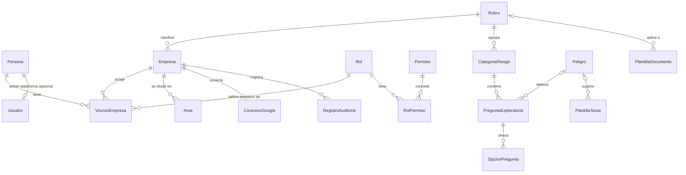
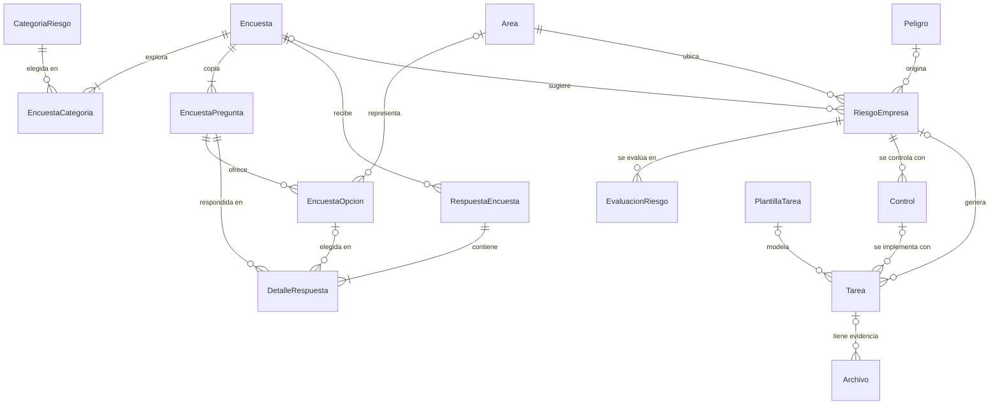
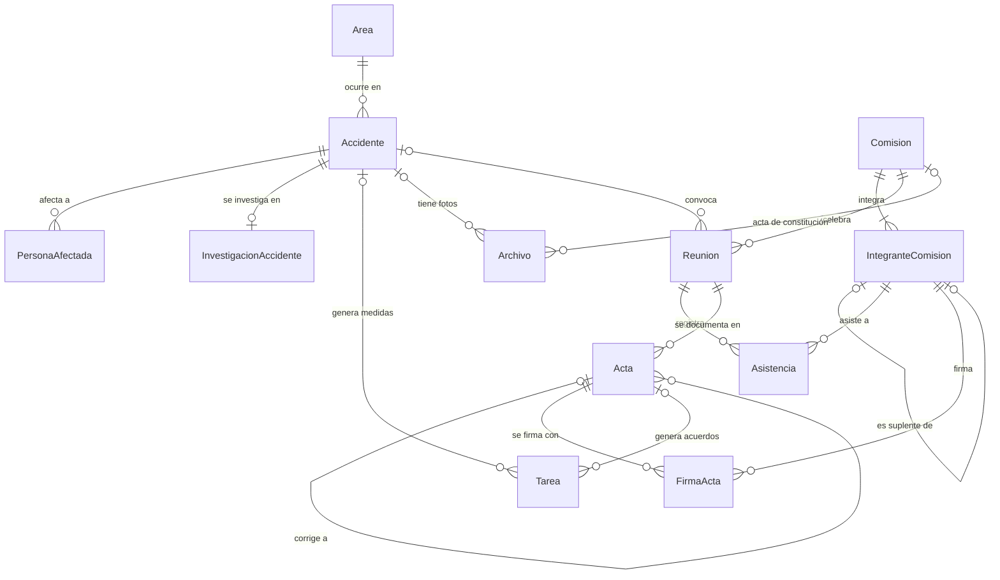
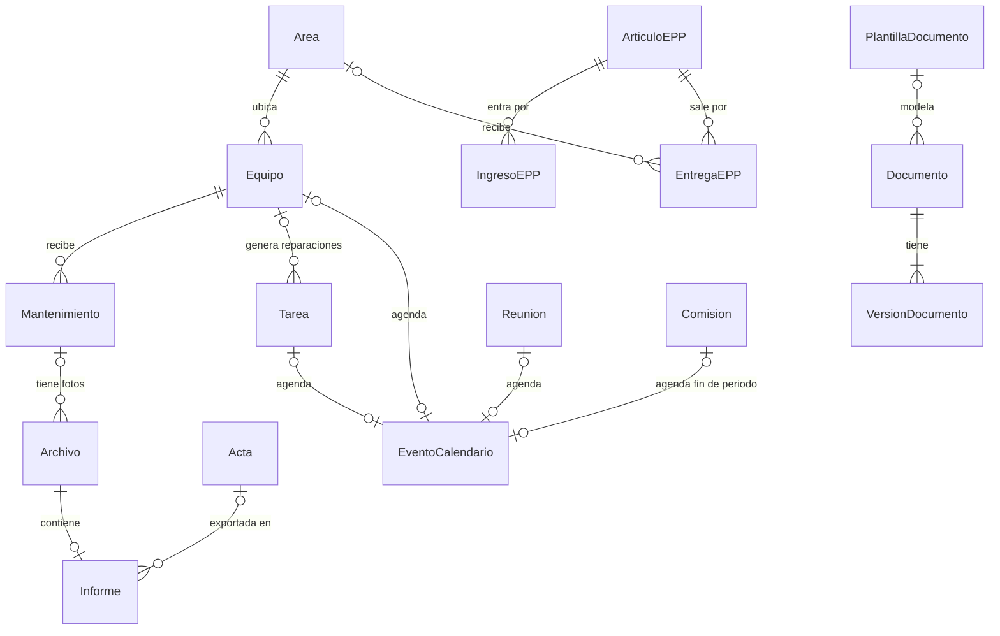

# Modelo de datos

**Para qué sirve:** define todas las tablas de Norvia, sus columnas, relaciones, restricciones e índices. Es la base del diagrama entidad-relación (ERD) que exige el curso y de la implementación con EF Core.

El modelo aplica las [decisiones](08-decisiones-bd.md) D1 a D22 y las [reglas de negocio](07-reglas-negocio.md). Parte de las [entidades candidatas](09-entidades.md) y agrega tablas que el diseño hizo necesarias: OpcionPregunta, EncuestaOpcion, Persona, VinculoEmpresa, historiales de estado y RBAC (`Permiso`, `RolPermiso`).

### Nombres de persona (3FN)

Los nombres se guardan en cuatro columnas en `Persona`. **No** existe `NombreCompleto` en base de datos; la aplicación lo concatena al mostrar (RN-62).

## 1. Convenciones

### Nombres y tipos

- Tablas y columnas en español, con PascalCase, igual que las clases de C#: `RiesgoEmpresa`, `FechaLimite`.
- La llave foránea se llama como la tabla a la que apunta, más `Id`: `AreaId` apunta a `Area`.
- Los tipos son los de PostgreSQL.

| Tipo | Uso |
|---|---|
| `uuid` | Llaves primarias. Un UUID es un identificador único generado al azar, que no revela cuántos registros existen |
| `smallint` | Llaves de catálogos pequeños (Rol, Rubro) y valores de 1 a 5 |
| `varchar(n)` | Texto corto con largo máximo |
| `text` | Texto largo |
| `date` | Fecha sin hora |
| `timestamptz` | Fecha y hora, guardada en UTC |
| `boolean` | Sí o no |
| `bytea` | Datos binarios, como credenciales cifradas |
| `jsonb` | Datos estructurados libres; solo se usa en la auditoría |

### Valores con opciones fijas

Los estados y tipos se guardan como texto en minúsculas, sin tildes, con una restricción `CHECK`. Una restricción `CHECK` es una condición que la base de datos verifica en cada fila; si no se cumple, rechaza el cambio.

Ejemplo: `Estado varchar(15) CHECK (Estado IN ('pendiente','en_progreso','completada','cancelada'))`.

En EF Core se mapean como `enum` de C# convertidos a texto.

### Claves en las tablas

| Marca | Significado |
|---|---|
| PK | Llave primaria |
| FK | Llave foránea |
| UQ | Valor único |
| NN | Obligatorio (`NOT NULL`) |

En los diccionarios, la columna **Nulo** dice "No" si el dato es obligatorio y "Sí" si es opcional.

### Fechas que fija el servidor

Las columnas que terminan en `En`, como `CreadoEn` o `RegistradoEn`, toman la hora del servidor (`DEFAULT now()`) y nunca la que envía el cliente.

## 2. Aislamiento entre empresas

| Tipo de tabla | Tiene `EmpresaId` | Tablas |
|---|---|---|
| Raíz | Es la empresa | Empresa |
| Global | No | Persona, Usuario, Rol, Permiso, RolPermiso, Rubro, CategoriaRiesgo, PreguntaExploratoria, OpcionPregunta, Peligro, PlantillaTarea, PlantillaDocumento |
| De empresa | Sí, obligatorio | Las demás tablas operativas (incluye VinculoEmpresa y historiales) |

Reglas que cumplen todas las tablas de empresa:

1. **`EmpresaId` es obligatorio** y es FK hacia `Empresa`.
2. **Cada tabla tiene un valor único compuesto `(EmpresaId, Id)`**, además de su PK. Esto permite que otras tablas apunten a ella incluyendo la empresa.
3. **Las FK entre tablas de empresa son compuestas:** incluyen `EmpresaId`. Por ejemplo, `Tarea (EmpresaId, AreaId) → Area (EmpresaId, Id)`. Así la base de datos rechaza que una tarea de la empresa A apunte a un área de la empresa B (decisión D15, regla RN-07). En los diccionarios se marcan como "FK compuesta".
4. **Las personas con operación en la empresa se referencian a través de su vínculo.** Una columna como `ResponsableId` es FK compuesta hacia `VinculoEmpresa (EmpresaId, Id)`. Así solo se asigna a quien tiene vínculo en esa empresa.
5. **EF Core aplica un filtro global** (`HasQueryFilter`) en cada tabla de empresa, usando la empresa activa del token.
6. **`EmpresaId` se asigna al guardar** desde la empresa activa, nunca desde lo que envía el cliente (RN-06).

Las referencias desde tablas de empresa hacia tablas globales son FK simples, por ejemplo `RiesgoEmpresa.PeligroId → Peligro.Id`.

## 3. Diagramas

Los diagramas están separados por área para que sean legibles. Solo muestran relaciones; las columnas están en el diccionario. Casi todas las tablas tienen además relación con `Empresa` (por `EmpresaId`) y con `Usuario` (autores y responsables); se omiten para no saturar los dibujos.

Cardinalidades: `||` es exactamente uno, `o|` es cero o uno, `o{` es cero o muchos y `|{` es uno o muchos.

### 3.1 Acceso, empresa y catálogos

### 3.2 Encuestas, riesgos y plan de trabajo

### 3.3 Accidentes y comisión

### 3.4 Gestión del riesgo, documentos, reportes y calendario

## 4. Diccionario de datos

### 4.1 Tablas globales

#### Persona

Identidad humana (D19, D21). Sin correo ni contraseña.

| Columna | Tipo | Nulo | Clave | Descripción y restricciones |
|---|---|---|---|---|
| Id | uuid | No | PK | |
| PrimerNombre | varchar(80) | No | | |
| SegundoNombre | varchar(80) | Sí | | |
| PrimerApellido | varchar(80) | No | | |
| SegundoApellido | varchar(80) | Sí | | |
| TipoDocumento | varchar(15) | Sí | | `dni`, `pasaporte`, `otro` |
| NumeroDocumento | varchar(50) | Sí | | |
| Telefono | varchar(30) | Sí | | |
| CreadoEn | timestamptz | No | | Lo fija el servidor |

**Restricciones:** UQ `(TipoDocumento, NumeroDocumento)` cuando ambos tienen valor.

#### Usuario

Cuenta del **administrador de plataforma** únicamente (D21). Los operadores de empresa autentican con `VinculoEmpresa`.

| Columna | Tipo | Nulo | Clave | Descripción y restricciones |
|---|---|---|---|---|
| Id | uuid | No | PK | |
| Email | varchar(254) | No | UQ | Índice único sobre `lower(Email)` |
| PasswordHash | varchar(255) | No | | |
| DebeCambiarPassword | boolean | No | | Por defecto `false` |
| Activo | boolean | No | | Por defecto `true` |
| CreadoEn | timestamptz | No | | |

#### Rol

Roles que una persona puede tener dentro de una empresa.

| Columna | Tipo | Nulo | Clave | Descripción y restricciones |
|---|---|---|---|---|
| Id | smallint | No | PK | |
| Codigo | varchar(30) | No | UQ | `admin_empresa`, `responsable_sst`, `colaborador` |
| Nombre | varchar(60) | No | | Nombre visible |

El Administrador de plataforma no usa `VinculoEmpresa`: entra por tabla `Usuario`.

#### Permiso

Catálogo de operaciones de la API (D20, HU-014).

| Columna | Tipo | Nulo | Clave | Descripción y restricciones |
|---|---|---|---|---|
| Id | smallint | No | PK | |
| Codigo | varchar(60) | No | UQ | Identificador estable |
| Nombre | varchar(120) | No | | |
| MetodoHttp | varchar(10) | No | | `GET`, `POST`, `PUT`, `PATCH`, `DELETE` |
| RutaPatron | varchar(200) | No | | Ejemplo: `/api/riesgos/*` |
| Activo | boolean | No | | Por defecto `true` |

#### RolPermiso

| Columna | Tipo | Nulo | Clave | Descripción y restricciones |
|---|---|---|---|---|
| RolId | smallint | No | PK, FK → Rol | |
| PermisoId | smallint | No | PK, FK → Permiso | |

#### Rubro

| Columna | Tipo | Nulo | Clave | Descripción y restricciones |
|---|---|---|---|---|
| Id | smallint | No | PK | |
| Codigo | varchar(30) | No | UQ | `oficina`, `comercio`, `maquila_fabrica`, `construccion` |
| Nombre | varchar(80) | No | UQ | |
| Activo | boolean | No | | Por defecto `true` |

#### CategoriaRiesgo

Categorías de riesgo de cada rubro, como trabajo en alturas o alto voltaje.

| Columna | Tipo | Nulo | Clave | Descripción y restricciones |
|---|---|---|---|---|
| Id | uuid | No | PK | |
| RubroId | smallint | No | FK → Rubro | |
| Nombre | varchar(100) | No | | |
| Descripcion | text | Sí | | |
| Activa | boolean | No | | Por defecto `true` |

**Restricciones:** UQ `(RubroId, Nombre)`.

#### Peligro

| Columna | Tipo | Nulo | Clave | Descripción y restricciones |
|---|---|---|---|---|
| Id | uuid | No | PK | |
| Codigo | varchar(20) | No | UQ | |
| Nombre | varchar(150) | No | | |
| Descripcion | text | Sí | | |
| Clasificacion | varchar(15) | No | | `fisico`, `mecanico`, `electrico`, `quimico`, `biologico`, `ergonomico`, `psicosocial`, `locativo`, `otro` |
| Activo | boolean | No | | Por defecto `true` |

#### PreguntaExploratoria

Preguntas de cada categoría. Si la pregunta detecta un peligro, se indica cuál (D7).

| Columna | Tipo | Nulo | Clave | Descripción y restricciones |
|---|---|---|---|---|
| Id | uuid | No | PK | |
| CategoriaRiesgoId | uuid | No | FK → CategoriaRiesgo | |
| Texto | varchar(500) | No | | |
| TipoRespuesta | varchar(15) | No | | `si_no`, `opcion_unica`, `texto` |
| Orden | smallint | No | | Posición dentro de la categoría |
| PeligroId | uuid | Sí | FK → Peligro | Peligro que detecta, si aplica |
| Activa | boolean | No | | Por defecto `true` |

**Restricciones:**

- UQ `(CategoriaRiesgoId, Orden)`.
- CHECK: si `TipoRespuesta = 'texto'`, `PeligroId` debe ser nulo, porque una respuesta libre no puede indicar exposición.

#### OpcionPregunta

Opciones de respuesta de cada pregunta. Está en una tabla aparte para cumplir la primera forma normal: una pregunta tiene varias opciones.

| Columna | Tipo | Nulo | Clave | Descripción y restricciones |
|---|---|---|---|---|
| Id | uuid | No | PK | |
| PreguntaExploratoriaId | uuid | No | FK → PreguntaExploratoria | |
| Texto | varchar(200) | No | | |
| Orden | smallint | No | | |
| IndicaExposicion | boolean | No | | Por defecto `false`. `true` si elegir esta opción sugiere el peligro de la pregunta |

**Restricciones:** UQ `(PreguntaExploratoriaId, Orden)`. Una pregunta `si_no` tiene exactamente dos opciones; lo valida la aplicación.

#### PlantillaTarea

Tareas modelo que se generan a partir de un peligro.

| Columna | Tipo | Nulo | Clave | Descripción y restricciones |
|---|---|---|---|---|
| Id | uuid | No | PK | |
| PeligroId | uuid | Sí | FK → Peligro | Peligro al que responde |
| TipoControl | varchar(15) | Sí | | Mismos valores que `Control.Tipo` |
| Titulo | varchar(200) | No | | |
| Descripcion | text | Sí | | |
| PrioridadSugerida | smallint | No | | CHECK entre 1 (alta) y 3 (baja) |
| RequiereEvidencia | boolean | No | | Por defecto `false` |
| Activa | boolean | No | | Por defecto `true` |

#### PlantillaDocumento

Políticas y procedimientos modelo.

| Columna | Tipo | Nulo | Clave | Descripción y restricciones |
|---|---|---|---|---|
| Id | uuid | No | PK | |
| Codigo | varchar(30) | No | UQ | |
| Titulo | varchar(200) | No | | |
| TipoDocumento | varchar(15) | No | | `politica`, `procedimiento` |
| RubroId | smallint | Sí | FK → Rubro | Nulo si aplica a todos los rubros |
| Contenido | text | No | | Texto con marcadores que se reemplazan por datos de la empresa, como `{{RazonSocial}}` |
| Activa | boolean | No | | Por defecto `true` |

### 4.2 Tabla raíz

#### Empresa

| Columna | Tipo | Nulo | Clave | Descripción y restricciones |
|---|---|---|---|---|
| Id | uuid | No | PK | |
| RazonSocial | varchar(200) | No | | |
| RTN | char(14) | No | UQ | CHECK: 14 dígitos (RN-01) |
| Direccion | varchar(300) | Sí | | Obligatoria para generar el informe anual |
| ActividadEconomica | varchar(150) | Sí | | |
| RubroId | smallint | Sí | FK → Rubro | Nulo hasta completar el perfil (RN-09) |
| TrabajadoresPermanentes | integer | Sí | | CHECK `>= 0` |
| FechaInicioOperaciones | date | Sí | | Sirve para advertir el plazo de 30 días de la comisión |
| Estado | varchar(12) | No | | `activa`, `suspendida`, `inactiva` (D22, RN-60) |
| CreadaEn | timestamptz | No | | Lo fija el servidor |

### 4.3 Tablas de empresa

En todas: `Id uuid` es la PK, `EmpresaId uuid` es obligatorio y es FK hacia `Empresa`, y existe UQ `(EmpresaId, Id)`. Las tablas con PK compuesta lo indican.

#### VinculoEmpresa

Relación persona–empresa con rol y credenciales institucionales (D1, D21).

| Columna | Tipo | Nulo | Clave | Descripción y restricciones |
|---|---|---|---|---|
| Id | uuid | No | PK | |
| EmpresaId | uuid | No | FK → Empresa | |
| PersonaId | uuid | No | FK → Persona | |
| RolId | smallint | No | FK → Rol | |
| Email | varchar(254) | No | | Correo institucional y login de este vínculo |
| PasswordHash | varchar(255) | No | | Clave solo de este vínculo |
| DebeCambiarPassword | boolean | No | | Por defecto `false` |
| Estado | varchar(12) | No | | `activo`, `suspendido`, `baja` |
| CreadoEn | timestamptz | No | | |

**Restricciones:**

- UQ `(EmpresaId, PersonaId)`: una persona, un vínculo por empresa.
- UQ índice sobre `lower(Email)` (RN-57).
- Destino de FK compuestas operativas (`ResponsableId`, etc.).
- Al menos un vínculo `activo` con rol admin por empresa (RN-08): lo valida la aplicación.

#### HistorialEstadoVinculo

Auditoría de cambios de estado del vínculo (D22, RN-59).

| Columna | Tipo | Nulo | Clave | Descripción y restricciones |
|---|---|---|---|---|
| Id | uuid | No | PK | |
| EmpresaId | uuid | No | FK → Empresa | |
| VinculoEmpresaId | uuid | No | FK compuesta → VinculoEmpresa | |
| EstadoAnterior | varchar(12) | Sí | | Nulo en el primer registro |
| EstadoNuevo | varchar(12) | No | | |
| MotivoCodigo | varchar(30) | No | | `decision_admin`, `baja_laboral`, `falta_pago_empresa`, `otro` |
| MotivoDetalle | text | Sí | | |
| RegistradoPorId | uuid | No | FK compuesta → VinculoEmpresa | |
| RegistradoEn | timestamptz | No | | |

#### HistorialEstadoEmpresa

Suspensión o reactivación del tenant (D22).

| Columna | Tipo | Nulo | Clave | Descripción y restricciones |
|---|---|---|---|---|
| Id | uuid | No | PK | |
| EmpresaId | uuid | No | FK → Empresa | |
| EstadoAnterior | varchar(12) | Sí | | |
| EstadoNuevo | varchar(12) | No | | |
| MotivoCodigo | varchar(30) | No | | `falta_pago_plataforma`, `reactivacion`, `otro` |
| MotivoDetalle | text | Sí | | |
| RegistradoPorId | uuid | Sí | FK → Usuario | Admin plataforma; nulo si es proceso automático |
| RegistradoEn | timestamptz | No | | |

#### ConexionGoogle

Cuenta de Google conectada por la empresa (D16).

| Columna | Tipo | Nulo | Clave | Descripción y restricciones |
|---|---|---|---|---|
| Id | uuid | No | PK | |
| EmpresaId | uuid | No | FK → Empresa | |
| CuentaGoogle | varchar(254) | No | | Correo de la cuenta conectada |
| RefreshTokenCifrado | bytea | No | | Credencial cifrada por la aplicación; nunca se envía al cliente |
| Alcances | text | No | | Permisos concedidos (Forms y Calendar) |
| ConectadaPorId | uuid | No | FK compuesta → VinculoEmpresa | |
| ConectadaEn | timestamptz | No | | |
| Activa | boolean | No | | Por defecto `true` |

**Restricciones:** UQ parcial `(EmpresaId) WHERE Activa`: como máximo una conexión activa (RN-53). Un índice parcial es un índice que solo incluye las filas que cumplen una condición.

#### RegistroAuditoria

Acciones importantes, para que la evidencia sea verificable.

| Columna | Tipo | Nulo | Clave | Descripción y restricciones |
|---|---|---|---|---|
| Id | uuid | No | PK | |
| EmpresaId | uuid | No | FK → Empresa | |
| VinculoEmpresaId | uuid | Sí | FK compuesta → VinculoEmpresa | Quien actuó en la empresa |
| UsuarioId | uuid | Sí | FK → Usuario | Solo acciones del admin de plataforma |
| Accion | varchar(50) | No | | Por ejemplo `acta_firmada` |
| Entidad | varchar(60) | No | | Tabla afectada |
| EntidadId | uuid | No | | Registro afectado; sin FK, porque puede apuntar a cualquier tabla |
| Fecha | timestamptz | No | | |
| Detalle | jsonb | Sí | | Datos adicionales de la acción |

**Restricciones:** la aplicación solo inserta; nunca actualiza ni borra.

#### Area

| Columna | Tipo | Nulo | Clave | Descripción y restricciones |
|---|---|---|---|---|
| Id | uuid | No | PK | |
| EmpresaId | uuid | No | FK → Empresa | |
| Nombre | varchar(100) | No | | |
| Descripcion | text | Sí | | |
| EncargadoId | uuid | Sí | FK compuesta → VinculoEmpresa | Encargado de área |
| Activa | boolean | No | | Por defecto `true`. Un área con registros se desactiva, no se borra |

**Restricciones:** UQ `(EmpresaId, Nombre)`.

#### Encuesta

Cada encuesta generada en Google Forms (D8).

| Columna | Tipo | Nulo | Clave | Descripción y restricciones |
|---|---|---|---|---|
| Id | uuid | No | PK | |
| EmpresaId | uuid | No | FK → Empresa | |
| Titulo | varchar(200) | No | | |
| GoogleFormId | varchar(100) | No | UQ | Identificador del formulario en Google |
| UrlRespuesta | varchar(500) | No | | Enlace que se comparte con los trabajadores |
| Estado | varchar(10) | No | | `publicada`, `cerrada` |
| CreadaPorId | uuid | No | FK compuesta → VinculoEmpresa | |
| CreadaEn | timestamptz | No | | |
| UltimaImportacionEn | timestamptz | Sí | | |

#### EncuestaCategoria

Categorías elegidas para cada encuesta. Resuelve la relación muchos a muchos entre Encuesta y CategoriaRiesgo.

| Columna | Tipo | Nulo | Clave | Descripción y restricciones |
|---|---|---|---|---|
| EncuestaId | uuid | No | PK, FK compuesta → Encuesta | |
| CategoriaRiesgoId | uuid | No | PK, FK → CategoriaRiesgo | |
| EmpresaId | uuid | No | FK → Empresa | |

**Restricciones:** PK `(EncuestaId, CategoriaRiesgoId)`. La categoría debe pertenecer al rubro de la empresa (RN-11); lo valida la aplicación.

#### EncuestaPregunta

Copia de cada pregunta tal como se envió (RN-12), para que los cambios del catálogo no alteren encuestas pasadas.

| Columna | Tipo | Nulo | Clave | Descripción y restricciones |
|---|---|---|---|---|
| Id | uuid | No | PK | |
| EmpresaId | uuid | No | FK → Empresa | |
| EncuestaId | uuid | No | FK compuesta → Encuesta | |
| PreguntaExploratoriaId | uuid | Sí | FK → PreguntaExploratoria | Pregunta de origen. Nulo en la pregunta de área |
| EsPreguntaArea | boolean | No | | `true` en la pregunta "¿En qué área trabaja?" |
| Texto | varchar(500) | No | | Copia del texto |
| TipoRespuesta | varchar(15) | No | | Copia del tipo |
| PeligroId | uuid | Sí | FK → Peligro | Copia del peligro asociado |
| Orden | smallint | No | | |
| GoogleQuestionId | varchar(50) | No | | Identificador de la pregunta en Google, para leer las respuestas |

**Restricciones:**

- UQ `(EncuestaId, Orden)`.
- UQ parcial `(EncuestaId) WHERE EsPreguntaArea`: una sola pregunta de área por encuesta.
- CHECK `EsPreguntaArea = (PreguntaExploratoriaId IS NULL)`.

#### EncuestaOpcion

Copia de las opciones de cada pregunta enviada. En la pregunta de área, cada opción es un área de la empresa.

| Columna | Tipo | Nulo | Clave | Descripción y restricciones |
|---|---|---|---|---|
| Id | uuid | No | PK | |
| EmpresaId | uuid | No | FK → Empresa | |
| EncuestaPreguntaId | uuid | No | FK compuesta → EncuestaPregunta | |
| Texto | varchar(200) | No | | |
| Orden | smallint | No | | |
| IndicaExposicion | boolean | No | | Copia del valor del catálogo |
| AreaId | uuid | Sí | FK compuesta → Area | Solo en las opciones de la pregunta de área |

**Restricciones:** UQ `(EncuestaPreguntaId, Orden)` y UQ `(EncuestaPreguntaId, Id)`; esta última permite verificar que la opción elegida pertenezca a su pregunta.

#### RespuestaEncuesta

Cada respuesta importada desde Google Forms.

| Columna | Tipo | Nulo | Clave | Descripción y restricciones |
|---|---|---|---|---|
| Id | uuid | No | PK | |
| EmpresaId | uuid | No | FK → Empresa | |
| EncuestaId | uuid | No | FK compuesta → Encuesta | |
| GoogleResponseId | varchar(100) | No | | Identificador de la respuesta en Google |
| RespondidaEn | timestamptz | No | | Hora en que el trabajador respondió |
| ImportadaEn | timestamptz | No | | |

**Restricciones:** UQ `(EncuestaId, GoogleResponseId)`: importar de nuevo no duplica respuestas.

El área de quien responde no se guarda aquí: es su respuesta a la pregunta de área, en DetalleRespuesta. Guardarla dos veces rompería la tercera forma normal.

#### DetalleRespuesta

Respuesta a cada pregunta.

| Columna | Tipo | Nulo | Clave | Descripción y restricciones |
|---|---|---|---|---|
| RespuestaEncuestaId | uuid | No | PK, FK compuesta → RespuestaEncuesta | |
| EncuestaPreguntaId | uuid | No | PK, FK compuesta → EncuestaPregunta | |
| EmpresaId | uuid | No | FK → Empresa | |
| EncuestaOpcionId | uuid | Sí | | Opción elegida |
| TextoLibre | text | Sí | | Respuesta abierta |

**Restricciones:**

- PK `(RespuestaEncuestaId, EncuestaPreguntaId)`.
- FK `(EncuestaPreguntaId, EncuestaOpcionId) → EncuestaOpcion (EncuestaPreguntaId, Id)`: la opción debe ser de esa pregunta.
- CHECK: exactamente uno de `EncuestaOpcionId` o `TextoLibre` tiene valor.

#### RiesgoEmpresa

Riesgos de la empresa. Un riesgo empieza como sugerido por una encuesta o lo crea el Responsable SST (D9).

| Columna | Tipo | Nulo | Clave | Descripción y restricciones |
|---|---|---|---|---|
| Id | uuid | No | PK | |
| EmpresaId | uuid | No | FK → Empresa | |
| PeligroId | uuid | Sí | FK → Peligro | Peligro del catálogo |
| DescripcionPeligro | varchar(300) | Sí | | Para peligros que no están en el catálogo |
| AreaId | uuid | No | FK compuesta → Area | RN-17 |
| Actividad | varchar(200) | Sí | | Actividad relacionada |
| Estado | varchar(12) | No | | `sugerido`, `confirmado`, `descartado` (RN-18) |
| EncuestaId | uuid | Sí | FK compuesta → Encuesta | Encuesta que lo sugirió |
| CreadoEn | timestamptz | No | | |
| RevisadoPorId | uuid | Sí | FK compuesta → VinculoEmpresa | Quien lo confirmó o descartó |
| RevisadoEn | timestamptz | Sí | | |

**Restricciones:**

- CHECK: `PeligroId` o `DescripcionPeligro` tiene valor.
- CHECK: si `Estado = 'sugerido'`, `EncuestaId` y `PeligroId` tienen valor.
- UQ parcial `(EncuestaId, PeligroId, AreaId) WHERE EncuestaId IS NOT NULL`: importar respuestas nuevas no duplica sugerencias.

#### EvaluacionRiesgo

Cada evaluación de un riesgo. Una nueva no reemplaza a la anterior (RN-20, D10).

| Columna | Tipo | Nulo | Clave | Descripción y restricciones |
|---|---|---|---|---|
| Id | uuid | No | PK | |
| EmpresaId | uuid | No | FK → Empresa | |
| RiesgoEmpresaId | uuid | No | FK compuesta → RiesgoEmpresa | |
| Tipo | varchar(10) | No | | `inicial`, `residual` |
| Probabilidad | smallint | No | | CHECK entre 1 y 5 |
| Severidad | smallint | No | | CHECK entre 1 y 5 |
| EvaluadoPorId | uuid | No | FK compuesta → VinculoEmpresa | |
| EvaluadoEn | timestamptz | No | | |

El nivel (`Probabilidad × Severidad`) y su clasificación se calculan; no se guardan (RN-15, RN-16).

#### Control

| Columna | Tipo | Nulo | Clave | Descripción y restricciones |
|---|---|---|---|---|
| Id | uuid | No | PK | |
| EmpresaId | uuid | No | FK → Empresa | |
| RiesgoEmpresaId | uuid | No | FK compuesta → RiesgoEmpresa | |
| Tipo | varchar(15) | No | | `eliminacion`, `sustitucion`, `ingenieria`, `administrativo`, `epp` (RN-21) |
| Descripcion | text | No | | |
| Estado | varchar(12) | No | | `propuesto`, `implementado` |
| CreadoEn | timestamptz | No | | |

**Restricciones:** UQ `(RiesgoEmpresaId, Id)`, para que una tarea pueda verificar que su control es del mismo riesgo.

#### Tarea

Tareas de todos los módulos (D6). El origen se deduce de qué columna de origen tiene valor; si ninguna tiene valor, la tarea es manual.

| Columna | Tipo | Nulo | Clave | Descripción y restricciones |
|---|---|---|---|---|
| Id | uuid | No | PK | |
| EmpresaId | uuid | No | FK → Empresa | |
| Titulo | varchar(200) | No | | |
| Descripcion | text | Sí | | |
| Estado | varchar(12) | No | | `pendiente`, `en_progreso`, `completada`, `cancelada` |
| Prioridad | smallint | No | | CHECK entre 1 (alta) y 3 (baja) |
| ResponsableId | uuid | Sí | FK compuesta → VinculoEmpresa | |
| FechaLimite | date | Sí | | |
| RequiereEvidencia | boolean | No | | Por defecto `false` |
| PlantillaTareaId | uuid | Sí | FK → PlantillaTarea | |
| RiesgoEmpresaId | uuid | Sí | FK compuesta → RiesgoEmpresa | Origen: riesgo |
| ControlId | uuid | Sí | | Control que implementa |
| EquipoId | uuid | Sí | FK compuesta → Equipo | Origen: mantenimiento |
| AccidenteId | uuid | Sí | FK compuesta → Accidente | Origen: accidente |
| ActaId | uuid | Sí | FK compuesta → Acta | Origen: acuerdo de reunión |
| CreadaPorId | uuid | No | FK compuesta → VinculoEmpresa | |
| CreadaEn | timestamptz | No | | |
| CompletadaEn | timestamptz | Sí | | |

**Restricciones:**

- CHECK: como máximo una de `RiesgoEmpresaId`, `EquipoId`, `AccidenteId` o `ActaId` tiene valor (RN-23).
- FK `(RiesgoEmpresaId, ControlId) → Control (RiesgoEmpresaId, Id)`: el control debe ser del mismo riesgo. Si `ControlId` tiene valor, `RiesgoEmpresaId` también.
- CHECK: si `Estado` es `en_progreso` o `completada`, `ResponsableId` y `FechaLimite` tienen valor (RN-22).
- CHECK: `CompletadaEn` tiene valor si y solo si `Estado = 'completada'`.
- UQ parcial `(RiesgoEmpresaId, PlantillaTareaId) WHERE` ambas tienen valor: generar el plan dos veces no duplica tareas.
- Evidencia obligatoria (RN-25) y quién puede actualizar (RN-24): los valida la aplicación.

#### Archivo

Datos y enlace de cada archivo guardado en el almacenamiento externo (D14). El archivo en sí no está en la base de datos.

| Columna | Tipo | Nulo | Clave | Descripción y restricciones |
|---|---|---|---|---|
| Id | uuid | No | PK | |
| EmpresaId | uuid | No | FK → Empresa | |
| NombreOriginal | varchar(255) | No | | |
| TipoContenido | varchar(100) | No | | Por ejemplo `image/jpeg` o `application/pdf` |
| TamanoBytes | bigint | No | | CHECK `> 0`. El máximo se define en los requerimientos no funcionales |
| ClaveAlmacenamiento | varchar(500) | No | UQ | Ubicación en el almacenamiento externo |
| SubidoPorId | uuid | No | FK compuesta → VinculoEmpresa | |
| SubidoEn | timestamptz | No | | |
| TareaId | uuid | Sí | FK compuesta → Tarea | Evidencia de una tarea |
| AccidenteId | uuid | Sí | FK compuesta → Accidente | Foto de un accidente |
| MantenimientoId | uuid | Sí | FK compuesta → Mantenimiento | Foto de un mantenimiento |
| ComisionId | uuid | Sí | FK compuesta → Comision | Acta de constitución |

**Restricciones:** CHECK: como máximo una de las cuatro columnas de dueño tiene valor. Los PDF de los informes no usan estas columnas: los referencia `Informe.ArchivoId`.

#### Accidente

Accidentes, incidentes y enfermedades profesionales (RN-26).

| Columna | Tipo | Nulo | Clave | Descripción y restricciones |
|---|---|---|---|---|
| Id | uuid | No | PK | |
| EmpresaId | uuid | No | FK → Empresa | |
| Tipo | varchar(25) | No | | `accidente`, `incidente`, `enfermedad_profesional` |
| EstadoEnfermedad | varchar(15) | Sí | | `sospechosa`, `diagnosticada` |
| EsGrave | boolean | No | | Por defecto `false` (RN-29) |
| FechaHoraEvento | timestamptz | No | | La indica quien reporta (RN-31) |
| AreaId | uuid | No | FK compuesta → Area | |
| Descripcion | text | No | | |
| ReportadoPorId | uuid | No | FK compuesta → VinculoEmpresa | |
| RegistradoEn | timestamptz | No | | Lo fija el servidor (RN-31) |
| Estado | varchar(16) | No | | `abierto`, `en_investigacion`, `cerrado` |
| CerradoEn | timestamptz | Sí | | |

**Restricciones:**

- CHECK: `EstadoEnfermedad` tiene valor si y solo si `Tipo = 'enfermedad_profesional'`.
- CHECK: `CerradoEn` tiene valor si y solo si `Estado = 'cerrado'`.
- Para cerrar debe existir investigación y al menos una medida (RN-28); lo valida la aplicación.

#### PersonaAfectada

Personas afectadas por un evento (D11). No necesitan vínculo. Puede enlazarse a `Persona` para evitar duplicar identidad.

| Columna | Tipo | Nulo | Clave | Descripción y restricciones |
|---|---|---|---|---|
| Id | uuid | No | PK | |
| EmpresaId | uuid | No | FK → Empresa | |
| AccidenteId | uuid | No | FK compuesta → Accidente | |
| PersonaId | uuid | Sí | FK → Persona | Opcional |
| NombreParaRegistro | varchar(200) | No | | Texto capturado en el evento si no hay Persona |
| Puesto | varchar(100) | Sí | | |
| TipoLesion | varchar(150) | Sí | | |
| DiasIncapacidad | integer | No | | Por defecto 0. CHECK `>= 0` |

Solo el Responsable SST y la comisión pueden consultarla (RN-30); lo valida la aplicación.

#### InvestigacionAccidente

| Columna | Tipo | Nulo | Clave | Descripción y restricciones |
|---|---|---|---|---|
| Id | uuid | No | PK | |
| EmpresaId | uuid | No | FK → Empresa | |
| AccidenteId | uuid | No | UQ, FK compuesta → Accidente | Una investigación por evento |
| CausasInmediatas | text | No | | |
| CausasBasicas | text | No | | Causas de fondo |
| Conclusiones | text | Sí | | |
| InvestigadaPorId | uuid | No | FK compuesta → VinculoEmpresa | |
| FechaInvestigacion | date | No | | |

Las medidas correctivas son tareas con `AccidenteId`.

#### Comision

| Columna | Tipo | Nulo | Clave | Descripción y restricciones |
|---|---|---|---|---|
| Id | uuid | No | PK | |
| EmpresaId | uuid | No | FK → Empresa | |
| FechaConstitucion | date | No | | |
| NumeroRegistroSTSS | varchar(50) | Sí | | Registro ante la Secretaría de Trabajo |
| FechaRegistroSTSS | date | Sí | | |
| Activa | boolean | No | | Por defecto `true` |
| CreadaEn | timestamptz | No | | |

**Restricciones:** UQ parcial `(EmpresaId) WHERE Activa`: una sola comisión activa (D4). El acta de constitución es un registro de Archivo con este `ComisionId`.

#### IntegranteComision

| Columna | Tipo | Nulo | Clave | Descripción y restricciones |
|---|---|---|---|---|
| Id | uuid | No | PK | |
| EmpresaId | uuid | No | FK → Empresa | |
| ComisionId | uuid | No | FK compuesta → Comision | |
| VinculoEmpresaId | uuid | No | FK compuesta → VinculoEmpresa | |
| Parte | varchar(14) | No | | `empleador`, `trabajadores` |
| Condicion | varchar(11) | No | | `propietario`, `suplente` |
| Cargo | varchar(11) | No | | `presidente`, `secretario`, `miembro` |
| SuplenteDeId | uuid | Sí | FK compuesta → IntegranteComision | Propietario al que suple |
| FechaInicio | date | No | | Inicio del periodo |
| FechaBaja | date | Sí | | Nulo mientras está activo |

**Restricciones:**

- CHECK: `SuplenteDeId` tiene valor si y solo si `Condicion = 'suplente'` (RN-33).
- CHECK: presidente y secretario son propietarios.
- UQ parcial `(ComisionId) WHERE Cargo = 'presidente' AND FechaBaja IS NULL`, y lo mismo para secretario.
- UQ parcial `(SuplenteDeId) WHERE FechaBaja IS NULL`: un suplente activo por propietario.
- El fin del periodo es `FechaInicio` más 2 años; se calcula (RN-36). La paridad entre partes (RN-32) la valida la aplicación.

#### Reunion

| Columna | Tipo | Nulo | Clave | Descripción y restricciones |
|---|---|---|---|---|
| Id | uuid | No | PK | |
| EmpresaId | uuid | No | FK → Empresa | |
| ComisionId | uuid | No | FK compuesta → Comision | |
| Tipo | varchar(14) | No | | `ordinaria`, `extraordinaria` |
| FechaHora | timestamptz | No | | |
| Lugar | varchar(200) | No | | |
| Temas | text | No | | |
| Motivo | text | Sí | | |
| AccidenteId | uuid | Sí | FK compuesta → Accidente | Accidente grave que la motivó (art. 32) |
| Estado | varchar(10) | No | | `programada`, `realizada`, `cancelada` |
| ConvocadaPorId | uuid | No | FK compuesta → VinculoEmpresa | |
| CreadaEn | timestamptz | No | | |

**Restricciones:** CHECK: si `Tipo = 'extraordinaria'`, `Motivo` tiene valor.

#### Asistencia

| Columna | Tipo | Nulo | Clave | Descripción y restricciones |
|---|---|---|---|---|
| ReunionId | uuid | No | PK, FK compuesta → Reunion | |
| IntegranteComisionId | uuid | No | PK, FK compuesta → IntegranteComision | |
| EmpresaId | uuid | No | FK → Empresa | |
| Asistio | boolean | No | | |

El quórum se calcula a partir de esta tabla (RN-34, RN-35).

#### Acta

| Columna | Tipo | Nulo | Clave | Descripción y restricciones |
|---|---|---|---|---|
| Id | uuid | No | PK | |
| EmpresaId | uuid | No | FK → Empresa | |
| ReunionId | uuid | No | FK compuesta → Reunion | |
| Estado | varchar(9) | No | | `borrador`, `aprobada`, `firmada` (RN-38) |
| ConclusionesVisitas | text | Sí | | Contenido mínimo del art. 33 |
| ResultadosInvestigaciones | text | Sí | | |
| ActividadesEducativas | text | Sí | | |
| OtrosTemas | text | Sí | | |
| RedactadaPorId | uuid | No | FK compuesta → VinculoEmpresa | |
| CreadaEn | timestamptz | No | | |
| AprobadaEn | timestamptz | Sí | | |
| FirmadaEn | timestamptz | Sí | | |
| HashContenido | char(64) | Sí | | Hash SHA-256 del contenido, calculado al aprobar |
| CorrigeActaId | uuid | Sí | FK compuesta → Acta | Acta que corrige |

**Restricciones:**

- CHECK: si `Estado = 'borrador'`, `HashContenido` es nulo; en otro caso tiene valor.
- UQ parcial `(ReunionId) WHERE CorrigeActaId IS NULL`: un acta original por reunión.
- Un disparador (trigger), que es código que la base de datos ejecuta automáticamente ante un cambio, impide modificar o borrar un acta firmada (RN-40).

#### FirmaActa

| Columna | Tipo | Nulo | Clave | Descripción y restricciones |
|---|---|---|---|---|
| ActaId | uuid | No | PK, FK compuesta → Acta | |
| IntegranteComisionId | uuid | No | PK, FK compuesta → IntegranteComision | |
| EmpresaId | uuid | No | FK → Empresa | |
| FirmadaEn | timestamptz | No | | |
| HashFirmado | char(64) | No | | Hash que vio quien firmó (RN-41) |

La aplicación verifica que `HashFirmado` coincida con `Acta.HashContenido` y que quien firma haya asistido.

#### Equipo

| Columna | Tipo | Nulo | Clave | Descripción y restricciones |
|---|---|---|---|---|
| Id | uuid | No | PK | |
| EmpresaId | uuid | No | FK → Empresa | |
| Identificador | varchar(50) | No | | Código del equipo o producto |
| Nombre | varchar(150) | No | | |
| Tipo | varchar(80) | No | | |
| AreaId | uuid | No | FK compuesta → Area | |
| ResponsableMantenimientoId | uuid | No | FK compuesta → VinculoEmpresa | |
| EsEquipoEmergencia | boolean | No | | Por defecto `false` |
| ProximoMantenimiento | date | Sí | | |
| Activo | boolean | No | | Por defecto `true` |

**Restricciones:** UQ `(EmpresaId, Identificador)` (RN-42). Un equipo está vencido si `ProximoMantenimiento < hoy`; se calcula (RN-45).

#### Mantenimiento

| Columna | Tipo | Nulo | Clave | Descripción y restricciones |
|---|---|---|---|---|
| Id | uuid | No | PK | |
| EmpresaId | uuid | No | FK → Empresa | |
| EquipoId | uuid | No | FK compuesta → Equipo | |
| Tipo | varchar(11) | No | | `preventivo`, `correctivo` |
| Descripcion | text | No | | |
| ResponsableId | uuid | No | FK compuesta → VinculoEmpresa | |
| Estado | varchar(10) | No | | `en_proceso`, `realizado` |
| RealizadoEn | timestamptz | Sí | | |
| RegistradoEn | timestamptz | No | | Lo fija el servidor (RN-44) |

**Restricciones:**

- CHECK: `RealizadoEn` tiene valor si y solo si `Estado = 'realizado'`.
- Al menos una foto para marcarlo como realizado (RN-43): lo valida la aplicación, porque las fotos están en otra tabla.
- Un disparador impide modificar un mantenimiento realizado (RN-44).

#### ArticuloEPP

| Columna | Tipo | Nulo | Clave | Descripción y restricciones |
|---|---|---|---|---|
| Id | uuid | No | PK | |
| EmpresaId | uuid | No | FK → Empresa | |
| Nombre | varchar(120) | No | | |
| Tipo | varchar(60) | No | | Por ejemplo casco, guantes o arnés |
| Marca | varchar(80) | Sí | | |
| Activo | boolean | No | | Por defecto `true` |

**Restricciones:** UQ `(EmpresaId, Nombre, Marca) NULLS NOT DISTINCT`, para que dos artículos sin marca tampoco se repitan (requiere PostgreSQL 15 o posterior). El inventario se calcula (RN-46, D18).

#### IngresoEPP

| Columna | Tipo | Nulo | Clave | Descripción y restricciones |
|---|---|---|---|---|
| Id | uuid | No | PK | |
| EmpresaId | uuid | No | FK → Empresa | |
| ArticuloEPPId | uuid | No | FK compuesta → ArticuloEPP | |
| Cantidad | integer | No | | CHECK `> 0` |
| Fecha | date | No | | |
| RegistradoPorId | uuid | No | FK compuesta → VinculoEmpresa | |
| RegistradoEn | timestamptz | No | | |

#### EntregaEPP

| Columna | Tipo | Nulo | Clave | Descripción y restricciones |
|---|---|---|---|---|
| Id | uuid | No | PK | |
| EmpresaId | uuid | No | FK → Empresa | |
| ArticuloEPPId | uuid | No | FK compuesta → ArticuloEPP | |
| NombreTrabajador | varchar(150) | No | | El trabajador no necesita cuenta |
| AreaId | uuid | Sí | FK compuesta → Area | |
| Puesto | varchar(100) | Sí | | |
| Cantidad | integer | No | | CHECK `> 0` |
| Fecha | date | No | | |
| RegistradoPorId | uuid | No | FK compuesta → VinculoEmpresa | |
| RegistradoEn | timestamptz | No | | |

**Restricciones:**

- CHECK: `AreaId` o `Puesto` tiene valor (RN-48).
- No entregar más de lo disponible (RN-47): la aplicación calcula el inventario dentro de la misma transacción, bloqueando la fila del artículo (`SELECT … FOR UPDATE`), para que dos entregas simultáneas no superen el inventario.

#### Documento

| Columna | Tipo | Nulo | Clave | Descripción y restricciones |
|---|---|---|---|---|
| Id | uuid | No | PK | |
| EmpresaId | uuid | No | FK → Empresa | |
| PlantillaDocumentoId | uuid | Sí | FK → PlantillaDocumento | Plantilla de origen |
| Titulo | varchar(200) | No | | |
| TipoDocumento | varchar(15) | No | | `politica`, `procedimiento` |
| CreadoPorId | uuid | No | FK compuesta → VinculoEmpresa | |
| CreadoEn | timestamptz | No | | |

#### VersionDocumento

| Columna | Tipo | Nulo | Clave | Descripción y restricciones |
|---|---|---|---|---|
| Id | uuid | No | PK | |
| EmpresaId | uuid | No | FK → Empresa | |
| DocumentoId | uuid | No | FK compuesta → Documento | |
| NumeroVersion | integer | No | | CHECK `>= 1` |
| Contenido | text | No | | |
| Estado | varchar(11) | No | | `borrador`, `vigente`, `reemplazada` |
| CreadaPorId | uuid | No | FK compuesta → VinculoEmpresa | |
| CreadaEn | timestamptz | No | | |
| AprobadaPorId | uuid | Sí | FK compuesta → VinculoEmpresa | |
| AprobadaEn | timestamptz | Sí | | |

**Restricciones:**

- UQ `(DocumentoId, NumeroVersion)`.
- UQ parcial `(DocumentoId) WHERE Estado = 'vigente'`: una sola versión vigente (RN-51).
- UQ parcial `(DocumentoId) WHERE Estado = 'borrador'`: un solo borrador a la vez.
- CHECK: si `Estado` no es `borrador`, `AprobadaPorId` y `AprobadaEn` tienen valor.
- Un disparador impide modificar el contenido de una versión aprobada (RN-50).

#### Informe

Cada reporte generado. El PDF está en Archivo.

| Columna | Tipo | Nulo | Clave | Descripción y restricciones |
|---|---|---|---|---|
| Id | uuid | No | PK | |
| EmpresaId | uuid | No | FK → Empresa | |
| Tipo | varchar(15) | No | | `matriz_riesgos`, `politicas`, `semestral`, `anual`, `acta` |
| PeriodoInicio | date | Sí | | |
| PeriodoFin | date | Sí | | |
| ActaId | uuid | Sí | FK compuesta → Acta | Solo en reportes de acta |
| RetosSiguientePeriodo | text | Sí | | Texto que redacta el Responsable SST para el informe anual |
| ArchivoId | uuid | No | UQ, FK compuesta → Archivo | PDF generado |
| GeneradoPorId | uuid | No | FK compuesta → VinculoEmpresa | |
| GeneradoEn | timestamptz | No | | |

**Restricciones:**

- CHECK: `ActaId` tiene valor si y solo si `Tipo = 'acta'`.
- CHECK: si `Tipo` es `semestral` o `anual`, `PeriodoInicio` y `PeriodoFin` tienen valor y `PeriodoInicio <= PeriodoFin`.
- CHECK: `RetosSiguientePeriodo` solo tiene valor si `Tipo = 'anual'`.

#### EventoCalendario

Une cada registro de Norvia con su evento en Google Calendar (D16, RN-54 a RN-56).

| Columna | Tipo | Nulo | Clave | Descripción y restricciones |
|---|---|---|---|---|
| Id | uuid | No | PK | |
| EmpresaId | uuid | No | FK → Empresa | |
| Tipo | varchar(20) | No | | `tarea`, `reunion`, `mantenimiento`, `informe_semestral`, `informe_anual`, `fin_comision` |
| TareaId | uuid | Sí | FK compuesta → Tarea | |
| ReunionId | uuid | Sí | FK compuesta → Reunion | |
| EquipoId | uuid | Sí | FK compuesta → Equipo | |
| ComisionId | uuid | Sí | FK compuesta → Comision | |
| FechaInforme | date | Sí | | Solo en eventos de informes, que no tienen otra tabla de origen |
| GoogleEventId | varchar(200) | Sí | | Nulo hasta que Google confirma el evento |
| EstadoSincronizacion | varchar(10) | No | | `pendiente`, `sincronizado`, `error`, `eliminado` |
| Intentos | smallint | No | | Por defecto 0 |
| UltimoError | text | Sí | | |
| ActualizadoEn | timestamptz | No | | |

**Restricciones:**

- CHECK: cada `Tipo` exige su columna de origen y ninguna otra: `tarea` exige `TareaId`; `reunion`, `ReunionId`; `mantenimiento`, `EquipoId`; `fin_comision`, `ComisionId`; los informes exigen `FechaInforme`.
- UQ parcial sobre `TareaId`, `ReunionId`, `EquipoId` y `ComisionId`, cada uno `WHERE` tiene valor: un evento por registro.
- UQ parcial `(EmpresaId, Tipo, FechaInforme) WHERE FechaInforme IS NOT NULL`.
- La fecha del evento no se guarda aquí, salvo en informes: se toma del registro de origen, como `Tarea.FechaLimite`, para no duplicarla.

## 5. Relaciones

| Relación | Cardinalidad | Cómo se implementa |
|---|---|---|
| Persona – Empresa | Muchos a muchos | Tabla intermedia VinculoEmpresa |
| Encuesta – CategoriaRiesgo | Muchos a muchos | Tabla intermedia EncuestaCategoria |
| Reunion – IntegranteComision (asistencia) | Muchos a muchos | Tabla intermedia Asistencia |
| Acta – IntegranteComision (firmas) | Muchos a muchos | Tabla intermedia FirmaActa |
| Rubro – CategoriaRiesgo – PreguntaExploratoria – OpcionPregunta | Uno a muchos, en cadena | FK en la tabla hija |
| Empresa – ConexionGoogle | Uno a cero o uno (activa) | UQ parcial |
| Empresa – Comision | Uno a cero o uno (activa) | UQ parcial |
| Accidente – InvestigacionAccidente | Uno a cero o uno | UQ en `AccidenteId` |
| Informe – Archivo | Uno a uno | UQ en `ArchivoId` |
| Integrante propietario – suplente | Uno a cero o uno (activo) | FK a la misma tabla y UQ parcial |
| Acta – Acta (corrección) | Uno a muchos | FK a la misma tabla |
| Tarea – origen | Muchos a cero o uno | Cuatro FK opcionales y CHECK de máximo una |
| Archivo – dueño | Muchos a cero o uno | Cuatro FK opcionales y CHECK de máximo una |
| Registro – EventoCalendario | Uno a cero o uno | FK opcional con UQ parcial |

## 6. Eliminación y actualización

- **Ninguna tabla se borra en cascada.** Todas las FK usan `ON DELETE RESTRICT`: la base de datos rechaza borrar un registro que otros usan.
- **Los registros operativos no se borran:** se desactivan (`Activo`, `Activa`) o cambian de estado (`cancelada`, `descartado`, `eliminado`). Así se conserva la evidencia.
- **Los registros inmutables** (actas firmadas, mantenimientos realizados, versiones aprobadas) están protegidos además por disparadores.
- **Las llaves primarias no cambian:** son UUID generados al crear el registro, por lo que no se necesita `ON UPDATE CASCADE`.

## 7. Índices

PostgreSQL crea índices automáticamente para las PK y los valores únicos, pero no para las FK.

1. **Cada FK lleva su índice,** empezando por `EmpresaId` cuando es compuesta.
2. **Índices de consultas frecuentes:**

| Tabla | Índice | Consulta que acelera |
|---|---|---|
| Tarea | `(EmpresaId, ResponsableId, Estado)` | Mis tareas |
| Tarea | `(EmpresaId, FechaLimite) WHERE Estado IN ('pendiente','en_progreso')` | Tareas vencidas y próximas |
| RiesgoEmpresa | `(EmpresaId, AreaId, Estado)` | Matriz por área |
| EvaluacionRiesgo | `(RiesgoEmpresaId, EvaluadoEn DESC)` | Última evaluación de cada riesgo |
| Accidente | `(EmpresaId, FechaHoraEvento)` | Estadísticas por periodo |
| Equipo | `(EmpresaId, ProximoMantenimiento) WHERE Activo` | Mantenimientos vencidos |
| Mantenimiento | `(EquipoId, RegistradoEn DESC)` | Historial de un equipo |
| EntregaEPP | `(EmpresaId, Fecha)` | Entregas por periodo |
| IngresoEPP, EntregaEPP | `(ArticuloEPPId)` | Cálculo de inventario |
| Reunion | `(EmpresaId, FechaHora)` | Reuniones del mes |
| DetalleRespuesta | `(EncuestaPreguntaId, EncuestaOpcionId)` | Resumen de respuestas y sugerencias |
| EventoCalendario | `(EstadoSincronizacion) WHERE EstadoSincronizacion IN ('pendiente','error')` | Reintentos con Google |
| RegistroAuditoria | `(EmpresaId, Fecha DESC)` y `(Entidad, EntidadId)` | Consulta de auditoría |

## 8. Normalización

### Primera forma normal (1FN)

Cada columna guarda un solo valor:

- Las opciones de una pregunta están en OpcionPregunta y EncuestaOpcion.
- Las categorías de una encuesta están en EncuestaCategoria.
- Las fotos y evidencias están en Archivo.
- Las firmas y asistencias tienen su propia tabla.

La única excepción es `RegistroAuditoria.Detalle`, que es `jsonb`: guarda información de contexto que no se consulta por campos ni se relaciona con otras tablas.

### Segunda forma normal (2FN)

Las tablas con PK compuesta (EncuestaCategoria, DetalleRespuesta, Asistencia, FirmaActa) solo tienen atributos que dependen de toda la llave. Por ejemplo, `Asistencia.Asistio` depende de la reunión y del integrante a la vez.

### Tercera forma normal (3FN)

No se guardan datos que se puedan obtener de otros:

| Dato | Cómo se obtiene |
|---|---|
| Nombre completo de Persona | Concatenación de las cuatro columnas de nombre (RN-62) |
| Nivel y clasificación del riesgo | `Probabilidad × Severidad` |
| Número de representantes de la comisión | `Empresa.TrabajadoresPermanentes` y la tabla del art. 14 |
| Fin del periodo de un integrante | `FechaInicio` más 2 años |
| Quórum | Asistencia e integrantes propietarios |
| Área de quien respondió la encuesta | Su respuesta a la pregunta de área |
| Trabajadores que respaldan una sugerencia | Conteo en DetalleRespuesta |
| Inventario de EPP | Ingresos menos entregas |
| Equipo vencido | `ProximoMantenimiento` comparado con hoy |
| Origen de una tarea | Columna de origen que tiene valor |
| Fecha de un evento de calendario | Fecha del registro de origen |
| Estadísticas de siniestralidad | Accidente y PersonaAfectada |

### Duplicaciones intencionales

Estas columnas repiten un dato a propósito, sin romper la 3FN:

- **Copias de la encuesta** (`EncuestaPregunta.Texto`, `EncuestaOpcion.Texto`, `PeligroId`, `IndicaExposicion`): registran lo que se envió en ese momento. No se pueden deducir del catálogo, porque este puede cambiar (RN-12).
- **`FirmaActa.HashFirmado`:** es la evidencia de lo que vio quien firmó. Si coincide con `Acta.HashContenido`, se demuestra que el acta no cambió.
- **`EmpresaId` en tablas hijas,** como DetalleRespuesta o Asistencia: técnicamente podría deducirse de la tabla padre. Se guarda porque el curso exige `EmpresaId` en las tablas transaccionales y porque el filtro global lo necesita en cada tabla. Las FK compuestas garantizan que siempre coincide con el padre, así que no puede quedar inconsistente.

## 9. Cómo se cumplen las reglas de negocio

**BD** indica que la base de datos lo garantiza aunque la aplicación falle. **App** indica que lo valida la aplicación, porque involucra varias tablas o condiciones que una restricción no puede expresar.

| Regla | Dónde | Cómo |
|---|---|---|
| RN-01 | BD | UQ `Empresa.RTN` |
| RN-02, RN-03 | BD | VinculoEmpresa con UQ `(EmpresaId, PersonaId)` y `RolId` |
| RN-57 | BD | `VinculoEmpresa.Email` y `PasswordHash` |
| RN-58, RN-59 | BD y App | `HistorialEstadoVinculo` y transacción con `Estado` |
| RN-60 | BD | `Empresa.Estado` |
| RN-61 | App | Cargo vs rol en permisos |
| RN-62 | App | Sin `NombreCompleto` en Persona/Usuario |
| RN-04 | BD | `EmpresaId` obligatorio |
| RN-05, RN-06 | App | Filtro global de EF Core y empresa tomada del token |
| RN-07 | BD | FK compuestas con `EmpresaId` |
| RN-08 | App | Validación al cambiar roles o suspender vínculos |
| RN-09 | BD | `Empresa.RubroId` es una sola columna |
| RN-10, RN-11 | App | Validación antes de generar la encuesta |
| RN-12 | BD | Copias en EncuestaPregunta y EncuestaOpcion |
| RN-13, RN-14 | App | Consulta determinista sobre DetalleRespuesta |
| RN-15, RN-16 | BD y App | CHECK de 1 a 5; nivel y clasificación calculados |
| RN-17 | BD | `RiesgoEmpresa.AreaId` obligatorio |
| RN-18 | BD | `RiesgoEmpresa.Estado` |
| RN-19 | App | Validación al evaluar |
| RN-20 | BD | Una fila por evaluación |
| RN-21 | BD | CHECK `Control.Tipo` |
| RN-22 | BD | CHECK en Tarea |
| RN-23 | BD | Columnas de origen con CHECK |
| RN-24, RN-25 | App | Permisos y conteo de evidencias |
| RN-26 | BD | CHECK `Tipo` y `EstadoEnfermedad` |
| RN-27 | App | Permiso de reporte |
| RN-28 | App | Validación al cerrar |
| RN-29 | BD y App | `EsGrave` y propuesta de reunión con `Reunion.AccidenteId` |
| RN-30 | App | Permiso sobre PersonaAfectada |
| RN-31 | BD | `RegistradoEn DEFAULT now()` |
| RN-32 | App | Conteo de integrantes por parte |
| RN-33 | BD | `SuplenteDeId` con CHECK y UQ parcial |
| RN-34, RN-35 | App | Cálculo sobre Asistencia |
| RN-36 | App | Fin calculado desde `FechaInicio` |
| RN-37 | App | Consulta de reuniones por mes |
| RN-38 | BD | CHECK `Acta.Estado` y hash |
| RN-39 | App | Validación al aprobar |
| RN-40 | BD | Disparador sobre actas firmadas |
| RN-41 | BD | `FirmaActa.HashFirmado` |
| RN-42 | BD | UQ `(EmpresaId, Identificador)` |
| RN-43 | BD y App | CHECK `RealizadoEn`; conteo de fotos |
| RN-44 | BD | `DEFAULT now()` y disparador |
| RN-45, RN-46 | App | Calculado |
| RN-47 | App | Transacción con bloqueo |
| RN-48 | BD | Columnas obligatorias y CHECK |
| RN-49, RN-50, RN-51 | BD | Estados, UQ parciales y disparador |
| RN-52 | App | Los informes se generan desde las tablas |
| RN-53 | BD | UQ parcial y credencial cifrada |
| RN-54, RN-55, RN-56 | BD y App | EventoCalendario con estado y reintentos |

## 10. Origen de los datos del informe anual

| Sección | Tablas y columnas |
|---|---|
| Datos de la empresa | `Empresa.RazonSocial`, `RTN`, `Direccion`, `ActividadEconomica`, `TrabajadoresPermanentes` |
| Comisión de Seguridad e Higiene | Comision (fecha y registro), Archivo con `ComisionId` (acta de constitución), IntegranteComision (integración). Las funciones son texto fijo del art. 25 |
| Estadísticas de siniestralidad | Accidente por `Tipo`, `EstadoEnfermedad` y `FechaHoraEvento`; `PersonaAfectada.DiasIncapacidad` para incapacidad y ausentismo |
| Gestión de prevención | RiesgoEmpresa, EvaluacionRiesgo y Control; Mantenimiento de equipos con `EsEquipoEmergencia` |
| Equipo de protección personal | ArticuloEPP, IngresoEPP y EntregaEPP por `AreaId` o `Puesto` |
| Plan de acción y mejoras | Tareas completadas en el año (`CompletadaEn`); `Informe.RetosSiguientePeriodo` |
