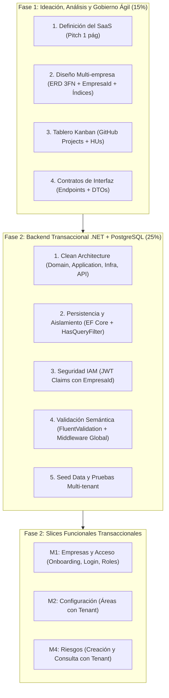

# Sprint Backlog: Fase 1 y Fase 2 (Entrega Actual)

**Para qué sirve:** define y prioriza el conjunto de historias de usuario (HUs) que el equipo debe completar para la entrega actual, que abarca la **Fase 1 (Ideación, análisis y gobierno ágil - 15 %)** y la **Fase 2 (Construcción del backend transaccional - 25 %)**, sumando el **40 % de la calificación final** de la clase según los [lineamientos del curso](02-requisitos-curso.md).

---

## 1. Alineación con los lineamientos del curso

Según el documento oficial del proyecto final, la entrega actual se evalúa bajo dos grandes bloques de ingeniería:



### Criterios de evaluación para nivel "Excelente (81–100 %)"
* **Análisis y BD:** Regla multi-empresa clara (`EmpresaId`), restricciones e índices correctos en el ERD, backlog ágil ordenado.
* **Backend (.NET Core):** Clean Architecture estrictamente respetada, filtros globales de EF aplicados (`HasQueryFilter`), simetría DTO, middleware global interceptando excepciones de `FluentValidation`, autenticación JWT con `EmpresaId` encriptado en los claims.

---

## 2. Sprint 1: Fase 1 – Ideación, Análisis y Gobierno Ágil (15 %)

Este sprint cubre la preparación conceptual, el modelado y la definición de contratos requeridos antes de implementar código.

### Entregables obligatorios de los lineamientos

| Entregable del lineamiento | Historias de usuario asociadas | Documento de soporte en el repositorio | Prioridad | Estado |
|---|---|---|---|---|
| **Definición del SaaS** (Pitch de 1 página) | [HU-015](10-historias-usuario.md#hu-015--redactar-el-pitch-de-1-página) | [01-vision-producto.md](01-vision-producto.md) | Must | Completado en docs |
| **Diseño Multi-empresa** (ERD 3FN + `EmpresaId` + Índices) | [HU-008](10-historias-usuario.md#hu-008--elaborar-el-diccionario-de-datos), [HU-009](10-historias-usuario.md#hu-009--definir-el-aislamiento-multiempresa), [HU-010](10-historias-usuario.md#hu-010--diseñar-el-diagrama-entidad-relación), [HU-011](10-historias-usuario.md#hu-011--definir-restricciones-e-índices) | [08-decisiones-bd.md](08-decisiones-bd.md), [09-entidades.md](09-entidades.md), [12-modelo-datos.md](12-modelo-datos.md) | Must | Completado en docs |
| **Tablero Kanban** (GitHub Projects con HUs claras) | [HU-005](10-historias-usuario.md#hu-005--priorizar-el-backlog), [HU-016](10-historias-usuario.md#hu-016--configurar-el-tablero-kanban) | [10-historias-usuario.md](10-historias-usuario.md), [13-sprint-backlog.md](13-sprint-backlog.md) | Must | Por cargar a GitHub Projects |
| **Contratos de Interfaz** (Endpoints, DTOs in/out) | [HU-012](10-historias-usuario.md#hu-012--definir-los-contratos-de-la-api) | [10-historias-usuario.md](10-historias-usuario.md) (criterios de API), contratos en Swagger | Must | En especificación |

### Detalle de historias de la Fase 1

| ID | Historia | Entregable específico | Prioridad | Depende de |
|---|---|---|---|---|
| **HU-001** | Aprobar el alcance | Aprobación de módulos y MVP | Must | Ninguna |
| **HU-002** | Documentar los requerimientos funcionales | Catálogo de requerimientos funcionales | Must | HU-001 |
| **HU-003** | Documentar los requerimientos no funcionales | RNF de rendimiento, aislamiento y seguridad | Must | HU-001 |
| **HU-004** | Validar las reglas de negocio | Catálogo de reglas con soporte normativo | Must | HU-002 |
| **HU-005** | Priorizar el backlog | Backlog ordenado para la entrega | Must | HU-002, HU-016 |
| **HU-006** | Elaborar casos de uso | Diagrama de casos de uso por rol | Should | HU-002 |
| **HU-007** | Documentar los flujos principales | Diagramas de actividad y secuencia de flujos | Must | HU-002 |
| **HU-008** | Elaborar el diccionario de datos | Catálogo de entidades, atributos y llaves | Must | HU-001 |
| **HU-009** | Definir el aislamiento multiempresa | Reglas de partición por `EmpresaId` y tenant context | Must | HU-008 |
| **HU-010** | Diseñar el diagrama entidad-relación | Diagrama ERD normalizado en 3FN | Must | HU-008, HU-009 |
| **HU-011** | Definir restricciones e índices | Restricciones de unicidad, foráneas e índices por tenant | Must | HU-010 |
| **HU-012** | Definir los contratos de la API | Catálogo de endpoints HTTP y esquemas DTO | Must | HU-002, HU-010 |
| **HU-013** | Diseñar la arquitectura del backend | Definición de capas Clean Architecture y dependencias | Must | HU-001 |
| **HU-014** | Diseñar autenticación y autorización | JWT por `VinculoEmpresa`; claims cifrados; `Permiso`/`RolPermiso` | Must | HU-009 |
| **HU-015** | Redactar el pitch de 1 página | Documento de pitch para la entrega del SaaS | Must | HU-001 |
| **HU-016** | Configurar el tablero Kanban | Tablero en GitHub Projects con columnas e issues creados | Must | HU-005 |

---

## 3. Sprint 2: Fase 2 – Backend Transaccional (.NET + PostgreSQL) (25 %)

Este sprint construye el motor del sistema. Para obtener la máxima nota en la rúbrica, se divide en dos bloques: la **infraestructura técnica transversal** y los **slices funcionales transaccionales** que demuestran el funcionamiento real del backend.

### Bloque A: Base técnica y requerimientos de rúbrica (Indispensables)

| ID | Historia | Requisito de la rúbrica que cubre | Prioridad | Depende de |
|---|---|---|---|---|
| **HU-091** | Crear la solución con Clean Architecture | Solución .NET dividida estrictamente en `Domain`, `Application`, `Infrastructure` y `API` | Must | HU-013 |
| **HU-092** | Configurar EF Core Code-First | Modelado de entidades maestras y transaccionales con Npgsql / PostgreSQL y migraciones | Must | HU-010, HU-091 |
| **HU-093** | Aplicar filtros globales por empresa | `HasQueryFilter` en `DbContext` para filtrar automáticamente por `EmpresaId` | Must | HU-009, HU-092 |
| **HU-094** | Implementar autenticación JWT | Login por vínculo; token con `VinculoEmpresaId` y `EmpresaId` cifrado | Must | HU-014, HU-091 |
| **HU-095** | Implementar autorización por roles | RBAC con `Permiso`/`RolPermiso`; admin plataforma aparte | Must | HU-094 |
| **HU-096** | Validar con FluentValidation | Pipeline de validación semántica con middleware global que captura excepciones y retorna Problem Details (RFC 7807) | Must | HU-012, HU-091 |
| **HU-097** | Cargar los catálogos iniciales | Script de migración / seed data con rubros, categorías, peligros base y roles | Must | HU-092 |
| **HU-098** | Probar el aislamiento entre empresas | Pruebas de integración automatizadas que verifiquen la imposibilidad de fuga de datos entre empresas | Must | HU-093, HU-094 |

### Bloque B: Slices funcionales transaccionales (Endpoints que dan vida al backend)

Para demostrar que EF Core, los filtros globales y las validaciones funcionan con transacciones reales, se implementan los endpoints de los tres módulos base del MVP E1:

#### Módulo 1: Empresas y Acceso (El Core Multi-tenant)
| ID | Historia | Endpoint / Operación backend | Prioridad | Depende de |
|---|---|---|---|---|
| **HU-017** | Registrar mi empresa | `POST /api/empresas` (Transacción: empresa + `Persona` + primer `VinculoEmpresa` admin) | Must | HU-092, HU-096 |
| **HU-018** | Iniciar y cerrar sesión | `POST /api/auth/login` (Correo/clave del vínculo; JWT con `VinculoEmpresaId` y `EmpresaId`) | Must | HU-094, HU-017 |
| **HU-019** | Acceder a otra empresa | Sin endpoint de “cambiar empresa”: nuevo login con credenciales del otro vínculo | Must | HU-018 |
| **HU-020** | Agregar vínculos | `POST /api/vinculos` (`Persona` + vínculo; correo institucional único) | Must | HU-018, HU-093 |
| **HU-021** | Gestionar roles y vínculos | `PATCH /api/vinculos/{id}` (rol, estado, `HistorialEstadoVinculo`; `Permiso`/`RolPermiso`) | Must | HU-020, HU-095 |

#### Módulo 2: Configuración Empresarial
| ID | Historia | Endpoint / Operación backend | Prioridad | Depende de |
|---|---|---|---|---|
| **HU-026** | Completar el perfil | `PUT /api/empresas/perfil` (Actualización de razón social, rubro, número de trabajadores) | Must | HU-018, HU-093 |
| **HU-027** | Registrar áreas | `POST/GET/PUT/DELETE /api/areas` (CRUD transaccional clave para evidenciar el aislamiento por `EmpresaId`) | Must | HU-026, HU-093 |

#### Módulo 4: Matriz de Riesgos (Núcleo funcional SST)
| ID | Historia | Endpoint / Operación backend | Prioridad | Depende de |
|---|---|---|---|---|
| **HU-036** | Agregar riesgos | `POST /api/riesgos` (Crea riesgo asociado a un peligro del catálogo y a un área de la empresa) | Must | HU-027, HU-097 |
| **HU-037** | Evaluar un riesgo | `POST /api/riesgos/{id}/evaluaciones` (Cálculo transaccional de probabilidad × severidad = nivel de riesgo) | Must | HU-036 |
| **HU-038** | Ver la matriz de riesgos | `GET /api/riesgos/matriz` (Consulta agrupada con filtro automático por tenant) | Must | HU-037, HU-093 |

---

## 4. Definición de Terminado (Definition of Done - DoD)

Para considerar una historia como completada en el tablero Kanban de GitHub Projects durante esta entrega:

### Para historias de la Fase 1:
- [ ] El artefacto está documentado en Markdown en la carpeta `docs/` o como PDF de pitch.
- [ ] Cumple con la tercera forma normal (3FN) y contiene `EmpresaId` en todas las tablas transaccionales.
- [ ] Cuenta con la aprobación del equipo.
- [ ] La issue asociada en GitHub Projects se encuentra en la columna **Done**.

### Para historias de la Fase 2:
- [ ] El código sigue la estructura estricta de Clean Architecture sin referencias circulares.
- [ ] La entidad incluye `EmpresaId` y está protegida por `HasQueryFilter`.
- [ ] Los DTOs de entrada y salida están separados de las entidades de dominio (simetría DTO).
- [ ] Las validaciones semánticas están escritas con FluentValidation y cubren casos límite.
- [ ] Los errores se devuelven en formato estándar RFC 7807 mediante el middleware global.
- [ ] El endpoint está documentado y probado en Swagger/OpenAPI.
- [ ] Las pruebas de aislamiento (`HU-098`) verifican que el vínculo de la empresa A no puede leer ni escribir datos de la empresa B.

---

## 5. Orden de ejecución recomendado para el equipo

```text
Paso 1: Gobierno Ágil y Pitch (Fase 1)
  ├── 1.1 Redactar Pitch de 1 página (HU-015)
  ├── 1.2 Configurar GitHub Projects y cargar las HUs priorizadas (HU-016, HU-005)
  └── 1.3 Revisar ERD y contratos de API contra los requisitos del docente (HU-010, HU-012)

Paso 2: Andamiaje de Backend (.NET Core) (Fase 2 - Infraestructura)
  ├── 2.1 Crear solución Clean Architecture en 4 capas (HU-091)
  ├── 2.2 Configurar DbContext con Npgsql y migración inicial (HU-092)
  ├── 2.3 Implementar servicio de TenantContext y HasQueryFilter global (HU-093)
  ├── 2.4 Configurar JWT Bearer, generación de tokens y extracción de claims (HU-094, HU-095)
  ├── 2.5 Configurar FluentValidation y Middleware global de excepciones (HU-096)
  └── 2.6 Ejecutar seed data con rubros, peligros y roles base (HU-097)

Paso 3: Slices Funcionales (Fase 2 - Casos de Uso Transaccionales)
  ├── 3.1 Registro empresa + Persona + vínculo admin (HU-017)
  ├── 3.2 Login por vínculo y JWT (HU-018)
  ├── 3.3 Alta y gestión de vínculos / roles (HU-020, HU-021)
  ├── 3.4 CRUD de Áreas de la empresa (HU-026, HU-027)
  └── 3.5 Creación y Evaluación de Riesgos (HU-036, HU-037, HU-038)

Paso 4: Verificación de Aislamiento y Preparación de Defensa (Fase 2 - Calidad)
  ├── 4.1 Ejecutar prueba automatizada de aislamiento multiempresa (HU-098)
  └── 4.2 Probar todos los endpoints con colección de Swagger o Postman
```

