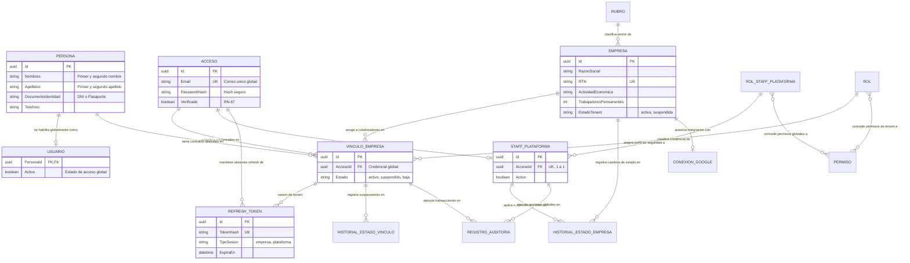
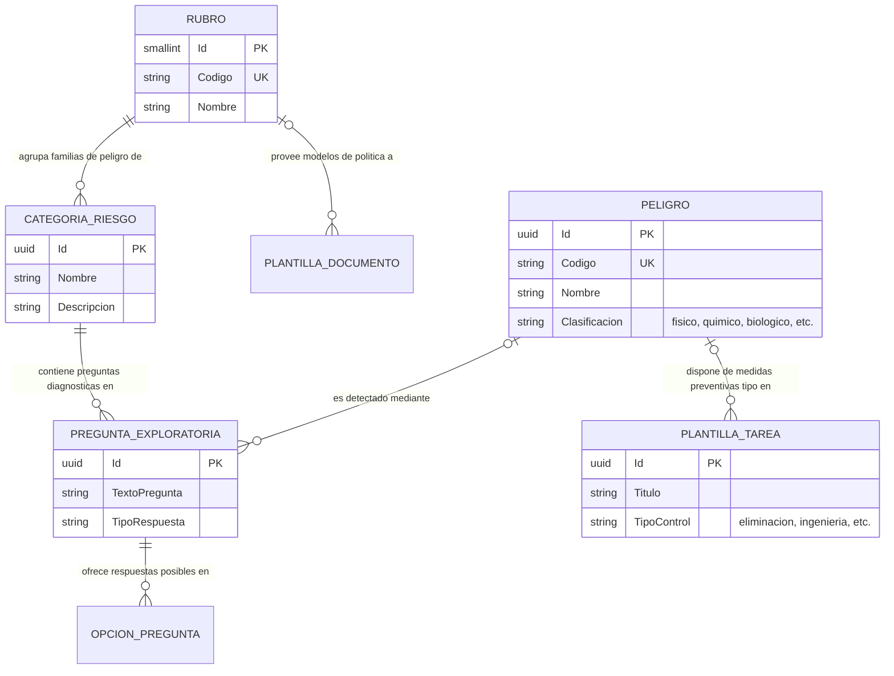
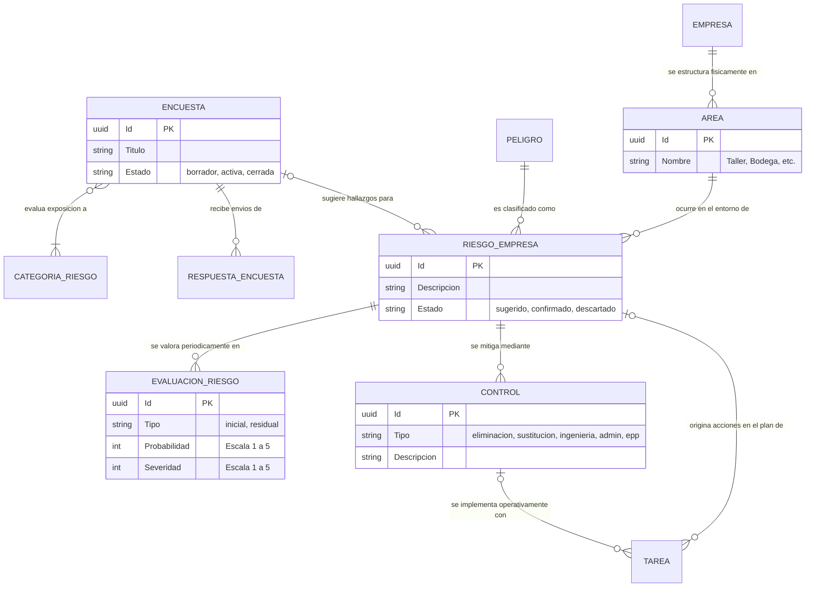
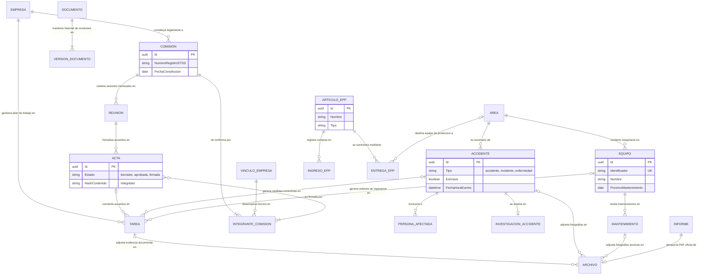
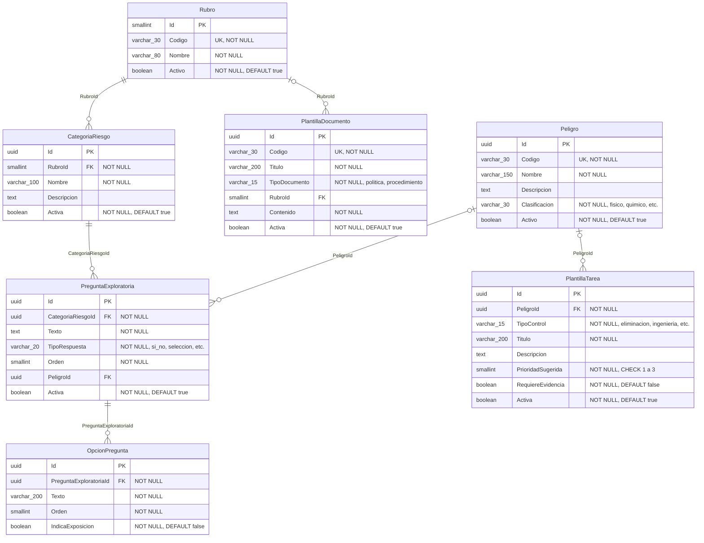
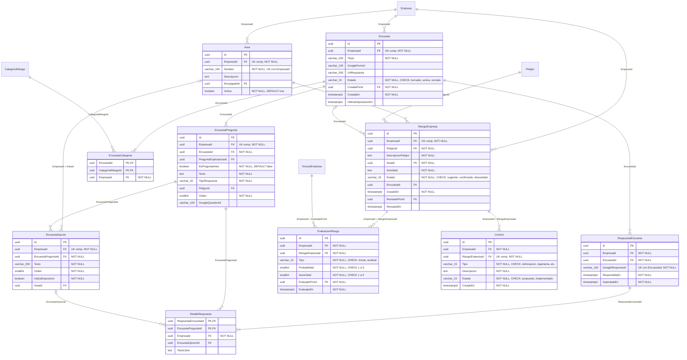

# Diagramas Exportables para Draw.io: Modelo ERD y Relacional

**Para qué sirve:** este documento proporciona las especificaciones completas en sintaxis **Mermaid** para generar e importar directamente en **draw.io** tanto el **Diagrama Entidad-Relación (Conceptual / Negocio)** como el **Diagrama Relacional (Físico para PostgreSQL)** de la plataforma **Norvia**, con cardinalidades y tipos de datos normalizados en tercera forma normal (3FN).

---

## Cómo importar estos diagramas en Draw.io

Draw.io admite código Mermaid de forma nativa:

1. Abre [draw.io](https://app.diagrams.net/) (en el navegador o en la aplicación de escritorio).
2. En el menú superior, ve a:
   $$\text{Organizar (Arrange)} \longrightarrow \text{Insertar (Insert)} \longrightarrow \text{Avanzado (Advanced)} \longrightarrow \text{Mermaid}$$
   *(O haz clic en el icono **`+`** de la barra de herramientas $\rightarrow$ **Avanzado** $\rightarrow$ **Mermaid**).*
3. Borra el código de ejemplo, **copia y pega** el bloque de código Mermaid del diagrama que deseas generar y presiona **Insertar**.
4. Draw.io generará automáticamente los nodos vectoriales, atributos, tablas y líneas conectoras con sus patas de gallo (*Crow's Foot*), los cuales puedes reorganizar, cambiar de color o exportar a PNG, SVG o PDF.

---

## Sobre la Cardinalidad en ambos diagramas

> [!NOTE]
> **¿Cómo se interpreta la cardinalidad en cada diagrama?**
> 
> - **En el Diagrama Entidad-Relación (Conceptual):** Representa las relaciones a nivel de negocio (semánticas). Admite cardinalidades **1 a 1 (1:1)**, **1 a Muchos (1:N)** y **Muchos a Muchos (N:M)** directamente. Por ejemplo, un `Rol` tiene muchos `Permiso` y un `Permiso` pertenece a muchos `Rol` (N:M directa).
> - **En el Diagrama Relacional (Físico PostgreSQL):** Representa la implementación física en tablas relacionales. **Todas las relaciones N:M se descomponen obligatoriamente en tablas asociativas/puente** (`RolPermiso`, `VinculoEmpresa`, `EncuestaCategoria`, `DetalleRespuesta`), por lo que todas las relaciones físicas son pares de **1:N**.
> 
> **Simbología de cardinalidad Crow's Foot utilizada:**
> - `||` : Exactamente uno (obligatorio, `NOT NULL`).
> - `o|` : Cero o uno (opcional, anulable `NULL`).
> - `}|` o `|{` : Uno o muchos (obligatorio).
> - `}o` o `o{` : Cero o muchos (opcional).

---

# PARTE 1: Diagramas Entidad-Relación (Conceptuales / Negocio)

Estos diagramas muestran las entidades del negocio, sus atributos descriptivos clave y las relaciones directas con sus verbos y cardinalidades.

## 1.1 Dominio 1: Identidad, Gobierno Multi-tenant y RBAC



---

## 1.2 Dominio 2: Catálogos Globales de Seguridad y Salud (SST)



---

## 1.3 Dominio 3: Diagnóstico, Encuestas y Matriz de Riesgos IPERC



---

## 1.4 Dominio 4: Plan de Trabajo, Comisión Mixta, Incidentes y Recursos



---

## 1.5 Diagrama ERD Conceptual Maestro Completo

```mermaid
erDiagram
    RUBRO ||--o{ EMPRESA : "clasifica"
    RUBRO ||--o{ CATEGORIA_RIESGO : "agrupa"
    RUBRO |o--o{ PLANTILLA_DOCUMENTO : "modela"
    EMPRESA ||--o{ AREA : "se divide en"
    EMPRESA ||--o{ VINCULO_EMPRESA : "acoge"
    EMPRESA ||--o{ HISTORIAL_ESTADO_EMPRESA : "audita tenant"
    EMPRESA ||--o| CONEXION_GOOGLE : "conecta"
    EMPRESA ||--o{ TAREA : "planifica"
    EMPRESA ||--o{ COMISION : "constituye"
    EMPRESA ||--o{ DOCUMENTO : "formaliza"
    EMPRESA ||--o{ INFORME : "genera"
    EMPRESA ||--o{ ARTICULO_EPP : "inventaria"
    PERSONA ||--o| USUARIO : "habilita"
    ACCESO ||--o{ VINCULO_EMPRESA : "autentica credenciales en"
    ACCESO ||--o| STAFF_PLATAFORMA : "autentica staff de"
    ACCESO ||--o{ REFRESH_TOKEN : "mantiene sesiones refresh de"
    VINCULO_EMPRESA ||--o{ REFRESH_TOKEN : "sesion de tenant"
    PERSONA ||--o{ VINCULO_EMPRESA : "presta servicios"
    PERSONA ||--o{ PERSONA_AFECTADA : "sufre dano"
    STAFF_PLATAFORMA ||--o{ HISTORIAL_ESTADO_EMPRESA : "suspende"
    ROL_STAFF_PLATAFORMA ||--o{ STAFF_PLATAFORMA : "autoriza"
    ROL_STAFF_PLATAFORMA }o--o{ PERMISO : "otorga"
    ROL ||--o{ VINCULO_EMPRESA : "define perfil"
    ROL }o--o{ PERMISO : "otorga"
    VINCULO_EMPRESA ||--o{ HISTORIAL_ESTADO_VINCULO : "audita"
    VINCULO_EMPRESA ||--o{ INTEGRANTE_COMISION : "integra"
    VINCULO_EMPRESA ||--o{ REGISTRO_AUDITORIA : "registra"
    STAFF_PLATAFORMA ||--o{ REGISTRO_AUDITORIA : "registra"
    CATEGORIA_RIESGO ||--o{ PREGUNTA_EXPLORATORIA : "contiene"
    PREGUNTA_EXPLORATORIA ||--o{ OPCION_PREGUNTA : "ofrece"
    PELIGRO |o--o{ PREGUNTA_EXPLORATORIA : "detecta"
    PELIGRO |o--o{ PLANTILLA_TAREA : "sugiere"
    PELIGRO ||--o{ RIESGO_EMPRESA : "origina"
    AREA ||--o{ RIESGO_EMPRESA : "localiza"
    AREA ||--o{ ACCIDENTE : "escenario"
    AREA ||--o{ EQUIPO : "ubica"
    AREA |o--o{ ENTREGA_EPP : "recibe"
    ENCUESTA }o--|{ CATEGORIA_RIESGO : "evalua"
    ENCUESTA ||--o{ RESPUESTA_ENCUESTA : "recibe"
    ENCUESTA |o--o{ RIESGO_EMPRESA : "sugiere"
    RIESGO_EMPRESA ||--o{ EVALUACION_RIESGO : "evalua"
    RIESGO_EMPRESA ||--o{ CONTROL : "mitiga"
    RIESGO_EMPRESA |o--o{ TAREA : "genera"
    CONTROL |o--o{ TAREA : "ejecuta"
    PLANTILLA_TAREA |o--o{ TAREA : "modela"
    ACCIDENTE ||--o{ PERSONA_AFECTADA : "afecta"
    ACCIDENTE ||--o| INVESTIGACION_ACCIDENTE : "investiga"
    ACCIDENTE |o--o{ TAREA : "medidas"
    ACCIDENTE |o--o{ REUNION : "convoca"
    COMISION ||--|{ INTEGRANTE_COMISION : "conforma"
    COMISION ||--o{ REUNION : "sesiona"
    REUNION ||--o{ ACTA : "redacta"
    REUNION ||--o{ ASISTENCIA : "controla"
    INTEGRANTE_COMISION ||--o{ ASISTENCIA : "asiste"
    INTEGRANTE_COMISION ||--o{ FIRMA_ACTA : "firma"
    ACTA ||--o{ FIRMA_ACTA : "formaliza"
    ACTA |o--o{ TAREA : "acuerdos"
    EQUIPO ||--o{ MANTENIMIENTO : "recibe"
    EQUIPO |o--o{ TAREA : "reparaciones"
    ARTICULO_EPP ||--o{ INGRESO_EPP : "abastece"
    ARTICULO_EPP ||--o{ ENTREGA_EPP : "suministra"
    PLANTILLA_DOCUMENTO |o--o{ DOCUMENTO : "basa"
    DOCUMENTO ||--|{ VERSION_DOCUMENTO : "versiona"
    TAREA |o--o{ ARCHIVO : "evidencia"
    ACCIDENTE |o--o{ ARCHIVO : "fotos"
    MANTENIMIENTO |o--o{ ARCHIVO : "fotos"
    COMISION |o--o{ ARCHIVO : "acta STSS"
    INFORME ||--o| ARCHIVO : "PDF"
    ACTA |o--o{ INFORME : "incluye"
    TAREA |o--o| EVENTO_CALENDARIO : "sincroniza"
    REUNION |o--o| EVENTO_CALENDARIO : "sincroniza"
    EQUIPO |o--o| EVENTO_CALENDARIO : "sincroniza"
    COMISION |o--o| EVENTO_CALENDARIO : "sincroniza"
```



---

# PARTE 2: Diagramas Relacionales (Físicos para PostgreSQL)

Estos diagramas representan las **tablas exactas con tipos de datos de PostgreSQL**, columnas obligatorias (`NOT NULL`), claves primarias (`PK`), claves foráneas simples y compuestas (`FK`), restricciones de unicidad (`UK`) y notación *Crow's Foot*.

## 2.1 Dominio 1: Identidad, Multi-tenant, Acceso y RBAC (16 Tablas)

```mermaid
erDiagram
    Persona ||--o| Usuario : "PersonaId"
    Acceso ||--o{ VinculoEmpresa : "AccesoId"
    Acceso ||--o| StaffPlataforma : "AccesoId"
    Acceso ||--o{ RefreshToken : "AccesoId"
    VinculoEmpresa ||--o{ RefreshToken : "VinculoEmpresaId"
    Persona ||--o{ VinculoEmpresa : "PersonaId"
    Empresa ||--o{ VinculoEmpresa : "EmpresaId"
    Empresa ||--o{ HistorialEstadoEmpresa : "EmpresaId"
    VinculoEmpresa ||--o{ HistorialEstadoVinculo : "VinculoEmpresaId"
    StaffPlataforma ||--o{ HistorialEstadoEmpresa : "RegistradoPorId"
    RolStaffPlataforma ||--o{ StaffPlataforma : "RolStaffPlataformaId"
    RolStaffPlataforma ||--o{ RolStaffPlataformaPermiso : "RolStaffPlataformaId"
    Permiso ||--o{ RolStaffPlataformaPermiso : "PermisoId"
    Rol ||--o{ VinculoEmpresa : "RolId"
    Rol ||--o{ RolPermiso : "RolId"
    Permiso ||--o{ RolPermiso : "PermisoId"
    Empresa ||--o| ConexionGoogle : "EmpresaId"
    VinculoEmpresa ||--o{ RegistroAuditoria : "VinculoEmpresaId"
    StaffPlataforma ||--o{ RegistroAuditoria : "StaffPlataformaId"
    Rubro ||--o{ Empresa : "RubroId"

    Acceso {
        uuid Id PK
        varchar_254 Email "UK lower, NOT NULL"
        varchar_255 PasswordHash "NOT NULL"
        boolean DebeCambiarPassword "NOT NULL, DEFAULT false"
        boolean Verificado "NOT NULL, DEFAULT false"
        timestamptz CreadoEn "NOT NULL"
    }

    RefreshToken {
        uuid Id PK
        uuid AccesoId FK "NOT NULL"
        uuid VinculoEmpresaId FK "Opcional en plataforma"
        varchar_64 TokenHash "UK, NOT NULL"
        varchar_12 TipoSesion "NOT NULL, CHECK: empresa, plataforma"
        timestamptz ExpiraEn "NOT NULL"
        timestamptz CreadoEn "NOT NULL"
    }

    Persona {
        uuid Id PK
        varchar_80 PrimerNombre "NOT NULL"
        varchar_80 SegundoNombre
        varchar_80 PrimerApellido "NOT NULL"
        varchar_80 SegundoApellido
        varchar_15 TipoDocumento "CHECK: dni, pasaporte, otro"
        varchar_50 NumeroDocumento "UK con TipoDocumento"
        varchar_30 Telefono
        timestamptz CreadoEn "NOT NULL"
    }

    Usuario {
        uuid Id PK
        uuid PersonaId FK "UK, NOT NULL"
        boolean Activo "NOT NULL, DEFAULT true"
        timestamptz CreadoEn "NOT NULL"
    }

    StaffPlataforma {
        uuid Id PK
        uuid AccesoId FK "UK, 1 a 1, NOT NULL"
        smallint RolStaffPlataformaId FK "NOT NULL"
        boolean Activo "NOT NULL, DEFAULT true"
        timestamptz CreadoEn "NOT NULL"
    }

    RolStaffPlataforma {
        smallint Id PK
        varchar_30 Codigo "UK, NOT NULL"
        varchar_80 Nombre "NOT NULL"
    }

    Rol {
        smallint Id PK
        varchar_30 Codigo "UK, NOT NULL"
        varchar_80 Nombre "NOT NULL"
    }

    Permiso {
        smallint Id PK
        varchar_60 Codigo "UK, NOT NULL"
        varchar_120 Nombre "NOT NULL"
        varchar_10 Alcance "NOT NULL, CHECK: empresa, plataforma"
        varchar_10 MetodoHttp "NOT NULL, GET, POST, etc."
        varchar_200 RutaPatron "NOT NULL"
        boolean Activo "NOT NULL, DEFAULT true"
    }

    RolPermiso {
        smallint RolId PK, FK
        smallint PermisoId PK, FK
    }

    RolStaffPlataformaPermiso {
        smallint RolStaffPlataformaId PK, FK
        smallint PermisoId PK, FK
    }

    Empresa {
        uuid Id PK
        varchar_200 RazonSocial "NOT NULL"
        varchar_14 RTN "UK, NOT NULL"
        text Direccion
        varchar_150 ActividadEconomica "NOT NULL"
        smallint RubroId FK "NOT NULL"
        integer TrabajadoresPermanentes "NOT NULL, CHECK >= 1"
        date FechaInicioOperaciones
        varchar_20 Estado "NOT NULL, CHECK: activa, suspendida"
        timestamptz CreadaEn "NOT NULL"
    }

    VinculoEmpresa {
        uuid Id PK
        uuid EmpresaId FK "UK comp, NOT NULL"
        uuid PersonaId FK "NOT NULL"
        uuid AccesoId FK "NOT NULL"
        smallint RolId FK "NOT NULL"
        varchar_20 Estado "NOT NULL, CHECK: activo, suspendido, baja"
        timestamptz CreadoEn "NOT NULL"
    }

    HistorialEstadoVinculo {
        uuid Id PK
        uuid EmpresaId FK "NOT NULL"
        uuid VinculoEmpresaId FK "NOT NULL"
        varchar_20 EstadoAnterior "NOT NULL"
        varchar_20 EstadoNuevo "NOT NULL"
        varchar_30 MotivoCodigo "NOT NULL"
        text MotivoDetalle
        uuid RegistradoPorId FK "NOT NULL"
        timestamptz RegistradoEn "NOT NULL"
    }

    HistorialEstadoEmpresa {
        uuid Id PK
        uuid EmpresaId FK "NOT NULL"
        varchar_20 EstadoAnterior "NOT NULL"
        varchar_20 EstadoNuevo "NOT NULL"
        varchar_30 MotivoCodigo "NOT NULL"
        text MotivoDetalle
        uuid RegistradoPorId FK "NOT NULL"
        timestamptz RegistradoEn "NOT NULL"
    }

    ConexionGoogle {
        uuid Id PK
        uuid EmpresaId FK "UK, NOT NULL"
        varchar_254 CuentaGoogle "NOT NULL"
        bytea RefreshTokenCifrado "NOT NULL"
        text Alcances "NOT NULL"
        uuid ConectadaPorId FK "NOT NULL"
        timestamptz ConectadaEn "NOT NULL"
        boolean Activa "NOT NULL, DEFAULT true"
    }

    RegistroAuditoria {
        uuid Id PK
        uuid EmpresaId FK
        uuid VinculoEmpresaId FK
        uuid StaffPlataformaId FK
        varchar_50 Accion "NOT NULL"
        varchar_50 Entidad "NOT NULL"
        uuid EntidadId
        timestamptz Fecha "NOT NULL"
        jsonb Detalle "NOT NULL"
    }
```



---

## 2.2 Dominio 2: Catálogos Globales de Seguridad y Salud (7 Tablas)



---

## 2.3 Dominio 3: Diagnóstico, Encuestas y Matriz de Riesgos IPERC (10 Tablas)



---

## 2.4 Dominio 4: Plan de Trabajo, Comisión Mixta, Incidentes y Recursos (20 Tablas)

```mermaid
erDiagram
    Empresa ||--o{ Tarea : "EmpresaId"
    Empresa ||--o{ Accidente : "EmpresaId"
    Empresa ||--o{ Comision : "EmpresaId"
    Empresa ||--o{ Equipo : "EmpresaId"
    Empresa ||--o{ ArticuloEPP : "EmpresaId"
    Empresa ||--o{ Documento : "EmpresaId"
    Empresa ||--o{ Informe : "EmpresaId"
    Empresa ||--o{ EventoCalendario : "EmpresaId"
    RiesgoEmpresa |o--o{ Tarea : "RiesgoEmpresaId"
    Control |o--o{ Tarea : "ControlId"
    PlantillaTarea |o--o{ Tarea : "PlantillaTareaId"
    VinculoEmpresa ||--o{ Tarea : "ResponsableId"
    Tarea |o--o{ Archivo : "TareaId"
    Area ||--o{ Accidente : "AreaId"
    Accidente ||--o{ PersonaAfectada : "AccidenteId"
    Persona |o--o{ PersonaAfectada : "PersonaId"
    Accidente ||--o| InvestigacionAccidente : "AccidenteId"
    Accidente |o--o{ Tarea : "AccidenteId"
    Accidente |o--o{ Archivo : "AccidenteId"
    Accidente |o--o{ Reunion : "AccidenteId"
    Comision ||--|{ IntegranteComision : "ComisionId"
    VinculoEmpresa ||--o{ IntegranteComision : "VinculoEmpresaId"
    IntegranteComision |o--o| IntegranteComision : "SuplenteDeId"
    Comision ||--o{ Reunion : "ComisionId"
    Reunion ||--o{ Asistencia : "ReunionId"
    IntegranteComision ||--o{ Asistencia : "IntegranteComisionId"
    Reunion ||--o{ Acta : "ReunionId"
    Acta |o--o{ Acta : "CorrigeActaId"
    Acta ||--o{ FirmaActa : "ActaId"
    IntegranteComision ||--o{ FirmaActa : "IntegranteComisionId"
    Acta |o--o{ Tarea : "ActaId"
    Comision |o--o{ Archivo : "ComisionId"
    Area ||--o{ Equipo : "AreaId"
    Equipo ||--o{ Mantenimiento : "EquipoId"
    Mantenimiento |o--o{ Archivo : "MantenimientoId"
    Equipo |o--o{ Tarea : "EquipoId"
    ArticuloEPP ||--o{ IngresoEPP : "ArticuloEPPId"
    ArticuloEPP ||--o{ EntregaEPP : "ArticuloEPPId"
    Area |o--o{ EntregaEPP : "AreaId"
    PlantillaDocumento |o--o{ Documento : "PlantillaDocumentoId"
    Documento ||--|{ VersionDocumento : "DocumentoId"
    Acta |o--o{ Informe : "ActaId"
    Archivo ||--o| Informe : "ArchivoId"
    Tarea |o--o| EventoCalendario : "TareaId"
    Reunion |o--o| EventoCalendario : "ReunionId"
    Equipo |o--o| EventoCalendario : "EquipoId"
    Comision |o--o| EventoCalendario : "ComisionId"

    Tarea {
        uuid Id PK
        uuid EmpresaId FK "NOT NULL"
        varchar_200 Titulo "NOT NULL"
        text Descripcion
        varchar_12 Estado "NOT NULL, CHECK: pendiente, en_progreso, etc."
        smallint Prioridad "NOT NULL, CHECK 1 a 3"
        uuid ResponsableId FK
        date FechaLimite
        boolean RequiereEvidencia "NOT NULL, DEFAULT false"
        uuid PlantillaTareaId FK
        uuid RiesgoEmpresaId FK
        uuid ControlId FK
        uuid EquipoId FK
        uuid AccidenteId FK
        uuid ActaId FK
        uuid CreadaPorId FK "NOT NULL"
        timestamptz CreadaEn "NOT NULL"
        timestamptz CompletadaEn
    }

    Archivo {
        uuid Id PK
        uuid EmpresaId FK "UK comp, NOT NULL"
        varchar_255 NombreOriginal "NOT NULL"
        varchar_100 TipoContenido "NOT NULL"
        bigint TamanoBytes "NOT NULL, CHECK > 0"
        varchar_500 ClaveAlmacenamiento "UK, NOT NULL"
        uuid SubidoPorId FK "NOT NULL"
        timestamptz SubidoEn "NOT NULL"
        uuid TareaId FK
        uuid AccidenteId FK
        uuid MantenimientoId FK
        uuid ComisionId FK
    }

    Accidente {
        uuid Id PK
        uuid EmpresaId FK "UK comp, NOT NULL"
        varchar_25 Tipo "NOT NULL, CHECK: accidente, incidente, enfermedad"
        varchar_15 EstadoEnfermedad "CHECK: sospechosa, diagnosticada"
        boolean EsGrave "NOT NULL, DEFAULT false"
        timestamptz FechaHoraEvento "NOT NULL"
        uuid AreaId FK "NOT NULL"
        text Descripcion "NOT NULL"
        uuid ReportadoPorId FK "NOT NULL"
        timestamptz RegistradoEn "NOT NULL"
        varchar_16 Estado "NOT NULL, CHECK: abierto, en_investigacion, cerrado"
        timestamptz CerradoEn
    }

    PersonaAfectada {
        uuid Id PK
        uuid EmpresaId FK "NOT NULL"
        uuid AccidenteId FK "NOT NULL"
        uuid PersonaId FK
        varchar_150 NombreParaRegistro "NOT NULL"
        varchar_100 Puesto "NOT NULL"
        varchar_100 TipoLesion "NOT NULL"
        integer DiasIncapacidad "NOT NULL, DEFAULT 0"
    }

    InvestigacionAccidente {
        uuid Id PK
        uuid EmpresaId FK "NOT NULL"
        uuid AccidenteId FK "UK, NOT NULL"
        text CausasInmediatas "NOT NULL"
        text CausasBasicas "NOT NULL"
        text Conclusiones "NOT NULL"
        uuid InvestigadaPorId FK "NOT NULL"
        date FechaInvestigacion "NOT NULL"
    }

    Comision {
        uuid Id PK
        uuid EmpresaId FK "UK comp, NOT NULL"
        date FechaConstitucion "NOT NULL"
        varchar_50 NumeroRegistroSTSS
        date FechaRegistroSTSS
        boolean Activa "NOT NULL, DEFAULT true"
        timestamptz CreadaEn "NOT NULL"
    }

    IntegranteComision {
        uuid Id PK
        uuid EmpresaId FK "UK comp, NOT NULL"
        uuid ComisionId FK "NOT NULL"
        uuid VinculoEmpresaId FK "NOT NULL"
        varchar_15 Parte "NOT NULL, CHECK: empleador, trabajadores"
        varchar_15 Condicion "NOT NULL, CHECK: propietario, suplente"
        varchar_15 Cargo "NOT NULL, CHECK: presidente, secretario, vocal"
        uuid SuplenteDeId FK
        date FechaInicio "NOT NULL"
        date FechaBaja
    }

    Reunion {
        uuid Id PK
        uuid EmpresaId FK "UK comp, NOT NULL"
        uuid ComisionId FK "NOT NULL"
        varchar_15 Tipo "NOT NULL, CHECK: ordinaria, extraordinaria"
        timestamptz FechaHora "NOT NULL"
        varchar_150 Lugar "NOT NULL"
        text Temas "NOT NULL"
        text Motivo
        uuid AccidenteId FK
        varchar_15 Estado "NOT NULL, CHECK: convocada, celebrada, cancelada"
        uuid ConvocadaPorId FK "NOT NULL"
        timestamptz CreadaEn "NOT NULL"
    }

    Asistencia {
        uuid ReunionId PK, FK
        uuid IntegranteComisionId PK, FK
        uuid EmpresaId FK "NOT NULL"
        boolean Asistio "NOT NULL, DEFAULT false"
    }

    Acta {
        uuid Id PK
        uuid EmpresaId FK "UK comp, NOT NULL"
        uuid ReunionId FK "UK, NOT NULL"
        varchar_15 Estado "NOT NULL, CHECK: borrador, aprobada, firmada"
        text ConclusionesVisitas
        text ResultadosInvestigaciones
        text ActividadesEducativas
        text OtrosTemas
        uuid RedactadaPorId FK "NOT NULL"
        timestamptz CreadaEn "NOT NULL"
        timestamptz AprobadaEn
        timestamptz FirmadaEn
        varchar_64 HashContenido
        uuid CorrigeActaId FK
    }

    FirmaActa {
        uuid ActaId PK, FK
        uuid IntegranteComisionId PK, FK
        uuid EmpresaId FK "NOT NULL"
        timestamptz FirmadaEn "NOT NULL"
        varchar_64 HashFirmado "NOT NULL"
    }

    Equipo {
        uuid Id PK
        uuid EmpresaId FK "UK comp, NOT NULL"
        varchar_50 Identificador "UK con EmpresaId, NOT NULL"
        varchar_150 Nombre "NOT NULL"
        varchar_80 Tipo "NOT NULL"
        uuid AreaId FK "NOT NULL"
        uuid ResponsableMantenimientoId FK "NOT NULL"
        boolean EsEquipoEmergencia "NOT NULL, DEFAULT false"
        date ProximoMantenimiento
        boolean Activo "NOT NULL, DEFAULT true"
    }

    Mantenimiento {
        uuid Id PK
        uuid EmpresaId FK "NOT NULL"
        uuid EquipoId FK "NOT NULL"
        varchar_15 Tipo "NOT NULL, CHECK: preventivo, correctivo"
        text Descripcion "NOT NULL"
        uuid ResponsableId FK "NOT NULL"
        varchar_15 Estado "NOT NULL, CHECK: en_proceso, realizado"
        timestamptz RealizadoEn
        timestamptz RegistradoEn "NOT NULL"
    }

    ArticuloEPP {
        uuid Id PK
        uuid EmpresaId FK "UK comp, NOT NULL"
        varchar_120 Nombre "NOT NULL"
        varchar_60 Tipo "NOT NULL"
        varchar_80 Marca
        boolean Activo "NOT NULL, DEFAULT true"
    }

    IngresoEPP {
        uuid Id PK
        uuid EmpresaId FK "NOT NULL"
        uuid ArticuloEPPId FK "NOT NULL"
        integer Cantidad "NOT NULL, CHECK > 0"
        date Fecha "NOT NULL"
        uuid RegistradoPorId FK "NOT NULL"
        timestamptz RegistradoEn "NOT NULL"
    }

    EntregaEPP {
        uuid Id PK
        uuid EmpresaId FK "NOT NULL"
        uuid ArticuloEPPId FK "NOT NULL"
        varchar_150 NombreTrabajador "NOT NULL"
        uuid AreaId FK
        varchar_100 Puesto
        integer Cantidad "NOT NULL, CHECK > 0"
        date Fecha "NOT NULL"
        uuid RegistradoPorId FK "NOT NULL"
        timestamptz RegistradoEn "NOT NULL"
    }

    Documento {
        uuid Id PK
        uuid EmpresaId FK "UK comp, NOT NULL"
        uuid PlantillaDocumentoId FK
        varchar_200 Titulo "NOT NULL"
        varchar_15 TipoDocumento "NOT NULL, CHECK: politica, procedimiento"
        uuid CreadoPorId FK "NOT NULL"
        timestamptz CreadoEn "NOT NULL"
    }

    VersionDocumento {
        uuid Id PK
        uuid EmpresaId FK "NOT NULL"
        uuid DocumentoId FK "NOT NULL"
        integer NumeroVersion "NOT NULL, CHECK >= 1"
        text Contenido "NOT NULL"
        varchar_15 Estado "NOT NULL, CHECK: borrador, vigente, reemplazada"
        uuid CreadaPorId FK "NOT NULL"
        timestamptz CreadaEn "NOT NULL"
        uuid AprobadaPorId FK
        timestamptz AprobadaEn
    }

    Informe {
        uuid Id PK
        uuid EmpresaId FK "NOT NULL"
        varchar_20 Tipo "NOT NULL, CHECK: matriz_riesgos, semestral, anual, acta, etc."
        date PeriodoInicio
        date PeriodoFin
        uuid ActaId FK
        text RetosSiguientePeriodo
        uuid ArchivoId FK "UK, NOT NULL"
        uuid GeneradoPorId FK "NOT NULL"
        timestamptz GeneradoEn "NOT NULL"
    }

    EventoCalendario {
        uuid Id PK
        uuid EmpresaId FK "NOT NULL"
        varchar_25 Tipo "NOT NULL, CHECK: tarea, reunion, mantenimiento, etc."
        uuid TareaId FK
        uuid ReunionId FK
        uuid EquipoId FK
        uuid ComisionId FK
        date FechaInforme
        varchar_200 GoogleEventId
        varchar_15 EstadoSincronizacion "NOT NULL, CHECK: pendiente, sincronizado, error, etc."
        smallint Intentos "NOT NULL, DEFAULT 0"
        text UltimoError
        timestamptz ActualizadoEn "NOT NULL"
    }
```



---

## 2.5 Diagrama Relacional Físico Maestro Completo (53 Tablas)

*(Copia el bloque siguiente si deseas importar la totalidad de las 53 tablas de Norvia con todas sus relaciones foráneas en un solo lienzo de draw.io).*

```mermaid
erDiagram
    Persona ||--o| Usuario : "PersonaId"
    Acceso ||--o{ VinculoEmpresa : "AccesoId"
    Acceso ||--o| StaffPlataforma : "AccesoId"
    Acceso ||--o{ RefreshToken : "AccesoId"
    VinculoEmpresa ||--o{ RefreshToken : "VinculoEmpresaId"
    Persona ||--o{ VinculoEmpresa : "PersonaId"
    Empresa ||--o{ VinculoEmpresa : "EmpresaId"
    Empresa ||--o{ HistorialEstadoEmpresa : "EmpresaId"
    VinculoEmpresa ||--o{ HistorialEstadoVinculo : "VinculoEmpresaId"
    StaffPlataforma ||--o{ HistorialEstadoEmpresa : "RegistradoPorId"
    RolStaffPlataforma ||--o{ StaffPlataforma : "RolStaffPlataformaId"
    RolStaffPlataforma ||--o{ RolStaffPlataformaPermiso : "RolStaffPlataformaId"
    Permiso ||--o{ RolStaffPlataformaPermiso : "PermisoId"
    Rol ||--o{ VinculoEmpresa : "RolId"
    Rol ||--o{ RolPermiso : "RolId"
    Permiso ||--o{ RolPermiso : "PermisoId"
    Empresa ||--o| ConexionGoogle : "EmpresaId"
    VinculoEmpresa ||--o{ RegistroAuditoria : "VinculoEmpresaId"
    StaffPlataforma ||--o{ RegistroAuditoria : "StaffPlataformaId"
    Rubro ||--o{ Empresa : "RubroId"
    Rubro ||--o{ CategoriaRiesgo : "RubroId"
    Rubro |o--o{ PlantillaDocumento : "RubroId"
    CategoriaRiesgo ||--o{ PreguntaExploratoria : "CategoriaRiesgoId"
    PreguntaExploratoria ||--o{ OpcionPregunta : "PreguntaExploratoriaId"
    Peligro |o--o{ PreguntaExploratoria : "PeligroId"
    Peligro |o--o{ PlantillaTarea : "PeligroId"
    Empresa ||--o{ Area : "EmpresaId"
    Empresa ||--o{ Encuesta : "EmpresaId"
    Empresa ||--o{ RiesgoEmpresa : "EmpresaId"
    Area ||--o{ RiesgoEmpresa : "EmpresaId + AreaId"
    Area |o--o{ EncuestaOpcion : "EmpresaId + AreaId"
    Peligro ||--o{ RiesgoEmpresa : "PeligroId"
    Encuesta ||--|{ EncuestaCategoria : "EncuestaId"
    CategoriaRiesgo ||--o{ EncuestaCategoria : "CategoriaRiesgoId"
    Encuesta ||--|{ EncuestaPregunta : "EncuestaId"
    EncuestaPregunta ||--o{ EncuestaOpcion : "EncuestaPreguntaId"
    Encuesta ||--o{ RespuestaEncuesta : "EncuestaId"
    RespuestaEncuesta ||--|{ DetalleRespuesta : "RespuestaEncuestaId"
    EncuestaPregunta ||--o{ DetalleRespuesta : "EncuestaPreguntaId"
    EncuestaOpcion |o--o{ DetalleRespuesta : "EncuestaOpcionId"
    Encuesta |o--o{ RiesgoEmpresa : "EncuestaId"
    RiesgoEmpresa ||--o{ EvaluacionRiesgo : "EmpresaId + RiesgoEmpresaId"
    RiesgoEmpresa ||--o{ Control : "EmpresaId + RiesgoEmpresaId"
    VinculoEmpresa ||--o{ EvaluacionRiesgo : "EmpresaId + EvaluadoPorId"
    Empresa ||--o{ Tarea : "EmpresaId"
    Empresa ||--o{ Accidente : "EmpresaId"
    Empresa ||--o{ Comision : "EmpresaId"
    Empresa ||--o{ Equipo : "EmpresaId"
    Empresa ||--o{ ArticuloEPP : "EmpresaId"
    Empresa ||--o{ Documento : "EmpresaId"
    Empresa ||--o{ Informe : "EmpresaId"
    Empresa ||--o{ EventoCalendario : "EmpresaId"
    RiesgoEmpresa |o--o{ Tarea : "RiesgoEmpresaId"
    Control |o--o{ Tarea : "ControlId"
    PlantillaTarea |o--o{ Tarea : "PlantillaTareaId"
    VinculoEmpresa ||--o{ Tarea : "ResponsableId"
    Tarea |o--o{ Archivo : "TareaId"
    Area ||--o{ Accidente : "AreaId"
    Accidente ||--o{ PersonaAfectada : "AccidenteId"
    Persona |o--o{ PersonaAfectada : "PersonaId"
    Accidente ||--o| InvestigacionAccidente : "AccidenteId"
    Accidente |o--o{ Tarea : "AccidenteId"
    Accidente |o--o{ Archivo : "AccidenteId"
    Accidente |o--o{ Reunion : "AccidenteId"
    Comision ||--|{ IntegranteComision : "ComisionId"
    VinculoEmpresa ||--o{ IntegranteComision : "VinculoEmpresaId"
    IntegranteComision |o--o| IntegranteComision : "SuplenteDeId"
    Comision ||--o{ Reunion : "ComisionId"
    Reunion ||--o{ Asistencia : "ReunionId"
    IntegranteComision ||--o{ Asistencia : "IntegranteComisionId"
    Reunion ||--o{ Acta : "ReunionId"
    Acta |o--o{ Acta : "CorrigeActaId"
    Acta ||--o{ FirmaActa : "ActaId"
    IntegranteComision ||--o{ FirmaActa : "IntegranteComisionId"
    Acta |o--o{ Tarea : "ActaId"
    Comision |o--o{ Archivo : "ComisionId"
    Area ||--o{ Equipo : "AreaId"
    Equipo ||--o{ Mantenimiento : "EquipoId"
    Mantenimiento |o--o{ Archivo : "MantenimientoId"
    Equipo |o--o{ Tarea : "EquipoId"
    ArticuloEPP ||--o{ IngresoEPP : "ArticuloEPPId"
    ArticuloEPP ||--o{ EntregaEPP : "ArticuloEPPId"
    Area |o--o{ EntregaEPP : "AreaId"
    PlantillaDocumento |o--o{ Documento : "PlantillaDocumentoId"
    Documento ||--|{ VersionDocumento : "DocumentoId"
    Acta |o--o{ Informe : "ActaId"
    Archivo ||--o| Informe : "ArchivoId"
    Tarea |o--o| EventoCalendario : "TareaId"
    Reunion |o--o| EventoCalendario : "ReunionId"
    Equipo |o--o| EventoCalendario : "EquipoId"
    Comision |o--o| EventoCalendario : "ComisionId"

    Acceso {
        uuid Id PK
        varchar_254 Email "UK lower, NOT NULL"
        varchar_255 PasswordHash "NOT NULL"
        boolean DebeCambiarPassword "NOT NULL, DEFAULT false"
        boolean Verificado "NOT NULL, DEFAULT false"
        timestamptz CreadoEn "NOT NULL"
    }
    RefreshToken {
        uuid Id PK
        uuid AccesoId FK "NOT NULL"
        uuid VinculoEmpresaId FK "Opcional en plataforma"
        varchar_64 TokenHash "UK, NOT NULL"
        varchar_12 TipoSesion "NOT NULL, CHECK: empresa, plataforma"
        timestamptz ExpiraEn "NOT NULL"
        timestamptz CreadoEn "NOT NULL"
    }
    Persona {
        uuid Id PK
        varchar_80 PrimerNombre "NOT NULL"
        varchar_80 SegundoNombre
        varchar_80 PrimerApellido "NOT NULL"
        varchar_80 SegundoApellido
        varchar_15 TipoDocumento
        varchar_50 NumeroDocumento
        varchar_30 Telefono
        timestamptz CreadoEn "NOT NULL"
    }
    Usuario {
        uuid Id PK
        uuid PersonaId FK "UK, NOT NULL"
        boolean Activo "NOT NULL"
        timestamptz CreadoEn "NOT NULL"
    }
    StaffPlataforma {
        uuid Id PK
        uuid AccesoId FK "UK, 1 a 1, NOT NULL"
        smallint RolStaffPlataformaId FK "NOT NULL"
        boolean Activo "NOT NULL"
        timestamptz CreadoEn "NOT NULL"
    }
    RolStaffPlataforma {
        smallint Id PK
        varchar_30 Codigo "UK, NOT NULL"
        varchar_80 Nombre "NOT NULL"
    }
    Rol {
        smallint Id PK
        varchar_30 Codigo "UK, NOT NULL"
        varchar_80 Nombre "NOT NULL"
    }
    Permiso {
        smallint Id PK
        varchar_60 Codigo "UK, NOT NULL"
        varchar_120 Nombre "NOT NULL"
        varchar_10 Alcance "NOT NULL"
        varchar_10 MetodoHttp "NOT NULL"
        varchar_200 RutaPatron "NOT NULL"
        boolean Activo "NOT NULL"
    }
    RolPermiso {
        smallint RolId PK, FK
        smallint PermisoId PK, FK
    }
    RolStaffPlataformaPermiso {
        smallint RolStaffPlataformaId PK, FK
        smallint PermisoId PK, FK
    }
    Rubro {
        smallint Id PK
        varchar_30 Codigo "UK, NOT NULL"
        varchar_80 Nombre "NOT NULL"
        boolean Activo "NOT NULL"
    }
    CategoriaRiesgo {
        uuid Id PK
        smallint RubroId FK "NOT NULL"
        varchar_100 Nombre "NOT NULL"
        text Descripcion
        boolean Activa "NOT NULL"
    }
    Peligro {
        uuid Id PK
        varchar_30 Codigo "UK, NOT NULL"
        varchar_150 Nombre "NOT NULL"
        text Descripcion
        varchar_30 Clasificacion "NOT NULL"
        boolean Activo "NOT NULL"
    }
    PreguntaExploratoria {
        uuid Id PK
        uuid CategoriaRiesgoId FK "NOT NULL"
        text Texto "NOT NULL"
        varchar_20 TipoRespuesta "NOT NULL"
        smallint Orden "NOT NULL"
        uuid PeligroId FK
        boolean Activa "NOT NULL"
    }
    OpcionPregunta {
        uuid Id PK
        uuid PreguntaExploratoriaId FK "NOT NULL"
        varchar_200 Texto "NOT NULL"
        smallint Orden "NOT NULL"
        boolean IndicaExposicion "NOT NULL"
    }
    PlantillaTarea {
        uuid Id PK
        uuid PeligroId FK "NOT NULL"
        varchar_15 TipoControl "NOT NULL"
        varchar_200 Titulo "NOT NULL"
        text Descripcion
        smallint PrioridadSugerida "NOT NULL"
        boolean RequiereEvidencia "NOT NULL"
        boolean Activa "NOT NULL"
    }
    PlantillaDocumento {
        uuid Id PK
        varchar_30 Codigo "UK, NOT NULL"
        varchar_200 Titulo "NOT NULL"
        varchar_15 TipoDocumento "NOT NULL"
        smallint RubroId FK
        text Contenido "NOT NULL"
        boolean Activa "NOT NULL"
    }
    Empresa {
        uuid Id PK
        varchar_200 RazonSocial "NOT NULL"
        varchar_14 RTN "UK, NOT NULL"
        text Direccion
        varchar_150 ActividadEconomica "NOT NULL"
        smallint RubroId FK "NOT NULL"
        integer TrabajadoresPermanentes "NOT NULL"
        date FechaInicioOperaciones
        varchar_20 Estado "NOT NULL"
        timestamptz CreadaEn "NOT NULL"
    }
    VinculoEmpresa {
        uuid Id PK
        uuid EmpresaId FK "UK comp, NOT NULL"
        uuid PersonaId FK "NOT NULL"
        uuid AccesoId FK "NOT NULL"
        smallint RolId FK "NOT NULL"
        varchar_20 Estado "NOT NULL, CHECK: activo, suspendido, baja"
        timestamptz CreadoEn "NOT NULL"
    }
    HistorialEstadoVinculo {
        uuid Id PK
        uuid EmpresaId FK "NOT NULL"
        uuid VinculoEmpresaId FK "NOT NULL"
        varchar_20 EstadoAnterior "NOT NULL"
        varchar_20 EstadoNuevo "NOT NULL"
        varchar_30 MotivoCodigo "NOT NULL"
        text MotivoDetalle
        uuid RegistradoPorId FK "NOT NULL"
        timestamptz RegistradoEn "NOT NULL"
    }
    HistorialEstadoEmpresa {
        uuid Id PK
        uuid EmpresaId FK "NOT NULL"
        varchar_20 EstadoAnterior "NOT NULL"
        varchar_20 EstadoNuevo "NOT NULL"
        varchar_30 MotivoCodigo "NOT NULL"
        text MotivoDetalle
        uuid RegistradoPorId FK "NOT NULL"
        timestamptz RegistradoEn "NOT NULL"
    }
    ConexionGoogle {
        uuid Id PK
        uuid EmpresaId FK "UK, NOT NULL"
        varchar_254 CuentaGoogle "NOT NULL"
        bytea RefreshTokenCifrado "NOT NULL"
        text Alcances "NOT NULL"
        uuid ConectadaPorId FK "NOT NULL"
        timestamptz ConectadaEn "NOT NULL"
        boolean Activa "NOT NULL"
    }
    RegistroAuditoria {
        uuid Id PK
        uuid EmpresaId FK
        uuid VinculoEmpresaId FK
        uuid StaffPlataformaId FK
        varchar_50 Accion "NOT NULL"
        varchar_50 Entidad "NOT NULL"
        uuid EntidadId
        timestamptz Fecha "NOT NULL"
        jsonb Detalle "NOT NULL"
    }
    Area {
        uuid Id PK
        uuid EmpresaId FK "UK comp, NOT NULL"
        varchar_100 Nombre "NOT NULL"
        text Descripcion
        uuid EncargadoId FK
        boolean Activa "NOT NULL"
    }
    Encuesta {
        uuid Id PK
        uuid EmpresaId FK "UK comp, NOT NULL"
        varchar_200 Titulo "NOT NULL"
        varchar_100 GoogleFormId
        varchar_500 UrlRespuesta
        varchar_15 Estado "NOT NULL"
        uuid CreadaPorId FK "NOT NULL"
        timestamptz CreadaEn "NOT NULL"
        timestamptz UltimaImportacionEn
    }
    EncuestaCategoria {
        uuid EncuestaId PK, FK
        uuid CategoriaRiesgoId PK, FK
        uuid EmpresaId FK "NOT NULL"
    }
    EncuestaPregunta {
        uuid Id PK
        uuid EmpresaId FK "UK comp, NOT NULL"
        uuid EncuestaId FK "NOT NULL"
        uuid PreguntaExploratoriaId FK
        boolean EsPreguntaArea "NOT NULL"
        text Texto "NOT NULL"
        varchar_20 TipoRespuesta "NOT NULL"
        uuid PeligroId FK
        smallint Orden "NOT NULL"
        varchar_100 GoogleQuestionId
    }
    EncuestaOpcion {
        uuid Id PK
        uuid EmpresaId FK "UK comp, NOT NULL"
        uuid EncuestaPreguntaId FK "NOT NULL"
        varchar_200 Texto "NOT NULL"
        smallint Orden "NOT NULL"
        boolean IndicaExposicion "NOT NULL"
        uuid AreaId FK
    }
    RespuestaEncuesta {
        uuid Id PK
        uuid EmpresaId FK "NOT NULL"
        uuid EncuestaId FK "NOT NULL"
        varchar_100 GoogleResponseId "NOT NULL"
        timestamptz RespondidaEn "NOT NULL"
        timestamptz ImportadaEn "NOT NULL"
    }
    DetalleRespuesta {
        uuid RespuestaEncuestaId PK, FK
        uuid EncuestaPreguntaId PK, FK
        uuid EmpresaId FK "NOT NULL"
        uuid EncuestaOpcionId FK
        text TextoLibre
    }
    RiesgoEmpresa {
        uuid Id PK
        uuid EmpresaId FK "UK comp, NOT NULL"
        uuid PeligroId FK "NOT NULL"
        text DescripcionPeligro "NOT NULL"
        uuid AreaId FK "NOT NULL"
        text Actividad "NOT NULL"
        varchar_15 Estado "NOT NULL"
        uuid EncuestaId FK
        timestamptz CreadoEn "NOT NULL"
        uuid RevisadoPorId FK
        timestamptz RevisadoEn
    }
    EvaluacionRiesgo {
        uuid Id PK
        uuid EmpresaId FK "NOT NULL"
        uuid RiesgoEmpresaId FK "NOT NULL"
        varchar_10 Tipo "NOT NULL"
        smallint Probabilidad "NOT NULL"
        smallint Severidad "NOT NULL"
        uuid EvaluadoPorId FK "NOT NULL"
        timestamptz EvaluadoEn "NOT NULL"
    }
    Control {
        uuid Id PK
        uuid EmpresaId FK "NOT NULL"
        uuid RiesgoEmpresaId FK "UK comp, NOT NULL"
        varchar_15 Tipo "NOT NULL"
        text Descripcion "NOT NULL"
        varchar_15 Estado "NOT NULL"
        timestamptz CreadoEn "NOT NULL"
    }
    Tarea {
        uuid Id PK
        uuid EmpresaId FK "NOT NULL"
        varchar_200 Titulo "NOT NULL"
        text Descripcion
        varchar_12 Estado "NOT NULL"
        smallint Prioridad "NOT NULL"
        uuid ResponsableId FK
        date FechaLimite
        boolean RequiereEvidencia "NOT NULL"
        uuid PlantillaTareaId FK
        uuid RiesgoEmpresaId FK
        uuid ControlId FK
        uuid EquipoId FK
        uuid AccidenteId FK
        uuid ActaId FK
        uuid CreadaPorId FK "NOT NULL"
        timestamptz CreadaEn "NOT NULL"
        timestamptz CompletadaEn
    }
    Archivo {
        uuid Id PK
        uuid EmpresaId FK "UK comp, NOT NULL"
        varchar_255 NombreOriginal "NOT NULL"
        varchar_100 TipoContenido "NOT NULL"
        bigint TamanoBytes "NOT NULL"
        varchar_500 ClaveAlmacenamiento "UK, NOT NULL"
        uuid SubidoPorId FK "NOT NULL"
        timestamptz SubidoEn "NOT NULL"
        uuid TareaId FK
        uuid AccidenteId FK
        uuid MantenimientoId FK
        uuid ComisionId FK
    }
    Accidente {
        uuid Id PK
        uuid EmpresaId FK "UK comp, NOT NULL"
        varchar_25 Tipo "NOT NULL"
        varchar_15 EstadoEnfermedad
        boolean EsGrave "NOT NULL"
        timestamptz FechaHoraEvento "NOT NULL"
        uuid AreaId FK "NOT NULL"
        text Descripcion "NOT NULL"
        uuid ReportadoPorId FK "NOT NULL"
        timestamptz RegistradoEn "NOT NULL"
        varchar_16 Estado "NOT NULL"
        timestamptz CerradoEn
    }
    PersonaAfectada {
        uuid Id PK
        uuid EmpresaId FK "NOT NULL"
        uuid AccidenteId FK "NOT NULL"
        uuid PersonaId FK
        varchar_150 NombreParaRegistro "NOT NULL"
        varchar_100 Puesto "NOT NULL"
        varchar_100 TipoLesion "NOT NULL"
        integer DiasIncapacidad "NOT NULL"
    }
    InvestigacionAccidente {
        uuid Id PK
        uuid EmpresaId FK "NOT NULL"
        uuid AccidenteId FK "UK, NOT NULL"
        text CausasInmediatas "NOT NULL"
        text CausasBasicas "NOT NULL"
        text Conclusiones "NOT NULL"
        uuid InvestigadaPorId FK "NOT NULL"
        date FechaInvestigacion "NOT NULL"
    }
    Comision {
        uuid Id PK
        uuid EmpresaId FK "UK comp, NOT NULL"
        date FechaConstitucion "NOT NULL"
        varchar_50 NumeroRegistroSTSS
        date FechaRegistroSTSS
        boolean Activa "NOT NULL"
        timestamptz CreadaEn "NOT NULL"
    }
    IntegranteComision {
        uuid Id PK
        uuid EmpresaId FK "UK comp, NOT NULL"
        uuid ComisionId FK "NOT NULL"
        uuid VinculoEmpresaId FK "NOT NULL"
        varchar_15 Parte "NOT NULL"
        varchar_15 Condicion "NOT NULL"
        varchar_15 Cargo "NOT NULL"
        uuid SuplenteDeId FK
        date FechaInicio "NOT NULL"
        date FechaBaja
    }
    Reunion {
        uuid Id PK
        uuid EmpresaId FK "UK comp, NOT NULL"
        uuid ComisionId FK "NOT NULL"
        varchar_15 Tipo "NOT NULL"
        timestamptz FechaHora "NOT NULL"
        varchar_150 Lugar "NOT NULL"
        text Temas "NOT NULL"
        text Motivo
        uuid AccidenteId FK
        varchar_15 Estado "NOT NULL"
        uuid ConvocadaPorId FK "NOT NULL"
        timestamptz CreadaEn "NOT NULL"
    }
    Asistencia {
        uuid ReunionId PK, FK
        uuid IntegranteComisionId PK, FK
        uuid EmpresaId FK "NOT NULL"
        boolean Asistio "NOT NULL"
    }
    Acta {
        uuid Id PK
        uuid EmpresaId FK "UK comp, NOT NULL"
        uuid ReunionId FK "UK, NOT NULL"
        varchar_15 Estado "NOT NULL"
        text ConclusionesVisitas
        text ResultadosInvestigaciones
        text ActividadesEducativas
        text OtrosTemas
        uuid RedactadaPorId FK "NOT NULL"
        timestamptz CreadaEn "NOT NULL"
        timestamptz AprobadaEn
        timestamptz FirmadaEn
        varchar_64 HashContenido
        uuid CorrigeActaId FK
    }
    FirmaActa {
        uuid ActaId PK, FK
        uuid IntegranteComisionId PK, FK
        uuid EmpresaId FK "NOT NULL"
        timestamptz FirmadaEn "NOT NULL"
        varchar_64 HashFirmado "NOT NULL"
    }
    Equipo {
        uuid Id PK
        uuid EmpresaId FK "UK comp, NOT NULL"
        varchar_50 Identificador "NOT NULL"
        varchar_150 Nombre "NOT NULL"
        varchar_80 Tipo "NOT NULL"
        uuid AreaId FK "NOT NULL"
        uuid ResponsableMantenimientoId FK "NOT NULL"
        boolean EsEquipoEmergencia "NOT NULL"
        date ProximoMantenimiento
        boolean Activo "NOT NULL"
    }
    Mantenimiento {
        uuid Id PK
        uuid EmpresaId FK "NOT NULL"
        uuid EquipoId FK "NOT NULL"
        varchar_15 Tipo "NOT NULL"
        text Descripcion "NOT NULL"
        uuid ResponsableId FK "NOT NULL"
        varchar_15 Estado "NOT NULL"
        timestamptz RealizadoEn
        timestamptz RegistradoEn "NOT NULL"
    }
    ArticuloEPP {
        uuid Id PK
        uuid EmpresaId FK "UK comp, NOT NULL"
        varchar_120 Nombre "NOT NULL"
        varchar_60 Tipo "NOT NULL"
        varchar_80 Marca
        boolean Activo "NOT NULL"
    }
    IngresoEPP {
        uuid Id PK
        uuid EmpresaId FK "NOT NULL"
        uuid ArticuloEPPId FK "NOT NULL"
        integer Cantidad "NOT NULL"
        date Fecha "NOT NULL"
        uuid RegistradoPorId FK "NOT NULL"
        timestamptz RegistradoEn "NOT NULL"
    }
    EntregaEPP {
        uuid Id PK
        uuid EmpresaId FK "NOT NULL"
        uuid ArticuloEPPId FK "NOT NULL"
        varchar_150 NombreTrabajador "NOT NULL"
        uuid AreaId FK
        varchar_100 Puesto
        integer Cantidad "NOT NULL"
        date Fecha "NOT NULL"
        uuid RegistradoPorId FK "NOT NULL"
        timestamptz RegistradoEn "NOT NULL"
    }
    Documento {
        uuid Id PK
        uuid EmpresaId FK "UK comp, NOT NULL"
        uuid PlantillaDocumentoId FK
        varchar_200 Titulo "NOT NULL"
        varchar_15 TipoDocumento "NOT NULL"
        uuid CreadoPorId FK "NOT NULL"
        timestamptz CreadoEn "NOT NULL"
    }
    VersionDocumento {
        uuid Id PK
        uuid EmpresaId FK "NOT NULL"
        uuid DocumentoId FK "NOT NULL"
        integer NumeroVersion "NOT NULL"
        text Contenido "NOT NULL"
        varchar_15 Estado "NOT NULL"
        uuid CreadaPorId FK "NOT NULL"
        timestamptz CreadaEn "NOT NULL"
        uuid AprobadaPorId FK
        timestamptz AprobadaEn
    }
    Informe {
        uuid Id PK
        uuid EmpresaId FK "NOT NULL"
        varchar_20 Tipo "NOT NULL"
        date PeriodoInicio
        date PeriodoFin
        uuid ActaId FK
        text RetosSiguientePeriodo
        uuid ArchivoId FK "UK, NOT NULL"
        uuid GeneradoPorId FK "NOT NULL"
        timestamptz GeneradoEn "NOT NULL"
    }
    EventoCalendario {
        uuid Id PK
        uuid EmpresaId FK "NOT NULL"
        varchar_25 Tipo "NOT NULL"
        uuid TareaId FK
        uuid ReunionId FK
        uuid EquipoId FK
        uuid ComisionId FK
        date FechaInforme
        varchar_200 GoogleEventId
        varchar_15 EstadoSincronizacion "NOT NULL"
        smallint Intentos "NOT NULL"
        text UltimoError
        timestamptz ActualizadoEn "NOT NULL"
    }
```

